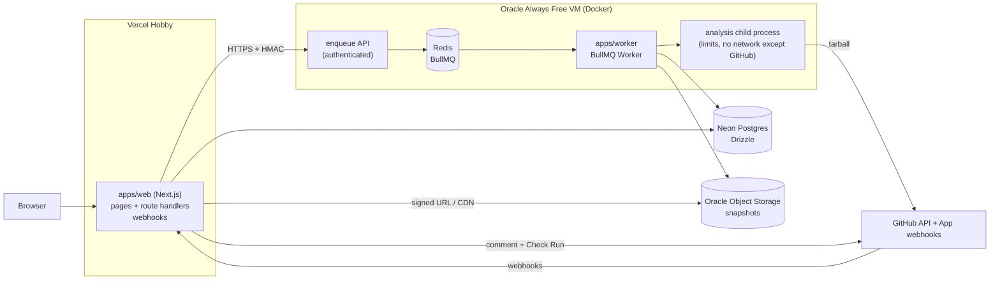

# GitInside technical design

**Git inside your repo.** This document is the technical design for v1. It follows `../gitinside-planning/SPEC.md` (approved 2026-10-25). Decisions are recorded in [DECISIONS.md](DECISIONS.md) (ADR-NNNN). The graph format is in [GRAPH_SCHEMA.md](GRAPH_SCHEMA.md), the UI in [UX.md](UX.md) and [DESIGN_SYSTEM.md](DESIGN_SYSTEM.md), and threats in [SECURITY.md](SECURITY.md).

---

## 1. Problem

Developers joining or reviewing a codebase can't see how it actually fits together: which pages call which API routes, which routes touch which tables, which external services are involved. Diagrams drawn by hand go stale. AI-generated diagrams look plausible but aren't verified, and change between runs. PRs that remove a route or field still used elsewhere slip through review because nothing connects the frontend call to the backend change.

## 2. Goals and non-goals

**Goals (v1)**
1. **Accurate, deterministic diagrams:** derived by static analysis of TS/JS repos. Same commit ⇒ identical graph. Every node and edge links to source.
2. **Readable at any size:** a hierarchical drill-down (System → Services → Modules → Files → Symbols), never a hairball.
3. **Cross-service edges:** frontend `fetch`/axios → backend route → model → datastore / external API, each with an explicit confidence level.
4. **PR diffs that flag broken connections,** posted by a GitHub App.
5. **A premium interactive explorer:** trace mode, Ctrl+K, filters, deep links, export.
6. **Published, reproducible numbers:** precision/recall, backtest results, incremental speedup, render performance.
7. **$0 to run.**

**Non-goals (v1)**
- Languages other than TS/JS; TypeORM, Kubernetes, Terraform; tRPC, GraphQL.
- Any LLM use.
- Runtime tracing, or executing analyzed code in any form.
- Editing or committing to users' repos.
- GitLab and Bitbucket.

## 3. Landscape and differentiation

| Tool | What it does | Gap GitInside fills |
|---|---|---|
| GitDiagram | An LLM reads the file tree + README and outputs a Mermaid diagram | Not verified, no function level, no cross-service edges, not deterministic |
| Eraser (Git Diagrammer, Eraserbot) | An AI reads the files a prompt points to and draws a diagram; the bot comments updated diagrams on PRs | AI-generated structure, no measured accuracy, no drill-down to functions, no trace, no broken-edge detection |
| CodeSee (GitKraken) | Codebase maps and review maps | Not focused on cross-service request paths; discontinued as a standalone product |
| Sourcegraph | Code search and precise code intelligence | Not an architecture diagram; no PR architecture diff |
| Swimm | Docs coupled to code | Documentation, not a generated system view |
| Structurizr | C4 diagrams as code | Hand-authored model, goes stale |

**Our claim:** provably accurate (static analysis, published precision/recall, unresolved shown not guessed), deep (drill to functions, trace a request hop by hop), and useful on PRs (detects broken connections, not just a new picture).

## 4. System architecture



**Components**
- **`apps/web`** (Next.js, App Router, on Vercel):
  - Landing page, the `/<owner>/<repo>[/<sha>]` diagram pages, the progress page, and the signed-in dashboard.
  - Route handlers: `/api/analyze`, `/api/jobs/:id`, `/api/badge/:owner/:repo.svg`, `/api/diagram/:owner/:repo.svg`, GitHub OAuth callback, GitHub App webhooks.
  - Never parses repos.
- **Enqueue API** (small Node HTTP server on the VM, same image as the worker):
  - Accepts `POST /enqueue` and `GET /jobs/:id`, authenticated with an HMAC shared secret, and talks to Redis.
  - Exists because Redis must not be internet-exposed (ADR-0014).
- **`apps/worker`** (BullMQ `Worker`, concurrency 2; `queue.ts`, `job.ts`, ADR-0061):
  - For each job, streams the tarball from GitHub into a fresh job folder, then forks a child process running `packages/analyzer`, with resource limits. The folder is deleted afterwards, and leftovers are swept at startup.
  - Retries only failures that can pass (network, rate limit, shutdown); deterministic ones (`LIMIT_*`, `TAR_*`, `REPO_NOT_FOUND`) fail on the first attempt.
  - Uploads the gzipped snapshot to Oracle Object Storage through its S3-compatible API (`storage.ts`, signed with our own SigV4, keyed per repo, SHA, and analyzer version; ADR-0062, ADR-0095), writes metadata to Postgres, and reports progress through BullMQ.
  - Runs in one process with the enqueue API (`bin.ts` ⇒ `main.ts`, ADR-0065): config from env checked up front, the startup sweep (job folders, then rows left `running`) before any job, and on SIGTERM an ordered shutdown (API, worker, queue, database).
- **`packages/schema`:** TS types + Zod for `architecture.json`. Imported everywhere.
- **`packages/analyzer`:** library + the `gitinside` CLI: `gitinside analyze <path>`, and `gitinside diff <base> <head>` (each side a graph file, a folder, or a git commit checked out into a temporary worktree; ADR-0089).
- **`packages/diff`:** library: `diffGraphs`, `applyDiff`, and `renderMermaidSummary` (the Mermaid summary of a diff). No Node or TypeScript dependency, so browsers can use it.
- **`packages/viewer`:** React components for the explorer (React Flow + ELK). Used by `apps/web` and Storybook.

## 5. Analyzer pipeline

`packages/analyzer` is pure: input is a directory on disk; output is an `ArchitectureGraph` (see GRAPH_SCHEMA). No network, no execution, deterministic.

```
fetch → inventory → parse → resolve → detect → build graph → link cross-service → group → layout hints → serialize
```

1. **Fetch** (worker only, not the analyzer library):
   - Download `GET /repos/{owner}/{repo}/tarball/{sha}` into a temp dir.
   - Stream-extract with path checks (`apps/worker/src/extract.ts`, ADR-0058): absolute paths and `..` fail the job; symlinks, hard links, and special files are skipped and listed.
   - Enforce limits: total size ≤ 500 MB extracted and ≤ 100,000 entries. Files over 2 MB are written, and the analyzer's inventory skips them with a `SKIPPED_LARGE` warning, as on a checkout.
2. **Inventory:**
   - Walk files (sorted, for determinism). Skip `node_modules/`, `.git/`, `dist/`, `build/`, `.next/`, `coverage/`, vendored dirs, and generated files (header markers like `@generated`, or `*.min.js`).
   - Count source files (`.ts .tsx .js .jsx .mjs .cjs .prisma`). Over 20,000 ⇒ fail with `LIMIT_FILES`; over 50 MB together (sizes from the walk) ⇒ fail with `LIMIT_SOURCE_SIZE`, before any parsing (ADR-0137: a repo that size runs out of the worker's 3 GB minutes into parsing).
   - Detect workspaces: root `package.json` `workspaces`, `pnpm-workspace.yaml`, `turbo.json`, `nx.json`, `lerna.json`. Each workspace package with a `package.json` becomes a **service candidate**. A single-package repo is one service.
3. **Parse:** per service, build a `ts.Program` from its `tsconfig.json`, or synthesized options if absent: `allowJs`, `jsx: preserve`, `skipLibCheck`, `noEmit`, `types: []`, and `paths`/`baseUrl` honored.
   - There is no `node_modules` on disk, so external imports resolve to an `external package` placeholder.
   - Each file gets a content hash (SHA-256), which keys the incremental cache (§9).
4. **Resolve:**
   - Use the `TypeChecker` for local symbols: functions, classes, exported consts, methods.
   - Resolve imports across files and across workspace packages: map `@acme/shared` to the workspace package path.
   - Record `imports` and `calls` edges between symbols when the callee resolves to a local declaration.
5. **Detect** (framework detectors, a plugin interface in §6):
   - Routes (Express, Next.js app/pages API).
   - Models (Prisma).
   - Outbound HTTP calls (fetch/axios).
   - Infra (docker-compose, `.env`).
   - External SDKs (an allowlist of known clients, e.g. `stripe`, `@aws-sdk/*`, `resend`, `openai`).
6. **Build graph:** create nodes (system, services, modules = top-level folders under a service's source root, files, symbols, routes, models, datastores, queues, externals) with stable IDs (ADR-0019), a parent chain, and source locations.
7. **Link cross-service:** match outbound HTTP calls to routes (§7). Link routes to the symbols that handle them. Link symbols to models through Prisma client usage (`prisma.order.create` ⇒ `reads`/`writes` model `Order`). Link models to the datastore from `datasource db { provider }` + compose/env.
8. **Group:** derive module labels heuristically (folder name, plus a common suffix like `routes/`, `services/`). No LLM (ADR-0003).
9. **Layout hints:** for each container, an ordering hint (topological by edge direction, ties broken by ID). This keeps ELK input stable so layouts are reproducible.
10. **Serialize:** canonical JSON. Keys sorted, arrays sorted by ID, no timestamps inside the graph (analysis time lives in metadata), `schemaVersion` set. Validated with Zod before writing.

**Determinism rules:**
- No `Date.now()` and no randomness in the graph.
- Every collection is sorted.
- Map iteration is never relied on for output order.
- The test analyzes each fixture twice and compares bytes.

## 6. Detector plugin interface

```ts
interface Detector {
  id: string;                      // "express-routes"
  appliesTo(service: ServiceContext): boolean;
  detect(ctx: DetectorContext): DetectorResult;   // pure, synchronous
}
interface DetectorResult {
  nodes: GraphNode[];              // routes, models, datastores, externals
  edges: GraphEdge[];
  unresolved: UnresolvedRecord[];  // with reason codes, never dropped
}
```

Every detector file starts with a doc comment listing **patterns handled** and **patterns not handled**. Examples:

**Express routes**
- **Handled:**
  - `app.get|post|put|patch|delete|all(path, ...handlers)`.
  - `router.METHOD(...)`.
  - `app.use(prefix, router)` mounting, including nested routers.
  - Imported routers across files.
  - `router.route(path).get(...)`.
- **Not handled** (recorded as unresolved):
  - Dynamically computed paths.
  - Routes registered in loops over runtime data.
  - Decorator frameworks (NestJS, v1.1+).

**Next.js routes** (ADR-0027)
- **Handled:**
  - `app/**/route.ts` exporting `GET|POST|…` ⇒ path from folders, mapping `[id]` ⇒ `:id`, `[...slug]` and `[[...slug]]` ⇒ `*slug`, and stripping `(group)` and `@slot`. Private `_folders` are skipped.
  - `pages/api/**` default exports ⇒ method `ALL` unless `req.method` checks are statically visible.
  - Pages: `app/**/page.tsx` and `pages/**` (minus `_app`, `_document`, `_error`) ⇒ `page` nodes with a `renders` edge to the default export.
  - `src/app` and `src/pages` when there's no root `app/` or `pages/`.
- **Not handled:** `next.config` (`basePath`, `pageExtensions`, rewrites, redirects; v1.1), intercepting routes, layouts and other special files, and middleware.

**Prisma**
- **Handled:**
  - `schema.prisma` (and multi-file schemas) models, views, fields, relations, `datasource.provider` ⇒ a datastore with `stores` edges.
  - Client usage `prisma.<model>.<op>`, where `create|update|upsert|delete*` are writes and `find*|count|aggregate|groupBy` are reads. The client is traced with the checker to `new PrismaClient()` or a `PrismaClient`-typed declaration (`exact`); untraced receivers named like a client (`db`, `tx`, `*prisma*`) are `heuristic`. Calls in inline Express handlers are attributed to the route.
  - Field-level reads from `select`/`include`/`where`/`data`/… object literals, as the edge's `fields`.
- **Not handled:** `$queryRaw` and friends (recorded as unresolved `RAW_QUERY`, model unknown); nested writes; delegates held in variables. Full list in `packages/analyzer/src/prisma.ts` (ADR-0028).

**HTTP clients**
- See §7.

**Queues** (`packages/analyzer/src/queues.ts`, ADR-0037)
- **Handled:** BullMQ `Queue`/`Worker`/`FlowProducer`, Bull, and Bee-Queue, traced like SDK clients (imports, workspace packages, class properties, factories with their parameters bound). `add`/`addBulk`/`upsertJobScheduler`/`createJob` and flow `queueName`s ⇒ `publishes`; `new Worker(name, processor)` and `queue.process(processor)` ⇒ `consumes` from the processor's symbol. Calls of worker factories bind the name per call. Every queue name is one `queue:infra/redis#<name>` node shared by producers and workers in any service.
- **Not handled:** NestJS `@Processor`/`@InjectQueue`, queues kept in maps or subclasses, publishing wrappers (their name parameter is `DYNAMIC_NAME`), sandboxed processor files, `prefix`/connection options, and other brokers' clients (amqplib, kafkajs, SQS). A name computed at runtime is an unresolved `DYNAMIC_NAME` node.

**Infra** (`packages/analyzer/src/infra.ts`, ADR-0036)
- **Handled:**
  - `docker-compose*.yml` / `compose*.yaml` services by image (`postgres`, `mysql`, `mongo`, `redis`, `rabbitmq`, `minio`, `elasticsearch`, etc.) ⇒ `datastore` or `queue` nodes, with override files in the same folder merged.
  - `.env*` URL keys: a Prisma datasource's `url = env("DATABASE_URL")` links its models' `stores` edges to the compose service the URL names (`exact`) or whose published port it uses on localhost (`heuristic`); other URL keys with a datastore scheme (`REDIS_URL=rediss://…`) that nothing else explains become env-only datastores.
  - Values are never stored. Only key names and URL schemes/hosts/ports are read; secrets are discarded at parse time, and hosts are only compared, never written.
- **Not handled:** `*_API_KEY` keys (SDK calls draw those edges), compose `extends`/`include`/`env_file`, images set from variables (warned), literal Prisma URLs, and other ORMs' connection settings.

## 7. Cross-service resolution algorithm

**Goal:** map each outbound HTTP call site in a frontend (or any service) to the route node it hits, with a confidence level.

### 7.1 Collect call sites
Implemented in `packages/analyzer/src/http.ts` (ADR-0030); its file comment lists every handled and unhandled pattern. A value that is set but can't be read statically (a runtime-built config, a method from a variable) is recorded as unknown, never defaulted.
- **`fetch(url, init?)`:** method from `init.method` if it's a string literal or resolvable const, else `GET`.
- **`axios.METHOD(url)`, `axios(config)`, `axios.request(config)`.**
- **Instances:**
  - `const api = axios.create({ baseURL })`, then `api.get(url)`. The instance is followed through imports via the TypeChecker, and `baseURL` is resolved the same way as URLs (§7.2).
  - Wrapper functions (`packages/analyzer/src/wrappers.ts`, ADR-0032): if `function get(path) { return fetch(BASE + path) }`, each call `get('/users')` becomes its own request, inlined one level deep with the wrapper's parameters bound to the caller's arguments (URL, axios `baseURL`, and method, including `{ method: "GET", ...init }`). A request whose URL still starts with the caller's own parameter (the caller is a wrapper too) is unresolved with reason `WRAPPER_DEPTH`. A wrapper with no visible callers keeps its own site, so no call site is dropped.

### 7.2 Normalize URL expressions to a pattern
Implemented in `packages/analyzer/src/url.ts` (ADR-0031); its file comment lists every handled and unhandled expression. A URL that starts with a runtime value is `DYNAMIC_URL`, with a readable detail.

Evaluate the URL expression into a sequence of **literal** and **hole** segments:

| Expression | Normalized |
|---|---|
| `'/api/users'` | `/api/users` |
| `` `/api/users/${id}` `` | `/api/users/{}` |
| `'/api/users/' + id` | `/api/users/{}` |
| `` `${API}/orders` `` where `const API = '/api'` (same or imported module) | `/api/orders` |
| `` `${process.env.NEXT_PUBLIC_API_URL}/orders` `` | `{env:NEXT_PUBLIC_API_URL}/orders` |
| `new URL('/x', base)` | `/x` relative to base |
| `buildUrl()` (unknown function) | unresolved, reason `DYNAMIC_URL` |

**Rules:**
- **Origin:** strip it if it's a literal (`https://api.example.com/...` ⇒ host recorded, path kept).
- **Env-prefixed bases:** treated as "same deployment" when the env var name matches a known pattern (`*_API_URL`, `*_BASE_URL`) and the frontend and backend are in the same repo. This yields **heuristic** confidence.
- **Query strings and fragments:** dropped.
- **Trailing slashes:** normalized away.

### 7.3 Route patterns
Each route node has a method and a path pattern: `/api/users/:id`, `/files/*rest`. Express mounts are composed (`app.use('/api', r)` + `r.get('/users/:id')` ⇒ `/api/users/:id`). Next.js paths come from the file system.

### 7.4 Matching

Implemented in `packages/analyzer/src/match.ts` (ADR-0033); its file comment lists every handled and unhandled pattern. Base, method, and path each give a level and the weakest wins. At the best level, the best path alignment wins, then the request's own method beats `ALL`; ambiguity floors at `heuristic`.

For each call (method M, pattern P), compare with every route (method M', pattern R):

1. **Method must match:** `ALL` matches any method.
2. **Segment-wise match:**
   - A literal matches an identical literal.
   - A hole `{}` matches a param `:x`.
   - A literal matches a param, typed as a "possible" match.
   - Anything matches `*rest`.
3. **Score the match:**
   - **exact:** every call segment is a literal or hole aligned to the same literal or param, with no wildcard. The call's base resolves to the route's service (same host, relative URL within the same app, or a configured base literal).
   - **pattern:** matches, but needs a literal-to-param alignment or a wildcard.
   - **heuristic:** matches only after assuming an env-var base points at this backend.
4. **Ambiguity:** if more than one route matches at the best level, link to all of them with confidence downgraded one level, and record `AMBIGUOUS`.
5. **No match:** an `unresolved` edge to a synthetic `unresolved` node at the call site (the wrapper call when inlined), with a reason (`NO_MATCHING_ROUTE`, `DYNAMIC_URL`, `WRAPPER_DEPTH`) and a `detail` in words (ADR-0034).
   - A literal external host (`api.stripe.com`) instead creates or links an `external` node with an `external_call` edge, at exact confidence. Credentials and default ports are dropped from the host.

**UI:**
- Confidence becomes the border and line style: exact = solid, pattern = solid with a small marker, heuristic = dashed, unresolved = dotted.
- Unresolved calls are always shown, never dropped (fail visibly).

**Complexity:** calls × routes per repo, worst case about 2k × 500. Index routes by method + first literal segment to make it near-linear.

## 8. Graph diff algorithm (`packages/diff`)

**Input:** base graph and head graph (same schema version).

1. **Node identity:** IDs are qualified names (ADR-0019), so most nodes match by ID.
2. **Rename and move detection** (`detectRenames`, ADR-0086): among base nodes missing in head and head nodes new in head, of the same kind, one to one. File text comes from the caller (`contents`); without it, only identical files match.
   - **Files:** identical hash, or content similarity (Jaccard over 4-token shingles, ≥ 0.6, files of 50+ tokens).
   - **Modules:** a folder most of whose files moved into one new folder.
   - **Symbols:** the same name under a renamed file or class with body similarity ≥ 0.8, or a body equal token for token (own name masked, 20+ tokens) that's unique on both sides.
   - **Unresolved nodes:** the same call in the same (or moved) file, paired in source order.
   - Ties are left unmatched, never broken by guessing. Each match is a `renamed` pair, and edges are remapped through it; a node whose parent was renamed is `updated`, not `modified`.
3. **Classify:**
   - **Nodes:** `added`, `removed`, `modified` (same ID, different fingerprint: e.g. a file's hash, a route's method/path, a model's fields; per-kind table in ADR-0085), `updated` (same ID and fingerprint, other facts such as a source line differ), `renamed`. A symbol's only signature fact is its required parameter count (ADR-0088), so body changes show through its file's hash.
   - **Edges:** `added`, `removed`, `modified` (confidence, label, reason, or fields), `updated` (call sites only), `renamed`.
4. **Broken edges:** a head edge E from S to T is **broken** if S exists in head and still references T, but T is removed in head, or T is modified incompatibly. Incompatible means:
   - A route's method or path changed.
   - A function's required parameter count increased.
   - A model field read by S was removed.

   Also check base edges whose target was removed but whose source in head still contains the same call site. Detect this by re-running the resolver on head and finding unresolved calls whose base resolution pointed at the removed target.
   - **How (`detectBroken`, ADR-0087):** head's analyzer already turned such calls into `unresolved` nodes, so the diff re-resolves each one from the (possibly renamed) source against the removed base target: an HTTP call's method and path against the route (the route grammar shared through `@gitinside/schema`), a relative import specifier against the file's path, a Prisma accessor against the model's name. A removed route whose handler now serves a new route is `ROUTE_CHANGED`; otherwise `TARGET_REMOVED`.
   - **Changed but present targets (ADR-0088):** the analyzer records each TypeScript symbol's `requiredParams`, each call site's argument count (`args`), and the names a Prisma call uses that its model lacks (`missingFields` on the site). A surviving `calls` edge is `PARAMETERS_ADDED` when the count rose and a head site passes the old count but not the new one; a surviving `reads`/`writes` edge is `FIELD_REMOVED` when a head site names a field base's model had and head's lacks. Only the offending sites are listed.
   - Calls to removed functions, aliased imports, queue/page/external edges, JavaScript parameters, overloads, and type-only changes aren't detected.
5. **Output:** a `GraphDiff` (GRAPH_SCHEMA.md): head records for added, changed, and renamed items, base IDs for removed ones, broken edges, and summary counts, so the diff alone rebuilds head from base (ADR-0084). Diffs are sorted and deterministic (`stringifyDiff`).
6. **Mermaid summary** (`renderMermaidSummary`, ADR-0089), for `gitinside diff --format mermaid` and the PR comment: a `flowchart LR` of broken connections first (source to base target), then changed services, routes, pages, models, datastores, queues, and external hosts, then changed cross-boundary edges (`http`, `reads`, `writes`, `stores`, `publishes`, `consumes`, `external_call`) lifted to the nearest drawn node and merged per pair. The change is in words ("Removed", "Renamed from …") and in a colored, for removals dashed, border. At most 40 nodes, the rest counted in a note. Two nodes that would read the same name their service (else their declaring file). Labels are cut at 60 characters and every character outside `[A-Za-z0-9 ._,()/:@-]` is written as a `#<code>;` entity (SECURITY.md T10).

**Properties (fast-check):**
- `diff(g, g)` is empty.
- `apply(base, diff(base, head)) == head`.
- `added(diff(a, b)) == removed(diff(b, a))`.
- Broken edges never point to nodes that exist unchanged in head.
- The diff doesn't depend on the order of nodes, edges, sites, or warnings in its inputs.

`packages/diff/src/properties.test.ts` builds base/head pairs from a fixed universe of node slots read off one choice vector, head being base's vector with 5–30% of the choices replaced, so pairs share most IDs and include renames (by hash and by content), changed route methods, and calls that became unresolved. A seeded check that the sampled pairs reach every broken-edge reason keeps the properties from passing vacuously.

**Layout stability:** the viewer lays out head with base positions pinned for nodes that exist in both, and only new nodes are placed (ELK `interactive` layering with fixed positions).

## 9. Incremental analysis

Built in steps M6.7a–f (ADR-0090).
- **Unit of reuse:** a service's facts: what each program stage (symbols, imports, calls, Express, Next.js, Prisma usage, HTTP requests before matching, SDKs, queues) found in that service's files, in serializable form, namespaced by `(schemaVersion, analyzerVersion)`.
- **Validation by observed inputs:** each entry lists every repo path the service's program and detectors read or probed, with its content hash (SHA-256) or "absent", including other services' files reached through workspace imports. An entry is reused only if every input still answers the same, so a changed, added, or deleted file invalidates every service that read or looked for it: its own, its importers' (transitively), and dependents in other services. Direct-importer invalidation alone could let a warm run differ from a cold one, since checker facts follow types through transitive imports and Express mounts compose routes from importer files.
  - Recorded by each service's own compiler host (`packages/analyzer/src/inputs.ts`, ADR-0091): files read (hash), files probed (`present`/`absent`), folders probed, and the service's root-file listing (so an added file counts). Other services' programs a service's analysis reached through the symbol resolver add their inputs transitively. `createInputVerifier` answers the first input that changed.
  - Global inputs are part of the cache key instead: the workspace layout, inventory limits, and TypeScript's bundled libs.
- **Always recomputed:** route matching, wrapper binding, the Prisma schema, infra, file nodes, and assembly; they're cheap compared with parsing. A clean service's program is built only if a dirty service's checker needs it.
- **Storage:** a local disk cache on the worker (`openDiskCache`, `packages/analyzer/src/cache.ts`): gzipped JSON entries named by key hash, atomic renames, LRU by file time, 2 GB cap, failures counted and treated as misses. For PR diffs, base and head share entries for unchanged services.
- **Budgets** (measured in `bench/`):
  - Full analysis of a 5k-file repo ≤ 60 s on the Oracle VM.
  - Incremental re-analysis after a 10-file change ≤ 10 s.

## 10. Data model (Postgres, Drizzle)

| Table | Key columns |
|---|---|
| `repos` | id, provider_repo_id, owner, name, visibility (`public`/`private`), installation_id (nullable), default_branch |
| `analyses` | id, repo_id, sha, status (`queued`/`running`/`done`/`failed`), error_code, stats (jsonb: files, nodes, edges, unresolved), snapshot_key, analyzer_version, started_at, finished_at. Unique (repo_id, sha, analyzer_version). Also the job (ADR-0139): job_id (`analyze-<32 hex>`, indexed), attempts, queued_at (queue position), progress (jsonb, only while `running`) |
| `users` | id, github_user_id, login, created_at |
| `installations` | id, github_installation_id, account_login, created_at |
| `access_cache` | user_id, repo_id, allowed (bool), checked_at. Primary key (user_id, repo_id); TTL 60 s (ADR-0009) |
| `pull_requests` | id, repo_id, number, base_sha, head_sha, diff_key, broken_count, comment_id, check_run_id |
| `rate_limits` | key (ip or user), window_start, count |
| `store_requests` | month_start (UTC), source (`worker`/`web`), count. Primary key (month_start, source); bucket requests against Oracle's 50,000 a month (ADR-0096) |

- **Implementation:** `packages/db` (ADR-0057). IDs are random UUIDs; GitHub IDs are `bigint`; every table has `created_at`, and `repos`/`pull_requests` also `updated_at`. The database itself enforces SHAs (40 lowercase hex), the status ⇔ columns rule for `analyses` (`done` has a snapshot, `failed` an error code, both a finish time), non-negative counts, owner/name unique ignoring case, and cascading deletes from repos and users. Migrations are committed SQL under `packages/db/drizzle/`, applied with `pnpm --filter @gitinside/db migrate`.
- **Writes** (ADR-0063, `packages/db/src/analyses.ts`): the worker upserts the repo from GitHub's own facts (ID, current name, visibility, default branch) and marks the analysis `running` at the start of each attempt, `queued` after an attempt that will be retried, `failed` after the last one, and `done` only after the snapshot is in the bucket. A `done` row is never changed again. At startup the worker fails rows left `running` by a dead process (`JOB_INTERRUPTED`). Each start stores the job ID and counts the attempt, and while it runs the worker writes each progress update to the row (`recordJobProgress`, `packages/db/src/jobs.ts`); `findJob` reads a job by ID with its queue position (ADR-0139).
- **Snapshot retention** (fits Oracle Object Storage's Always Free 20 GB, ADR-0095; R2's 10 GB until PROPOSALS P-2): keep the latest 5 SHAs per public repo plus any SHA referenced by a PR from the last 30 days. Evict the oldest first, globally, when usage passes 16 GB.
  - **Implementation** (ADR-0077, `apps/worker/src/retention.ts`): a pure `planRetention` over the `done` rows, the bucket's own listing (what the free tier counts), and the pinned commits. Per public repo, each kept commit keeps only the analysis its permalink serves (older analyzer versions are `superseded`). Past 16 × 10⁹ bytes the oldest unpinned snapshots go, private ones included. Objects no row names are deleted after an hour. A run deletes rows before their objects, so a failure leaves an orphan for the next run, never a row without its graph. Between the two it removes each deleted row's completed BullMQ job (ADR-0082): the job ID comes from the commit, so a kept job would answer "done" for an analysis that no longer exists, and the commit couldn't be analyzed again for a day.
  - **Schedule and quota check** (ADR-0078, `apps/worker/src/maintenance.ts`): the worker runs retention a minute after startup and then an hour after each run ends, prunes `rate_limits` windows that ended over an hour ago, and measures the bucket (a fresh listing), the database (`pg_database_size`), and the month's bucket requests (`store_requests`, counted by the worker and the web app through `countingFetch`, ADR-0096) against Object Storage's 20 GB and 50,000 requests a month and Neon's 1 GB. At 80% it logs `quota_alarm`; `pnpm --filter @gitinside/worker quota` prints the same check and exits 2 on an alarm.
- **Private data:** stored under the installation prefix and deleted on uninstall.

## 11. API

| Method + path | Purpose |
|---|---|
| `POST /api/analyze` `{ url }` | Resolve the repo and latest SHA. Return the existing analysis (`200 { status: "done", owner, repo, sha }`), or enqueue (`202 { status: "queued", jobId, … }`). Only new analyses are rate-limited (5/h per IP signed out, 30/h signed in); a commit in flight gets its job back free. Errors: `{ error, message }` (`INVALID_URL`, `REPO_NOT_FOUND` incl. private, `REPO_EMPTY`, `RATE_LIMITED` with `retryAt`, `UNAVAILABLE`, …). `apps/web/lib/analyze.ts`, ADR-0066 |
| `GET /api/jobs/:id` | The job as the progress page shows it: `{ state: "queued", text: "2 ahead of you", position? }`, `{ state: "running", step, progress, text: "Parsing 1,204 files" }`, `{ state: "done" }`, `{ state: "failed", errorCode, message, retry }`, `missing` (404, also a private repo's job until M8), `unavailable` (503). Read from the job's `analyses` row (`findJob`, ADR-0139), never from the worker: the progress is checked with the worker's `parseRecordedProgress`, and the time left is what the worker wrote minus the row's age, both on the database's clock (ADR-0140). SSE variant at `/api/jobs/:id/events`: `event: status` on each change (one row read a second), ends after 25 s or a final state, and `EventSource` reconnects. Page: `/<owner>/<repo>/jobs/<jobId>`. `apps/web/lib/jobs.ts` + `jobRoute.ts`, ADR-0067 |
| `GET /api/graph/:owner/:repo/:sha` | Snapshot: the newest finished analysis of that commit, streamed from the snapshot bucket as JSON (public: `public, max-age=300, s-maxage=86400`, cached by Vercel's CDN; private (M8): access check, then `no-store`). Bad names or a short SHA ⇒ 404 before any lookup; another spelling of the repo ⇒ `308` to the stored one before any bucket read (cached 1 h, ADR-0097); storage down ⇒ 503. `apps/web/lib/graphRoute.ts`, ADR-0068 |
| Page `/<owner>/<repo>[/<sha>]` | Check-on-view (`lib/repoView.ts`, ADR-0068): the newest finished analysis; without a SHA, GitHub's latest commit (remembered 60 s) is compared and a new one enqueued, charged to the repo (`repo:<id>`, 6/h), not the visitor. A repo GitHub no longer shows publicly is a 404. Not analyzed ⇒ an Analyze button; ready ⇒ a repo bar (commit, latest-commit status) and the graph fetched from `/api/graph` and schema-checked in the browser (`app/[owner]/[repo]/`, ADR-0069) |
| `GET /api/diff/:owner/:repo/:base...:head` | Diff for the viewer |
| `GET /api/badge/:owner/:repo.svg` | README badge, "GitInside \| 3 services · 2 datastores" (`badgeMessage`). Check-on-view through `viewRepo` (a new commit is enqueued, charged to the repo) while the newest finished diagram is shown, its graph fetched from our own day-cached `/api/graph` URL, never the bucket (ADR-0097). Cached 10 min (`public, max-age=600, s-maxage=600`). No diagram (never analyzed, private, gone, impossible name) ⇒ the same link-only badge, "view architecture"; a failure on our side ⇒ that badge for 1 min, never a 5xx. Served with its own CSP (`default-src 'none'; style-src 'unsafe-inline'; sandbox`). `apps/web/lib/imageRoute.ts`, ADR-0072 |
| `GET /api/diagram/:owner/:repo.svg[?theme=dark\|light]` | Live README image: the top level as SVG (`renderDiagram`; `auto` follows the reader's system, `<picture>` asks for one theme). Same check-on-view, caching, link-only fallback, and CSP as the badge. ADR-0072 |
| `POST /api/github/webhook` | `pull_request`, `push`, `installation`, `installation_repositories` (HMAC-verified) |
| `GET /api/auth/github/callback` | OAuth (identity only) |

**Worker enqueue API (VM, HMAC; `apps/worker/src/api.ts`, ADR-0060):**
- `POST /enqueue` `{ kind: 'analyze' | 'diff', owner, repo, sha, baseSha?, installationId? }` → `202 { id, created }`. The ID is derived from the commit and analyzer version, so a repeat is `created: false`.
- `GET /jobs/:id` → `{ id, kind, state, stage?, progress?, step?, count?, position?, errorCode? }` (the website no longer asks it, ADR-0139; it goes with BullMQ in M5.17c). While `stage` is `analyze`, `step` is the analyzer stage running and `count` its size when known (source files for `programs`, requests for `http`); `describeProgress` in `@gitinside/worker/progress` turns them into the progress page's words ("Parsing 1,204 files", ADR-0064).
- `GET /health` (unauthenticated) → `{ status: 'ok' | 'unavailable' }`
- Signed with `X-GitInside-Timestamp` + `X-GitInside-Signature: v1=<hex>` (`@gitinside/worker/hmac`).

## 12. Failure modes and limits

| Situation | Behavior |
|---|---|
| Dynamic routes, DI, reflection, routes built in loops | Not guessed. Recorded as unresolved with a reason, and visible in the UI |
| Over 20k files / 50 MB of source / 5 min / 500 MB | Fails with `LIMIT_*`; the UI suggests a subfolder (`?path=apps/web`) |
| Missing or invalid tsconfig | Synthesized defaults (§5.3); warning in stats |
| Syntax errors in a file | The file is parsed with errors; the TS AST is still traversed; warning recorded |
| Monorepo with circular workspace deps | Services are still created; cycle warning |
| Worker crash mid-job | BullMQ stalled-job recovery re-queues it (`maxStalledCount: 2`; then `JOB_STALLED`). A stall doesn't use up one of the 3 attempts, so a job that both fails retriably and stalls can start up to 5 times (M5 review). A worker shutdown cancels running jobs, which run again after the restart |
| Transient failure (GitHub down, rate limit, storage) | Retried with exponential backoff, 3 attempts; re-adding the job after that runs it again (ADR-0061) |
| Oracle VM reclaimed | Rebuild from the provisioning script; queued jobs are lost (Redis); web shows "temporarily unavailable" and allows retry |
| GitHub API rate limit | Back off; use the installation token for private repos and the app-level token for public ones |
| Free-tier quota close to the limit | Retention eviction (§10); a `needs-abhinav` issue at 80% |

## 13. Observability

- **Logs:** structured JSON logs from the worker, one event per line on stdout (`createJsonLog`, ADR-0065), rotated on disk by Docker's log driver. Codes, IDs, counts, and timings only; never a secret or connection string.
- **Per-analysis timing** for each pipeline stage, stored in `analyses.stats` (feeds benchmarks).
- **Health endpoint** on the enqueue API.
- No third-party telemetry ($0, privacy).
