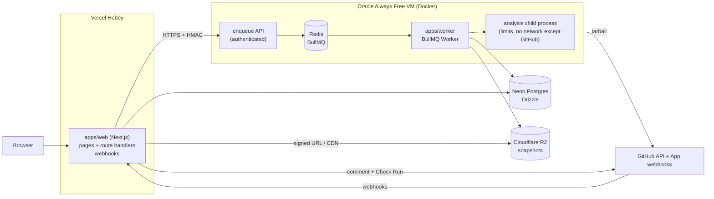

# GitInside technical design

**Git inside your repo.** This document is the technical design for v1. It follows `../gitinside-planning/SPEC.md` (approved 2026-10-25). Decisions are recorded in [DECISIONS.md](DECISIONS.md) (ADR-NNNN). The graph format is in [GRAPH_SCHEMA.md](GRAPH_SCHEMA.md), the UI in [UX.md](UX.md) and [DESIGN_SYSTEM.md](DESIGN_SYSTEM.md), and threats in [SECURITY.md](SECURITY.md).

---

## 1. Problem

Developers joining or reviewing a codebase can't see how it actually fits together: which pages call which API routes, which routes touch which tables, which external services are involved. Diagrams drawn by hand go stale. AI-generated diagrams look plausible but aren't verified, and change between runs. PRs that remove a route or field still used elsewhere slip through review because nothing connects the frontend call to the backend change.

## 2. Goals and non-goals

**Goals (v1)**
1. **Accurate, deterministic diagrams:** derived by static analysis of TS/JS repos. Same commit ⇒ identical graph. Every node and edge links to source.
2. **Readable at any size:** a hierarchical drill-down (System → Services → Modules → Files → Symbols), never a hairball.
3. **Cross-service edges:** frontend `fetch`/axios → backend route → model → datastore / external API, each with an explicit confidence level.
4. **PR diffs that flag broken connections,** posted by a GitHub App.
5. **A premium interactive explorer:** trace mode, Ctrl+K, filters, deep links, export.
6. **Published, reproducible numbers:** precision/recall, backtest results, incremental speedup, render performance.
7. **$0 to run.**

**Non-goals (v1)**
- Languages other than TS/JS; TypeORM, Kubernetes, Terraform; tRPC, GraphQL.
- Any LLM use.
- Runtime tracing, or executing analyzed code in any form.
- Editing or committing to users' repos.
- GitLab and Bitbucket.

## 3. Landscape and differentiation

| Tool | What it does | Gap GitInside fills |
|---|---|---|
| GitDiagram | An LLM reads the file tree + README and outputs a Mermaid diagram | Not verified, no function level, no cross-service edges, not deterministic |
| Eraser (Git Diagrammer, Eraserbot) | An AI reads the files a prompt points to and draws a diagram; the bot comments updated diagrams on PRs | AI-generated structure, no measured accuracy, no drill-down to functions, no trace, no broken-edge detection |
| CodeSee (GitKraken) | Codebase maps and review maps | Not focused on cross-service request paths; discontinued as a standalone product |
| Sourcegraph | Code search and precise code intelligence | Not an architecture diagram; no PR architecture diff |
| Swimm | Docs coupled to code | Documentation, not a generated system view |
| Structurizr | C4 diagrams as code | Hand-authored model, goes stale |

**Our claim:** provably accurate (static analysis, published precision/recall, unresolved shown not guessed), deep (drill to functions, trace a request hop by hop), and useful on PRs (detects broken connections, not just a new picture).

## 4. System architecture



**Components**
- **`apps/web`** (Next.js, App Router, on Vercel):
  - Landing page, the `/<owner>/<repo>[/<sha>]` diagram pages, the progress page, and the signed-in dashboard.
  - Route handlers: `/api/analyze`, `/api/jobs/:id`, `/api/badge/:owner/:repo.svg`, GitHub OAuth callback, GitHub App webhooks.
  - Never parses repos.
- **Enqueue API** (small Node HTTP server on the VM, same image as the worker):
  - Accepts `POST /enqueue` and `GET /jobs/:id`, authenticated with an HMAC shared secret, and talks to Redis.
  - Exists because Redis must not be internet-exposed (ADR-0014).
- **`apps/worker`** (BullMQ `Worker`, concurrency 2):
  - For each job, forks a child process running `packages/analyzer`, with resource limits.
  - Uploads the snapshot to R2, writes metadata to Postgres, and reports progress through BullMQ.
- **`packages/schema`:** TS types + Zod for `architecture.json`. Imported everywhere.
- **`packages/analyzer`:** library + CLI (`gitinside analyze <path>`).
- **`packages/diff`:** library + CLI (`gitinside diff <base> <head>`).
- **`packages/viewer`:** React components for the explorer (React Flow + ELK). Used by `apps/web` and Storybook.

## 5. Analyzer pipeline

`packages/analyzer` is pure: input is a directory on disk; output is an `ArchitectureGraph` (see GRAPH_SCHEMA). No network, no execution, deterministic.

```
fetch → inventory → parse → resolve → detect → build graph → link cross-service → group → layout hints → serialize
```

1. **Fetch** (worker only, not the analyzer library):
   - Download `GET /repos/{owner}/{repo}/tarball/{sha}` into a temp dir.
   - Stream-extract with path checks: reject absolute paths, `..`, symlinks, and hard links.
   - Enforce limits: total size ≤ 500 MB extracted, any file > 2 MB skipped and recorded as skipped.
2. **Inventory:**
   - Walk files (sorted, for determinism). Skip `node_modules/`, `.git/`, `dist/`, `build/`, `.next/`, `coverage/`, vendored dirs, and generated files (header markers like `@generated`, or `*.min.js`).
   - Count source files (`.ts .tsx .js .jsx .mjs .cjs .prisma`). Over 20,000 ⇒ fail with `LIMIT_FILES`.
   - Detect workspaces: root `package.json` `workspaces`, `pnpm-workspace.yaml`, `turbo.json`, `nx.json`, `lerna.json`. Each workspace package with a `package.json` becomes a **service candidate**. A single-package repo is one service.
3. **Parse:** per service, build a `ts.Program` from its `tsconfig.json`, or synthesized options if absent: `allowJs`, `jsx: preserve`, `skipLibCheck`, `noEmit`, `types: []`, and `paths`/`baseUrl` honored.
   - There is no `node_modules` on disk, so external imports resolve to an `external package` placeholder.
   - Each file gets a content hash (SHA-256), which keys the incremental cache (§9).
4. **Resolve:**
   - Use the `TypeChecker` for local symbols: functions, classes, exported consts, methods.
   - Resolve imports across files and across workspace packages: map `@acme/shared` to the workspace package path.
   - Record `imports` and `calls` edges between symbols when the callee resolves to a local declaration.
5. **Detect** (framework detectors, a plugin interface in §6):
   - Routes (Express, Next.js app/pages API).
   - Models (Prisma).
   - Outbound HTTP calls (fetch/axios).
   - Infra (docker-compose, `.env`).
   - External SDKs (an allowlist of known clients, e.g. `stripe`, `@aws-sdk/*`, `resend`, `openai`).
6. **Build graph:** create nodes (system, services, modules = top-level folders under a service's source root, files, symbols, routes, models, datastores, queues, externals) with stable IDs (ADR-0019), a parent chain, and source locations.
7. **Link cross-service:** match outbound HTTP calls to routes (§7). Link routes to the symbols that handle them. Link symbols to models through Prisma client usage (`prisma.order.create` ⇒ `reads`/`writes` model `Order`). Link models to the datastore from `datasource db { provider }` + compose/env.
8. **Group:** derive module labels heuristically (folder name, plus a common suffix like `routes/`, `services/`). No LLM (ADR-0003).
9. **Layout hints:** for each container, an ordering hint (topological by edge direction, ties broken by ID). This keeps ELK input stable so layouts are reproducible.
10. **Serialize:** canonical JSON. Keys sorted, arrays sorted by ID, no timestamps inside the graph (analysis time lives in metadata), `schemaVersion` set. Validated with Zod before writing.

**Determinism rules:**
- No `Date.now()` and no randomness in the graph.
- Every collection is sorted.
- Map iteration is never relied on for output order.
- The test analyzes each fixture twice and compares bytes.

## 6. Detector plugin interface

```ts
interface Detector {
  id: string;                      // "express-routes"
  appliesTo(service: ServiceContext): boolean;
  detect(ctx: DetectorContext): DetectorResult;   // pure, synchronous
}
interface DetectorResult {
  nodes: GraphNode[];              // routes, models, datastores, externals
  edges: GraphEdge[];
  unresolved: UnresolvedRecord[];  // with reason codes, never dropped
}
```

Every detector file starts with a doc comment listing **patterns handled** and **patterns not handled**. Examples:

**Express routes**
- **Handled:**
  - `app.get|post|put|patch|delete|all(path, ...handlers)`.
  - `router.METHOD(...)`.
  - `app.use(prefix, router)` mounting, including nested routers.
  - Imported routers across files.
  - `router.route(path).get(...)`.
- **Not handled** (recorded as unresolved):
  - Dynamically computed paths.
  - Routes registered in loops over runtime data.
  - Decorator frameworks (NestJS, v1.1+).

**Next.js routes** (ADR-0027)
- **Handled:**
  - `app/**/route.ts` exporting `GET|POST|…` ⇒ path from folders, mapping `[id]` ⇒ `:id`, `[...slug]` and `[[...slug]]` ⇒ `*slug`, and stripping `(group)` and `@slot`. Private `_folders` are skipped.
  - `pages/api/**` default exports ⇒ method `ALL` unless `req.method` checks are statically visible.
  - Pages: `app/**/page.tsx` and `pages/**` (minus `_app`, `_document`, `_error`) ⇒ `page` nodes with a `renders` edge to the default export.
  - `src/app` and `src/pages` when there's no root `app/` or `pages/`.
- **Not handled:** `next.config` (`basePath`, `pageExtensions`, rewrites, redirects; v1.1), intercepting routes, layouts and other special files, and middleware.

**Prisma**
- **Handled:**
  - `schema.prisma` models, fields, relations, `datasource.provider`.
  - Client usage `prisma.<model>.<op>`, where `create|update|upsert|delete*` are writes and `find*|count|aggregate|groupBy` are reads.
  - Field-level reads from `select`/`include`/`where` object literals.
- **Not handled:** `$queryRaw` (recorded as unresolved, model unknown).

**HTTP clients**
- See §7.

**Infra**
- **Handled:**
  - `docker-compose*.yml` services by image (`postgres`, `mysql`, `mongo`, `redis`, `rabbitmq`, `minio`, `elasticsearch`, etc.).
  - `.env*` keys (`DATABASE_URL` scheme, `REDIS_URL`, `*_API_KEY` mapped to known externals).
  - Values are never stored. Only key names and URL schemes/hosts are read; secrets are discarded at parse time.

## 7. Cross-service resolution algorithm

**Goal:** map each outbound HTTP call site in a frontend (or any service) to the route node it hits, with a confidence level.

### 7.1 Collect call sites
- **`fetch(url, init?)`:** method from `init.method` if it's a string literal or resolvable const, else `GET`.
- **`axios.METHOD(url)`, `axios(config)`, `axios.request(config)`.**
- **Instances:**
  - `const api = axios.create({ baseURL })`, then `api.get(url)`. The instance is followed through imports via the TypeChecker, and `baseURL` is resolved the same way as URLs (§7.2).
  - Wrapper functions: if `function get(path) { return fetch(BASE + path) }`, call sites `get('/users')` are inlined one level deep when the wrapper's URL expression is `concat(const, param)`. Deeper wrappers are unresolved with reason `WRAPPER_DEPTH`.

### 7.2 Normalize URL expressions to a pattern
Evaluate the URL expression into a sequence of **literal** and **hole** segments:

| Expression | Normalized |
|---|---|
| `'/api/users'` | `/api/users` |
| `` `/api/users/${id}` `` | `/api/users/{}` |
| `'/api/users/' + id` | `/api/users/{}` |
| `` `${API}/orders` `` where `const API = '/api'` (same or imported module) | `/api/orders` |
| `` `${process.env.NEXT_PUBLIC_API_URL}/orders` `` | `{env:NEXT_PUBLIC_API_URL}/orders` |
| `new URL('/x', base)` | `/x` relative to base |
| `buildUrl()` (unknown function) | unresolved, reason `DYNAMIC_URL` |

**Rules:**
- **Origin:** strip it if it's a literal (`https://api.example.com/...` ⇒ host recorded, path kept).
- **Env-prefixed bases:** treated as "same deployment" when the env var name matches a known pattern (`*_API_URL`, `*_BASE_URL`) and the frontend and backend are in the same repo. This yields **heuristic** confidence.
- **Query strings and fragments:** dropped.
- **Trailing slashes:** normalized away.

### 7.3 Route patterns
Each route node has a method and a path pattern: `/api/users/:id`, `/files/*rest`. Express mounts are composed (`app.use('/api', r)` + `r.get('/users/:id')` ⇒ `/api/users/:id`). Next.js paths come from the file system.

### 7.4 Matching

For each call (method M, pattern P), compare with every route (method M', pattern R):

1. **Method must match:** `ALL` matches any method.
2. **Segment-wise match:**
   - A literal matches an identical literal.
   - A hole `{}` matches a param `:x`.
   - A literal matches a param, typed as a "possible" match.
   - Anything matches `*rest`.
3. **Score the match:**
   - **exact:** every call segment is a literal or hole aligned to the same literal or param, with no wildcard. The call's base resolves to the route's service (same host, relative URL within the same app, or a configured base literal).
   - **pattern:** matches, but needs a literal-to-param alignment or a wildcard.
   - **heuristic:** matches only after assuming an env-var base points at this backend.
4. **Ambiguity:** if more than one route matches at the best level, link to all of them with confidence downgraded one level, and record `AMBIGUOUS`.
5. **No match:** an `unresolved` edge to a synthetic `unresolved` node at the call site, with a reason: `NO_MATCHING_ROUTE`, `DYNAMIC_URL`, `EXTERNAL_HOST`, `WRAPPER_DEPTH`.
   - A literal external host (`api.stripe.com`) instead creates or links an `external` node, at exact confidence.

**UI:**
- Confidence becomes the border and line style: exact = solid, pattern = solid with a small marker, heuristic = dashed, unresolved = dotted.
- Unresolved calls are always shown, never dropped (fail visibly).

**Complexity:** calls × routes per repo, worst case about 2k × 500. Index routes by method + first literal segment to make it near-linear.

## 8. Graph diff algorithm (`packages/diff`)

**Input:** base graph and head graph (same schema version).

1. **Node identity:** IDs are qualified names (ADR-0019), so most nodes match by ID.
2. **Rename and move detection:** among base nodes missing in head and head nodes new in head, of the same kind:
   - **Files:** content-similarity score (shingled token Jaccard, ≥ 0.6).
   - **Symbols:** body-hash equality, or a similarity ≥ 0.8 plus the same name in a moved file.
   - Each match is a `renamed` pair, and edges are remapped through it.
3. **Classify:**
   - **Nodes:** `added`, `removed`, `modified` (same ID, different fingerprint: signature, route method/path, or model fields), `renamed`.
   - **Edges:** `added`, `removed`, unchanged.
4. **Broken edges:** a head edge E from S to T is **broken** if S exists in head and still references T, but T is removed in head, or T is modified incompatibly. Incompatible means:
   - A route's method or path changed.
   - A function's required parameter count increased.
   - A model field read by S was removed.

   Also check base edges whose target was removed but whose source in head still contains the same call site. Detect this by re-running the resolver on head and finding unresolved calls whose base resolution pointed at the removed target.
5. **Output:** a `GraphDiff` with lists of ID references plus summary counts. Diffs are sorted and deterministic.

**Properties (fast-check):**
- `diff(g, g)` is empty.
- `apply(base, diff(base, head)) == head`.
- `added(diff(a, b)) == removed(diff(b, a))`.
- Broken edges never point to nodes that exist unchanged in head.

**Layout stability:** the viewer lays out head with base positions pinned for nodes that exist in both, and only new nodes are placed (ELK `interactive` layering with fixed positions).

## 9. Incremental analysis

- **Cache key:** per-file `(schemaVersion, analyzerVersion, path, contentHash)` ⇒ cached per-file facts: symbols, imports, call sites, route and model declarations.
- **Invalidation:** a changed file invalidates itself and its direct importers' resolution facts (import edges and resolved calls). Cross-service linking is always recomputed; it's cheap compared with parsing.
- **Storage:** a local disk cache on the worker (LRU, 2 GB cap). For PR diffs, base and head share entries for unchanged files.
- **Budgets** (measured in `bench/`):
  - Full analysis of a 5k-file repo ≤ 60 s on the Oracle VM.
  - Incremental re-analysis after a 10-file change ≤ 10 s.

## 10. Data model (Postgres, Drizzle)

| Table | Key columns |
|---|---|
| `repos` | id, provider_repo_id, owner, name, visibility (`public`/`private`), installation_id (nullable), default_branch |
| `analyses` | id, repo_id, sha, status (`queued`/`running`/`done`/`failed`), error_code, stats (jsonb: files, nodes, edges, unresolved), snapshot_key, analyzer_version, started_at, finished_at. Unique (repo_id, sha, analyzer_version) |
| `users` | id, github_user_id, login, created_at |
| `installations` | id, github_installation_id, account_login, created_at |
| `access_cache` | user_id, repo_id, allowed (bool), checked_at. Primary key (user_id, repo_id); TTL 60 s (ADR-0009) |
| `pull_requests` | id, repo_id, number, base_sha, head_sha, diff_key, broken_count, comment_id, check_run_id |
| `rate_limits` | key (ip or user), window_start, count |

- **Snapshot retention** (fits R2's 10 GB): keep the latest 5 SHAs per public repo plus any SHA referenced by a PR from the last 30 days. Evict the oldest first, globally, when usage passes 8 GB.
- **Private data:** stored under the installation prefix and deleted on uninstall.

## 11. API

| Method + path | Purpose |
|---|---|
| `POST /api/analyze` `{ url }` | Resolve the repo and latest SHA. Return the existing analysis, or enqueue. Rate-limited (5/h per IP signed out, 30/h signed in). |
| `GET /api/jobs/:id` | Status, stage, progress, queue position (SSE variant at `/api/jobs/:id/events`) |
| `GET /api/graph/:owner/:repo/:sha` | Snapshot (public: redirect to CDN; private: access check, then a stream) |
| `GET /api/diff/:owner/:repo/:base...:head` | Diff for the viewer |
| `GET /api/badge/:owner/:repo.svg` | Badge (live image for public repos: top-level SVG, cached 10 min; check-on-view triggers re-analysis) |
| `POST /api/github/webhook` | `pull_request`, `push`, `installation`, `installation_repositories` (HMAC-verified) |
| `GET /api/auth/github/callback` | OAuth (identity only) |

**Worker enqueue API (VM, HMAC):**
- `POST /enqueue` `{ kind: 'analyze' | 'diff', owner, repo, sha, baseSha?, installationId? }`
- `GET /jobs/:id`

## 12. Failure modes and limits

| Situation | Behavior |
|---|---|
| Dynamic routes, DI, reflection, routes built in loops | Not guessed. Recorded as unresolved with a reason, and visible in the UI |
| Over 20k files / 5 min / 500 MB | Fails with `LIMIT_*`; the UI suggests a subfolder (`?path=apps/web`) |
| Missing or invalid tsconfig | Synthesized defaults (§5.3); warning in stats |
| Syntax errors in a file | The file is parsed with errors; the TS AST is still traversed; warning recorded |
| Monorepo with circular workspace deps | Services are still created; cycle warning |
| Worker crash mid-job | BullMQ stalled-job recovery re-queues it (max 3 attempts) |
| Oracle VM reclaimed | Rebuild from the provisioning script; queued jobs are lost (Redis); web shows "temporarily unavailable" and allows retry |
| GitHub API rate limit | Back off; use the installation token for private repos and the app-level token for public ones |
| Free-tier quota close to the limit | Retention eviction (§10); a `needs-abhinav` issue at 80% |

## 13. Observability

- **Logs:** structured JSON logs from the worker, rotated on disk.
- **Per-analysis timing** for each pipeline stage, stored in `analyses.stats` (feeds benchmarks).
- **Health endpoint** on the enqueue API.
- No third-party telemetry ($0, privacy).
