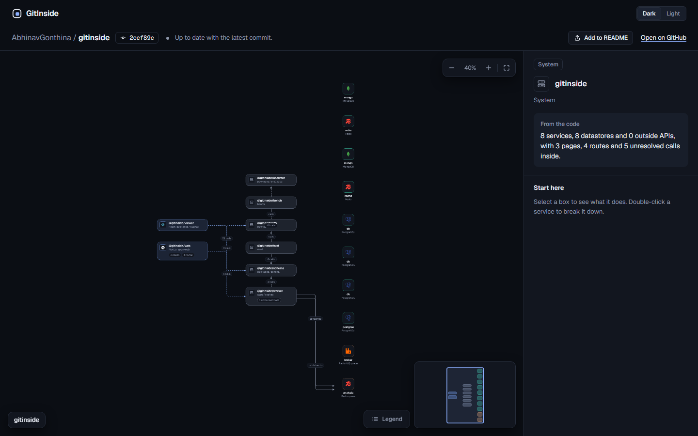
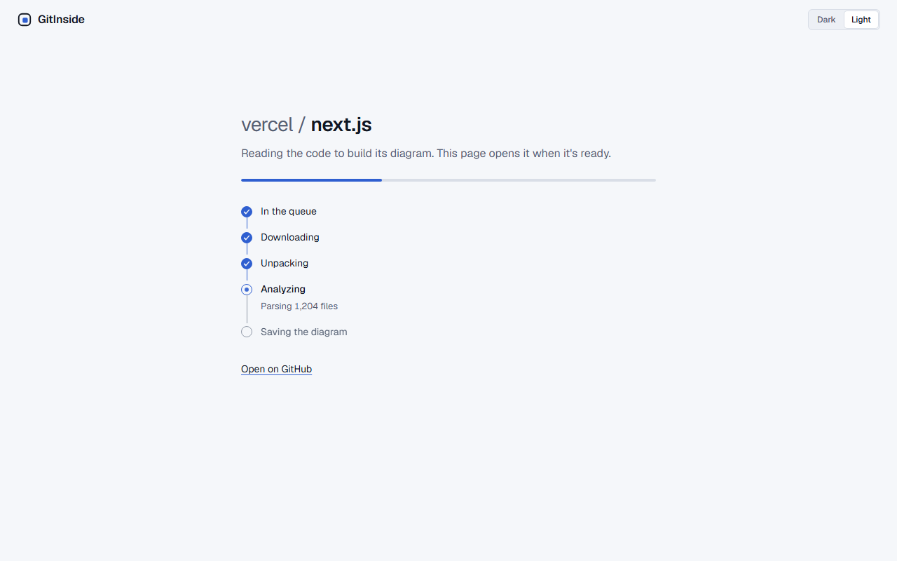
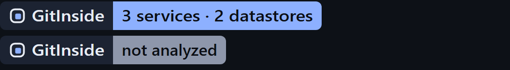
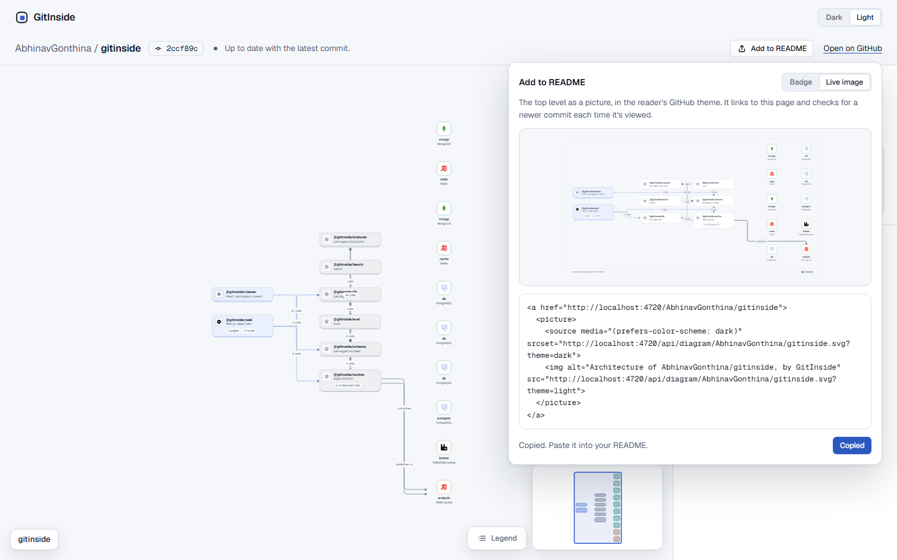

# M5 review: Website (public) + live badge

**Tag:** `m5` (not yet: waits for M5.14b) · **Range:** `m4a..HEAD` (M5.1–M5.12b, M5.14a) · **Date:** 2026-10-29

> **Status: pre-deploy.** Everything that can be verified without production accounts is verified here (M5.14a). The deploy (M5.13) waits on Abhinav's signups (planning #3–#7), so the production half of the acceptance criteria and the `m5` tag come with M5.14b. Sections that need production are marked **Pending M5.14b**.

## What was built

The whole path from "paste a public repo URL" to "see the diagram", plus README images, minus the production accounts it will run on.

| Piece | Where | What it does |
|---|---|---|
| Website | `apps/web` (Next.js 16 App Router) | Landing page with the URL form, progress page (SSE), diagram page `/<owner>/<repo>[/<sha>]` with every state, "Add to README", dark/light by cookie, nonce CSP |
| Web API | `apps/web/lib/*Route.ts` | `POST /api/analyze` (latest SHA, cache, dedupe, 5/h per IP), `GET /api/jobs/:id[/events]`, `GET /api/graph/…` (streamed from R2), badge and diagram SVGs with check-on-view |
| README images | `packages/viewer/src/image/` | `@gitinside/viewer/image`: `renderBadge` and `renderDiagram` as standalone, escaped, deterministic SVG |
| Database | `packages/db` | Drizzle schema (7 tables) with integrity in the database, committed SQL migrations, PGlite locally and Postgres on CI |
| Worker | `apps/worker` | Our own streaming tar extractor, a sandboxed analysis child (permission model, empty env, network guard, heap cap, 5 min SIGKILL), HMAC enqueue API, BullMQ worker, R2 store with our own SigV4, Postgres records, progress events, hourly retention + quota check |
| Infra | `infra/oracle/` | Hardened image (non-root, read-only root, no capabilities), compose with internal-only Redis, DNS-allowlisting egress gateway, Caddy TLS, idempotent `provision.sh`, CI container check |
| Security suite | `apps/worker/src/security.test.ts`, `fixtures/malicious/` | Each malicious repo through the whole job pipeline at the production limits |

Decisions are ADR-0055 to ADR-0079.

## Results (exactly as measured)

- **Tests (local, after the review fixes):** 1,997 passed: analyzer 595, viewer 471, worker 448 (+14 that need Redis/Postgres and run on CI only), web 316, eval 77, db 67, schema 15, bench 8. Before the fixes: 1,986 (worker 447, web 307, db 66). Typecheck and lint clean.
- **Coverage (lines, local, before the fixes):** web 98.77%, worker 92.63% (the Redis-only paths are measured on CI), db 95.95%, viewer 99.51%, schema 98.85%, eval 99.48%, bench 100%. Targets: analyzer and diff ≥ 85%, others ≥ 70%.
  - **Analyzer coverage couldn't be measured locally.** Its "exponentially shared mounts" test passed in 5.5 s under plain `test` but timed out at 30 s under `coverage` all three times, even with the machine otherwise idle; M5.8c saw the same on clean `main`. Its number comes from CI (below). The analyzer didn't change in M5.14a.
- **CI on the fixes (`aa2ec6d`):** green; analyzer coverage 97.57% lines (see "CI" below).
- **Eval:** unchanged since M5.8c (report `eval/results/2026-10-29-0.1.0.md`: TP 28, FP 1, FN 110). M5.14a didn't touch the analyzer, schema, eval, or lockfile, so no re-record.
- **Pending M5.14b:** paste URL → progress → diagram in production; the second request served from cache; the rate limit enforced; the badge rendering in a real GitHub README; production timings and quota readings.

## Key decisions and trade-offs

- **The worker parses tarballs itself** (ADR-0058). Every byte written goes through our checks (paths, link types, sizes, entry counts), instead of trusting a tar library's defaults with hostile input.
- **Three sandboxes deep for the analysis child** (ADR-0059, ADR-0074, ADR-0075): Node's permission model with an empty env and a network guard, then a no-capability, read-only container, then an egress gateway that resolves only GitHub, R2, and Neon. Each layer assumes the one inside it failed.
- **Our own SigV4** (ADR-0062) instead of the AWS SDK: about 150 lines checked against AWS's published examples, versus a large dependency tree in the process that holds the bucket keys.
- **Check-on-view charged to the repo, not the visitor** (ADR-0068). A README image is viewed by many people, so a new commit is analyzed at most 6 times an hour per repo, whoever opens it.
- **Always an image** (ADR-0072). README routes never return a 5xx or a 404 for a repo; everything without a diagram gets the same link-only badge, so the image never confirms a private repo exists.
- **Retention measured from the bucket's own listing** (ADR-0077), rows deleted before objects, so a crash leaves an orphan for the next run, never a page with no graph.
- **M5.14 split** (ADR-0079): the production checks wait for the deploy instead of being skipped or faked.

## Hardest problem: a TypeScript crash that only happened on the full checkout

M5.8b's smoke run of `gitinside analyze .` on this repo died inside TypeScript (`Cannot read properties of undefined (reading 'id')`). Every eval and bench checkout analyzed fine on its own, and copies of the folder didn't reproduce it.

The trigger turned out to be a gitignored Storybook build (`storybook-static/assets/Icon-*.js`, which bundles zod). TypeScript 5.6 threw while printing a getter-only property type for an error message. Instead of minimizing a compiler crash, M5.8c made the analyzer contain it (ADR-0070): a guarded checker turns a throw into "unknown symbol" plus one `TYPESCRIPT_INTERNAL_ERROR` warning, and a detector that throws becomes an empty part plus `DETECTOR_FAILED`. Limits still fail the analysis. `storybook-static` is now ignored, and a `checker-crash` fixture plus fault-injection tests keep it that way. This matters more for the website than for the CLI: one odd file in a stranger's repo must cost a warning, not the whole analysis. (The M5 review found that `getTypeAtLocation` isn't guarded yet; that's in M5.14c.)

## What's still weak

- **Nothing has run in production.** The VM, Neon, R2, Vercel, and DNS are all waiting on signups (#3–#7). `provision.sh` has only run on CI's containers.
- **Some review findings are deferred to M5.14e–f** (before the deploy): the egress gateway mounts every secret when it needs only host names; Redis has no password and is reachable from the analysis child's namespace if netguard fails; retention can leave a completed BullMQ job behind its deleted row. (`getTypeAtLocation` was guarded in M5.14c; the stale head cache and "Analyze again" for permanent failures were fixed in M5.14d.)
- **`ANALYZER_VERSION` is still `0.1.0`** although M5 changed the output; it's bumped right before the first deploy (M5.13).
- **A repo that goes private is hidden only once someone opens its repo page or README image.** Permalinks never ask GitHub, and a CDN copy of a graph can live a day (ADR-0079).
- **Case variants of a path** (`/Acme/shop` vs. `/acme/shop`) are separate CDN keys that each reach the database.
- **The diagram page is the M4a prototype** until M4b (blocked on the design gate, #2): fixed column layout, small text on big repos, and overlapping labels in the README image for large graphs.
- **Neon's quota limit is SPEC's assumption** (1 GB) until #4 reports the real figure.

## Fresh-eyes review

Two subagents with no prior context reviewed `m4a..HEAD`: one the web side (apps/web, the viewer's image entry), one the worker, db, infra, and analyzer changes. They checked against SPEC.md, DESIGN.md, SECURITY.md, TESTING.md, UX.md, DESIGN_SYSTEM.md, and the M5 ADRs, and verified each finding against the code. Together: 1 high, 4 medium, 10 low.

| # | Severity | Finding | Outcome |
|---|---|---|---|
| 1 | High | A repo that went private still served its graph through permalinks and `/api/graph`: `viewRepo` answered 404 but recorded nothing (SECURITY.md T6). | Fixed in `980dd9e`: `hideRepo` on `REPO_NOT_FOUND`/`REPO_UNAVAILABLE`; `/api/analyze` restores it from GitHub's facts. Tests in db, `repoView`, `analyze`. |
| 2 | Medium | The CSP matcher excluded every path starting with `api`, so `/api-platform/core` had no CSP. | Fixed in `9742485` (`api/` only), tested with `api-*` owners. |
| 3 | Medium | Made-up query strings missed the CDN cache on graph/badge/diagram, each costing a DB lookup and an R2 read. | Fixed in `9742485`: `308` to the canonical URL before any lookup. Case variants remain (noted above). |
| 4 | Medium | A skipped tar entry kept its whole path (up to 1 MiB), and 50 of them go into Redis with the job result. | Fixed in `aa2ec6d`: cut to 512 characters. |
| 5 | Medium | Shutdown awaited a maintenance pass before cancelling jobs, so jobs could outlive the 20 s deadline. | Fixed in `aa2ec6d`: jobs cancelled first. |
| 6 | Low | A failed row write after the job was created answered 500 with the slot spent. | Fixed in `980dd9e`: logged, still `202`. |
| 7 | Low | DESIGN.md said a job starts at most 3 times; stalls and attempts add up to 5. | Fixed in `aa2ec6d` (docs). |
| 8 | Low | Stale head cache can show an older commit as current right after a job. | Fixed in M5.14d: the cache is keyed by the shown analysis (ADR-0081). |
| 9 | Low | "Analyze again" offered for permanent failures. | Fixed in M5.14d: the reason instead of the button (ADR-0081). |
| 10 | Low | The egress gateway mounts the whole `worker.env`. | Deferred to M5.14f (infra, verified on CI's container check). |
| 11 | Low | Redis has no password and the child's namespace can reach it. | Deferred to M5.14f. |
| 12 | Low | Retention can delete a row whose completed BullMQ job is kept a day, so `created: false` loops. | Deferred to M5.14e (Redis tests, CI only). |
| 13 | Low | `getTypeAtLocation` isn't guarded like `getSymbolAtLocation`. | Fixed in M5.14c (ADR-0080): answers `any` with a `TYPESCRIPT_INTERNAL_ERROR` warning instead of failing the `http` stage. |
| 14 | Low | `ANALYZER_VERSION` not bumped although M5 changed the output. | Added to M5.13, right before the first deploy. |
| 15 | Low (M8) | Job IDs ignore the installation. | Added to M8.3, the first time a job carries one. |

The reviewers also confirmed these were fine: SVG escaping and the image CSP; the HMAC client, the strict `/api/analyze` body, SSE cleanup, errors logged by name only; tar paths, link types, limits, checksums, and exclusive creates; constant-time HMAC over the raw body; SigV4 canonicalization; the child's empty env and permission roots; GitHub redirects with the token kept to the API host; retention's delete order; status constraints matching the migration; every timer cleared or unref'd.

**After the fixes:** 1,997 local tests green, typecheck and lint clean. Two existing tests changed on purpose: `repoView`'s "stops serving" test (a hidden repo now stays hidden until an analysis request) and the security suite's over-long-path case (now expects the cut path).

## CI

Run [40939747567](https://github.com/AbhinavGonthina/gitinside/actions/runs/40939747567) for `aa2ec6d` (the three fix commits): all four jobs green (`check`, `visual`, `worker-image`, `web-e2e`).

| Package | Tests | Lines | Branches |
|---|---:|---:|---:|
| analyzer | 595 | 97.57% | 90.59% |
| worker (incl. the 14 Redis/Postgres tests) | 462 | 96.00% | 94.54% |
| viewer | 471 | 99.51% | 93.40% |
| web | 316 | 98.79% | 97.45% |
| eval | 77 | 99.48% | 96.04% |
| db | 67 | 98.80% | 93.93% |
| schema | 15 | 98.85% | 91.48% |
| bench | 8 | 100% | 89.28% |

All above target (analyzer ≥ 85%, others ≥ 70%).

## Smoke test

**CLI on a real public repo,** as a user would run it: `node packages/analyzer/dist/cli.js analyze eval/.repos/krishnaacharyaa__wanderlust --owner krishnaacharyaa --name wanderlust --sha 2d83720… --out packages/analyzer/dist/smoke.json`. Exit 0, a 296,707-byte graph that passes `parseGraph`, with one warning (`TSCONFIG_MISSING`).

- **Nodes (443):** 1 system, 1 service, 35 modules, 109 files, 156 symbols, 23 routes, 2 datastores, 116 unresolved (111 `UNKNOWN_SYMBOL`, 3 `NO_MATCHING_ROUTE`, 2 `DYNAMIC_URL`).
- **Edges (276):** 195 imports, 40 calls, 36 handles, 5 `http` (all to unresolved nodes).
- Same node and edge counts as M3's eval recorded for wanderlust (443 / 276).

**Whole-job pipeline without production:** the security suite runs real jobs end to end (fake GitHub → tarball → our extractor → the sandboxed child → stored graph) for 18 cases, all green; the Redis + Postgres round trip (`main.test.ts`) runs on CI.

**Website: Pending M5.14b** (needs the deploy).

## Interview questions

**1. A stranger's repo can contain anything. Walk through what stops it from hurting you.**
It's never executed or installed: we download GitHub's tarball and parse it. Our own extractor refuses absolute or `..` paths, skips every link and device, and caps bytes (on the decompressed stream, so gzip bombs stop early), entries, and path lengths. The analyzer runs in a child process with Node's permission model (read only the code and the repo, write only the graph file), an empty environment, a heap cap, a 5-minute SIGKILL, and a network guard. That child runs in a read-only container with no capabilities, and the container's only route out is a gateway that resolves just GitHub, R2, and Neon. The security suite proves each layer with sentinels and canaries at the real limits. *Follow-up:* "Which layer is weakest?" Netguard is in-process JavaScript; the review found the shared namespace can still reach Redis without a password, so M5.14c adds `requirepass`.

**2. Why write your own SigV4 signer instead of using the AWS SDK?**
The worker process holds the bucket keys and parses hostile input, so every dependency there is attack surface and supply-chain risk. We need one signed request shape for four operations (PUT, GET, LIST, DELETE). That's about 150 lines, verified byte for byte against the three worked examples in AWS's docs, plus a fake S3 that checks signatures and body hashes in tests. The trade-off is owning the edge cases: the fake S3 caught that S3 error codes contain digits (`XAmzContentSHA256Mismatch`).

**3. A repo goes private after it was analyzed. What happens now, and what still leaks?**
The next time someone opens its repo page or README image, GitHub answers 404 for it, and `viewRepo` calls `hideRepo`, which flips the row to private. Every public route reads through `findPublishedAnalysis`, which filters on public, so permalinks, graphs, and images all stop at once. It comes back only when an analysis request sees GitHub say it's public again. What still leaks: permalinks never ask GitHub (to protect the 60-an-hour quota), so a permalink-only audience isn't checked, and a CDN copy of a graph can live up to a day. The fresh-eyes review found that the first version didn't record the change at all.

**4. How do you keep a free R2 bucket under 10 GB without a transaction across Postgres and R2?**
A pure planner decides from the database rows and the bucket's own listing (what R2 bills): keep the 5 newest commits per public repo and anything a recent PR names, and drop the oldest past 8 GB. The runner deletes rows before objects. With no transaction spanning both stores, you choose the order whose failure is harmless: a crash after the row delete leaves an orphan object, which the next run deletes after an hour's grace, never a row pointing at a missing graph. A row whose object is missing is only reported, so a listing bug can't wipe the database.

**5. Why is the analysis's job ID derived from the commit instead of random?**
Dedupe and replay safety in one step. The same commit (and analyzer version) is always the same BullMQ job, so a second visitor's request gets the job already in flight, and a replayed signed request is a no-op. It also lets the web app refund a rate-limit slot when the job already existed. The review found the cost: a permanent failure or a completed job is kept a day under that ID, so the ID must also carry its scope (installation, M8.3), and retention must remove the completed job when it deletes the row (M5.14c).

Quiz yourself: open Claude Code and say 'quiz me on M5'.
