# M5 review: Website (public) + live badge

**Tag:** `m5` (not yet: after the second review's fixes, M5.14b3b–g, the re-check M5.14b3h tags it) · **Range:** `m4a..m5`, M5 commits only (M5.1–M5.18, M5.13a–b, M5.14a–f, M5.14b1–b3); M5A, M5B, M5C, and M6 commits are interleaved and reviewed in their own milestones · **Dates:** pre-deploy review 2026-10-29 (M5.14a), deployed 2026-11-04 (M5.13), production checks and the second review 2026-11-05 (M5.14b1–b3)

> **Status: acceptance met, review fixes pending.** All five acceptance criteria were met in production (see "Acceptance criteria" below). The sections up to "Fresh-eyes review" were first written before the deploy (M5.14a) and are now updated for what shipped: between that review and the deploy, the worker moved from an Oracle VM with BullMQ and Redis to Google Cloud Run with Cloud Tasks (ADR-0111, ADR-0114), and snapshots moved from R2 to Oracle Object Storage (ADR-0095). That later work had its own fresh-eyes review ("Second fresh-eyes review": 1 high, 4 medium, 9 low), whose fixes are planned as M5.14b3b–g; M5.14b3h re-runs the checks, fills in the outcomes, and tags `m5`. One follow-up stays open without holding the tag: M5.14b4 compares `compute_usage` with Google's settled billing report once it has caught up (planning #22).

## What was built

The whole path from "paste a public repo URL" to "see the diagram", plus README images, running in production at `gitinside.abhinavgonthina.dev`.

| Piece | Where | What it does |
|---|---|---|
| Website | `apps/web` (Next.js 16 App Router, Vercel Hobby) | Landing page with the URL form, progress page (SSE, found facts, time left, job link), diagram page `/<owner>/<repo>[/<sha>]` with every state, "Add to README", dark/light by cookie, nonce CSP |
| Web API | `apps/web/lib/*Route.ts` | `POST /api/analyze` (latest SHA, cache, dedupe, abuse limits below), `GET /api/jobs/:id[/events]` read from the job's row, `GET /api/graph/…` (gzipped, CDN-cached a day), badge and diagram SVGs with check-on-view, renamed repos followed to their new name |
| Queue | Cloud Tasks (`apps/web/lib/cloudTasks.ts`, `googleAuth.ts`) | A task per queue entry with the HMAC-signed job as body, created keylessly (Vercel OIDC ⇒ Workload Identity Federation), 2 dispatches at once, 3 attempts |
| Abuse limits | `apps/web/lib/analyze.ts`, `sizeHold.ts`, `codeSize.ts`, `botCheck.ts` (SECURITY.md T9) | 5/h per address, one new analysis per repo per 30 min, "too big" remembered 7 days, a size check from GitHub's language count before any download, a monthly compute pause at 80% of Google's free allowance, Turnstile only when traffic looks automated |
| README images | `packages/viewer/src/image/` | `@gitinside/viewer/image`: `renderBadge` and `renderDiagram` as standalone, escaped, deterministic SVG |
| Database | `packages/db` (Neon free) | Drizzle schema with integrity in the database, committed SQL migrations applied by the worker at startup under an advisory lock; the `analyses` row is the job (ID, attempts, queue entry, progress); request and compute meters |
| Worker | `apps/worker` (Cloud Run, 1 vCPU / 4 GiB, max 2 instances) | `POST /run` (Cloud Run IAM + HMAC, one job per request under a 280 s budget), our own streaming tar extractor, a sandboxed analysis child (permission model, empty env, network guard, heap cap, kill time from the deadline), our own SigV4 store on Oracle Object Storage, maintenance at the end of a job (retention, quota check, stale rows) |
| Infra | `infra/gcp/` | Service, queue, and IAM as reviewed JSON tested against the code, a billing kill switch (1 USD budget ⇒ Pub/Sub ⇒ unlink billing), keyless deploy from CI, `verify.mjs` reading the live project back (119 checks), CI's container check of the image as Cloud Run runs it |
| Security suite | `apps/worker/src/security.test.ts`, `fixtures/malicious/` | Each malicious repo through the whole job pipeline at the production limits |

Decisions are ADR-0055 to ADR-0079 (pre-deploy), then ADR-0095–0097, ADR-0111, ADR-0114, ADR-0135–0157, ADR-0169–0171, ADR-0188, ADR-0192, and ADR-0197–0199.

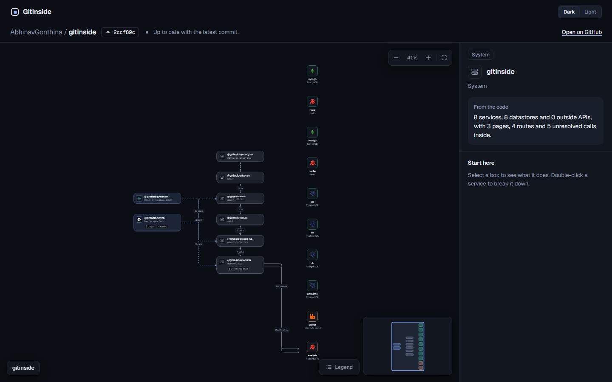
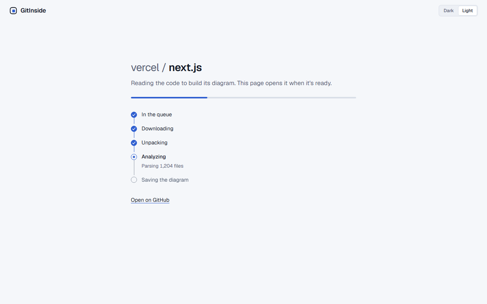

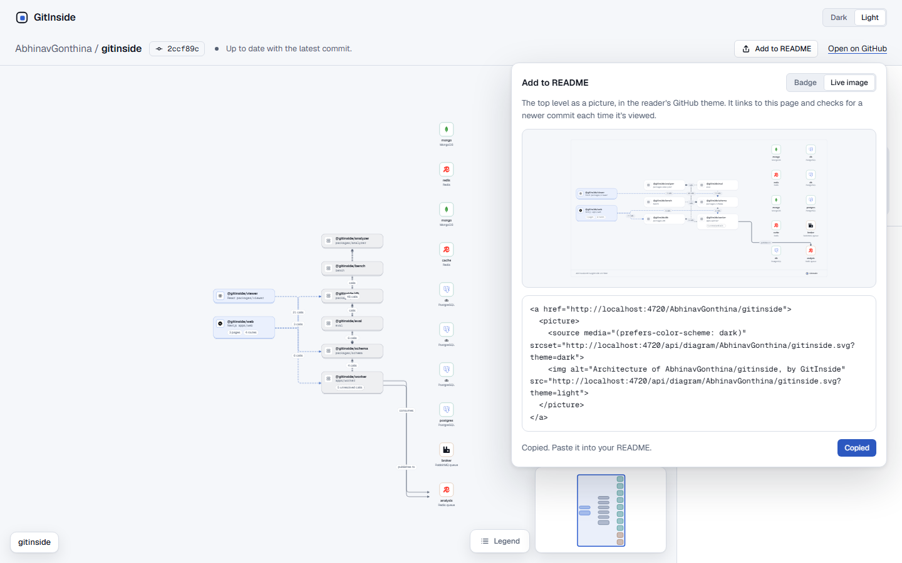

## Results (exactly as measured)

- **Tests (local, after the review fixes):** 1,997 passed: analyzer 595, viewer 471, worker 448 (+14 that need Redis/Postgres and run on CI only), web 316, eval 77, db 67, schema 15, bench 8. Before the fixes: 1,986 (worker 447, web 307, db 66). Typecheck and lint clean.
- **Coverage (lines, local, before the fixes):** web 98.77%, worker 92.63% (the Redis-only paths are measured on CI), db 95.95%, viewer 99.51%, schema 98.85%, eval 99.48%, bench 100%. Targets: analyzer and diff ≥ 85%, others ≥ 70%.
  - **Analyzer coverage couldn't be measured locally.** Its "exponentially shared mounts" test passed in 5.5 s under plain `test` but timed out at 30 s under `coverage` all three times, even with the machine otherwise idle; M5.8c saw the same on clean `main`. Its number comes from CI (below). The analyzer didn't change in M5.14a.
- **CI on the fixes (`aa2ec6d`):** green; analyzer coverage 97.57% lines (see "CI" below).
- **Eval:** unchanged since M5.8c (report `eval/results/2026-10-29-0.1.0.md`: TP 28, FP 1, FN 110). M5.14a didn't touch the analyzer, schema, eval, or lockfile, so no re-record.
- The numbers above are the pre-deploy check's (M5.14a, `aa2ec6d`). M5.14b3h adds the counts at the tag.

### Acceptance criteria

| Criterion (ROADMAP M5) | Result | Evidence |
|---|---|---|
| Paste URL → progress → diagram works in production | Met | M5.13: taxonomy, documenso, and cal.diy pasted, real stages shown, diagrams drawn under the production CSP in both themes ("Smoke test") |
| Second request served from cache | Met | M5.13: the same URL again answered `200 done` in 95–388 ms with no new job; graph URLs are CDN `HIT`s, big ones too since M5.13a1 |
| Rate limit enforced | Met | M5.14b1: the per-repo `429 REPO_RATE_LIMITED` and Turnstile's `403 CHALLENGE_REQUIRED` / `CHALLENGE_FAILED` in production. The 5-an-hour `429` can't be reached from a script past the bot check, so it rests on `analyze.test.ts` and the route tests |
| Security tests green | Met | The security suite (18 malicious-repo cases) in every CI run, including the one at the tag |
| Badge renders in a GitHub README | Met | M5.14b1: this repo's README, through GitHub's image proxy, in both of GitHub's themes |

Also measured, not criteria: every free-tier meter under 1% after the first 8 production analyses (M5.14b2), and DESIGN.md's 5k files in ≤ 60 s **not met** on Cloud Run's vCPU (cal.diy 81.6 s of analysis, M5.13a2–a5 and #20).

## Key decisions and trade-offs

- **The worker parses tarballs itself** (ADR-0058). Every byte written goes through our checks (paths, link types, sizes, entry counts), instead of trusting a tar library's defaults with hostile input.
- **Three sandboxes deep for the analysis child** (ADR-0059, ADR-0074, ADR-0075): Node's permission model with an empty env and a network guard, then a no-capability, read-only container, then an egress gateway that resolves only GitHub, R2, and Neon. Each layer assumes the one inside it failed. **On Cloud Run** (ADR-0152) the platform applies no capability drops and has no egress gateway at $0, so the child's own guards (permission model, empty env, `netguard.ts`) are the network boundary, the image itself is non-root with nothing writable outside `/tmp` (ADR-0150), and the worker is reachable only through Cloud Run IAM plus the HMAC.
- **Cloud Run and Cloud Tasks instead of an Oracle VM** (ADR-0111, ADR-0114): scale to zero inside Google's free tier, no always-on Redis; the `analyses` row in Neon is the job (ADR-0139), and Cloud Tasks gives the concurrency, retries, and dedupe the queue used to. The price is one deadline for the whole job (Cloud Run's request timeout, ADR-0143) and `/tmp` in memory (ADR-0146).
- **Spending can't go above zero by accident** (ADR-0156, ADR-0169): new analyses pause at 80% of the free compute, and a 1 USD budget alert unlinks billing from the project.
- **Our own SigV4** (ADR-0062) instead of the AWS SDK: about 150 lines checked against AWS's published examples, versus a large dependency tree in the process that holds the bucket keys.
- **Check-on-view charged to the repo, not the visitor** (ADR-0068). A README image is viewed by many people, so a new commit is analyzed at most 6 times an hour per repo, whoever opens it.
- **Always an image** (ADR-0072). README routes never return a 5xx or a 404 for a repo; everything without a diagram gets the same link-only badge, so the image never confirms a private repo exists.
- **Retention measured from the bucket's own listing** (ADR-0077), rows deleted before objects, so a crash leaves an orphan for the next run, never a page with no graph.
- **M5.14 split** (ADR-0079): the production checks wait for the deploy instead of being skipped or faked.

## Hardest problem: a TypeScript crash that only happened on the full checkout

M5.8b's smoke run of `gitinside analyze .` on this repo died inside TypeScript (`Cannot read properties of undefined (reading 'id')`). Every eval and bench checkout analyzed fine on its own, and copies of the folder didn't reproduce it.

The trigger turned out to be a gitignored Storybook build (`storybook-static/assets/Icon-*.js`, which bundles zod). TypeScript 5.6 threw while printing a getter-only property type for an error message. Instead of minimizing a compiler crash, M5.8c made the analyzer contain it (ADR-0070): a guarded checker turns a throw into "unknown symbol" plus one `TYPESCRIPT_INTERNAL_ERROR` warning, and a detector that throws becomes an empty part plus `DETECTOR_FAILED`. Limits still fail the analysis. `storybook-static` is now ignored, and a `checker-crash` fixture plus fault-injection tests keep it that way. This matters more for the website than for the CLI: one odd file in a stranger's repo must cost a warning, not the whole analysis. (The M5 review found that `getTypeAtLocation` isn't guarded yet; that's in M5.14c.)

## What's still weak

*Updated at the tag (2026-11-05). The pre-deploy list's items that are now resolved: the deploy itself (M5.13); the deferred review findings (M5.14c–f, two of them on the VM stack that M5.17 then removed); `ANALYZER_VERSION` (0.2.0, `38a3b11`); case variants of a graph path (redirected to the stored spelling, M5.12d2); the M4a prototype diagram page (replaced by M4b's explorer).*

- **5k files in ≤ 60 s isn't met in production.** cal.diy took 92.7 s from queued to done, 81.6 s of it analysis, every stage 1.6–2.0× slower than on CI's 1-vCPU runner (#20). On CI the analysis alone now meets the budget (33.7–58.5 s median over four CPU models, with 1.5 s to spare on the slowest), after sharing parsed files (ADR-0197) and a 32 MiB semi-space (ADR-0198). Production's rows predate both, so the next production run of cal.diy measures them there (DESIGN.md Budgets). The caps weren't raised.
- **The compute meter isn't confirmed against Google's bill yet,** and the kill switch's own Cloud Run time probably isn't counted (ADR-0156's 2026-11-05 amendment). Our count was above everything Google had reported, the safe side. M5.14b4 settles it on #22.
- **On Cloud Run the analysis child's in-process guards are the only network boundary** (ADR-0152). The VM's no-capability container and DNS-allowlisting gateway have no free equivalent there. The child's probes pin the guard (M5.17f), but a Node permission-model escape would reach the network as the worker.
- **A repo that goes private is hidden only once someone opens its repo page or README image.** Permalinks never ask GitHub, and a CDN copy of a graph can live a day (ADR-0079).
- **The 5-an-hour per-address `429` is proven by tests only;** production checks stop at the bot check, as they should.
- **Every push to a repo with a badge is analyzed the next time someone views the README** (check-on-view, at most 6 an hour per repo). Fine at today's traffic; the compute pause bounds the month.
- **Neon's quota limit is SPEC's figure** (1 GB, `QUOTA_LIMITS`); production uses 0.85% of it.
- **The second review's findings** (R1–R14 below) are open until M5.14b3b–g; R1 (duplicate tasks after a retry) is the one that can cost compute.

## Fresh-eyes review

Two subagents with no prior context reviewed `m4a..HEAD`: one the web side (apps/web, the viewer's image entry), one the worker, db, infra, and analyzer changes. They checked against SPEC.md, DESIGN.md, SECURITY.md, TESTING.md, UX.md, DESIGN_SYSTEM.md, and the M5 ADRs, and verified each finding against the code. Together: 1 high, 4 medium, 10 low.

| # | Severity | Finding | Outcome |
|---|---|---|---|
| 1 | High | A repo that went private still served its graph through permalinks and `/api/graph`: `viewRepo` answered 404 but recorded nothing (SECURITY.md T6). | Fixed in `980dd9e`: `hideRepo` on `REPO_NOT_FOUND`/`REPO_UNAVAILABLE`; `/api/analyze` restores it from GitHub's facts. Tests in db, `repoView`, `analyze`. |
| 2 | Medium | The CSP matcher excluded every path starting with `api`, so `/api-platform/core` had no CSP. | Fixed in `9742485` (`api/` only), tested with `api-*` owners. |
| 3 | Medium | Made-up query strings missed the CDN cache on graph/badge/diagram, each costing a DB lookup and an R2 read. | Fixed in `9742485`: `308` to the canonical URL before any lookup. Case variants remain (noted above). |
| 4 | Medium | A skipped tar entry kept its whole path (up to 1 MiB), and 50 of them go into Redis with the job result. | Fixed in `aa2ec6d`: cut to 512 characters. |
| 5 | Medium | Shutdown awaited a maintenance pass before cancelling jobs, so jobs could outlive the 20 s deadline. | Fixed in `aa2ec6d`: jobs cancelled first. |
| 6 | Low | A failed row write after the job was created answered 500 with the slot spent. | Fixed in `980dd9e`: logged, still `202`. |
| 7 | Low | DESIGN.md said a job starts at most 3 times; stalls and attempts add up to 5. | Fixed in `aa2ec6d` (docs). |
| 8 | Low | Stale head cache can show an older commit as current right after a job. | Fixed in M5.14d: the cache is keyed by the shown analysis (ADR-0081). |
| 9 | Low | "Analyze again" offered for permanent failures. | Fixed in M5.14d: the reason instead of the button (ADR-0081). |
| 10 | Low | The egress gateway mounts the whole `worker.env`. | Fixed in M5.14f (ADR-0083): `egress-hosts.sh` writes host names to `egress.hosts`, the only file the gateway mounts; checked on CI's container check. |
| 11 | Low | Redis has no password and the child's namespace can reach it. | Fixed in M5.14f (ADR-0083): `requirepass` from a generated root-only `redis.env`, given to Redis and the worker only; CI checks `NOAUTH` from the worker's namespace. |
| 12 | Low | Retention can delete a row whose completed BullMQ job is kept a day, so `created: false` loops. | Fixed in M5.14e (ADR-0082): retention removes the deleted rows' completed jobs; Redis tests on CI. |
| 13 | Low | `getTypeAtLocation` isn't guarded like `getSymbolAtLocation`. | Fixed in M5.14c (ADR-0080): answers `any` with a `TYPESCRIPT_INTERNAL_ERROR` warning instead of failing the `http` stage. |
| 14 | Low | `ANALYZER_VERSION` not bumped although M5 changed the output. | Added to M5.13, right before the first deploy. |
| 15 | Low (M8) | Job IDs ignore the installation. | Added to M8.3, the first time a job carries one. |

The reviewers also confirmed these were fine: SVG escaping and the image CSP; the HMAC client, the strict `/api/analyze` body, SSE cleanup, errors logged by name only; tar paths, link types, limits, checksums, and exclusive creates; constant-time HMAC over the raw body; SigV4 canonicalization; the child's empty env and permission roots; GitHub redirects with the token kept to the API host; retention's delete order; status constraints matching the migration; every timer cleared or unref'd.

**After the fixes:** 1,997 local tests green, typecheck and lint clean. Two existing tests changed on purpose: `repoView`'s "stops serving" test (a hidden repo now stays hidden until an analysis request) and the security suite's over-long-path case (now expects the cut path).

## Second fresh-eyes review (M5.14b3a, 2026-11-05)

The first review stopped at `aa2ec6d`. Everything M5 built after it (the move to Cloud Run and Cloud Tasks, the abuse limits, the kill switch and deploy, the progress page additions, and the fixes from the production smoke test) got its own review at `2c0fa50`. Two subagents with no prior context read the M5 commits only: one the server side (worker, db, infra, CI deploy, bench), one the web and viewer side. They checked against DESIGN.md, SECURITY.md, TESTING.md, UX.md, DESIGN_SYSTEM.md, `infra/gcp/README.md`, and the ADRs, verified each finding against the code at HEAD, and edited nothing. Together: 1 high, 4 medium, 9 low. I checked R1 against the code myself before planning it (`enqueueAnalysis` creates a task for any `queued` row, named from its current `queued_at`).

| # | Severity | Finding | Outcome |
|---|---|---|---|
| R1 | High | A retried attempt moves the row back to `queued` with a new `queued_at` (`requeueAnalysis`), so a request or a repo view during Cloud Tasks' backoff creates a second task under a new name beside the pending retry. An in-flight row skips the size hold, the compute pause, the bot check, and the rate limit, so a repo that keeps failing retriably can be multiplied by polling, and two attempts can run at once and overwrite each other's row. | Fixed in M5.14b3b: `queueAnalysis` says a `queued` row with attempts is `retrying`, and `enqueueAnalysis` creates no task (and counts no operation) for it. ADR-0141's amendment. |
| R2 | Medium | Only the landing form handles `CHALLENGE_REQUIRED`. The repo page's Analyze buttons and the progress page's "Try again" ignore it, so a busy hour shows "Analyze continues once it does" with no widget and nothing continuing. | Fixed in M5.14b3c: one hook (`apps/web/app/useStartAnalysis.tsx`) holds the request and the bot check for every Analyze button, the landing form included; the reason is a status beside the button and the widget runs under it. Tests red first on all three buttons; screenshots in `M5/bot-check/` (`not-analyzed-*`, `diagram-*`, `job-*`). |
| R3 | Medium | CI's deploy diffs against the previous push (`github.event.before`), not against what's deployed, so a worker change whose run failed or was cancelled in the concurrency group is never shipped by the next docs push, silently (a lesson already records one case). | Planned: M5.14b3d |
| R4 | Medium | When a slow download eats the job's 280 s budget, the analysis's cut timeout ends as the permanent `LIMIT_TIME`, which isn't retried and starts the 7-day "too big" hold: a network problem reads as "too big". | Planned: M5.14b3e |
| R5 | Medium | CLAUDE.md's hosting line still named the Oracle VM with Redis/BullMQ, and DESIGN.md said logs are rotated by Docker's log driver. | Fixed here (docs). DESIGN.md's R2 mention is now marked as history. |
| R6 | Low | The bot check reads both counts (`peekRateLimit`) and counts later, so a parallel burst can all read under the threshold and skip Turnstile. The hourly limit, the per-repo claim, and the pause still bound it. | Planned: M5.14b3f |
| R7 | Low | A throw from `enqueueAnalysis` (a database error) answers 500 but keeps the visitor's hourly slot and the repo's 30-minute claim. | Planned: M5.14b3f |
| R8 | Low | `/api/analyze` re-queues a row that failed permanently (`TAR_INVALID`, `TAR_UNSAFE_PATH`), which the job view and check-on-view treat as final, and the same-commit rule lets each retry past the per-repo limit. | Planned: M5.14b3f |
| R9 | Low | `record.ts` ignores `startAnalysis`'s `done` and downloads, analyzes, and uploads anyway when the pre-check missed it. | Fixed in M5.14b3b: the start answers `"done"`, and the attempt stops before the tarball with `200 done`. ADR-0145's amendment. |
| R10 | Low | A task Cloud Tasks gives up on before the worker records anything (three 503s or 429s at cold start, a 401 during a bad secret rotation) leaves the row `queued` for 24 h 10 min, and re-requests hit `ALREADY_EXISTS`. | Planned: M5.14b3g |
| R11 | Low | Secret Manager's free reads (about 2,500 cold starts a month, `infra/gcp/README.md`) aren't counted or paused on. | Planned: M5.14b3g |
| R12 | Low | A request's `x-vercel-oidc-token` header becomes the instance's token for the next Google refresh. Safe only if Vercel replaces a client-sent header of that name; not confirmed. A forged one would make enqueue fail on that instance until a genuine request arrives. | Planned: M5.14b3g (confirm from Vercel's docs, or prefer the environment's token) |
| R13 | Low | The kill switch's instance time and a worker crash-looping before `meter.startup` aren't counted in `compute_usage`. | Folded into M5.14b4 (the kill switch is already its question) |
| R14 | Low | No test for "enqueue after a requeue". | Fixed in M5.14b3b: `enqueue.test.ts` (red before the fix: a second task name). |

Checked and fine, per the reviewers: the HMAC check (constant time, raw body, a day's age, repeated headers refused); `POST /run`'s answers against the queue's attempts; the 280 s / 300 s / 330 s deadlines and maintenance's 60 s floor; shutdown order; progress writes only on `running` rows; migrations under an advisory lock; the kill switch (reads billing first, retries through Pub/Sub, never fires on a 0 budget, logs no token); per-resource IAM and deploy federation limited to `ci.yml` on `main`; atomic counting; the child's empty env and permission flags; job folders cleaned; the limits' order and refunds in `analyze.ts`; HTTP codes; Turnstile's server check (action required, Cloudflare errors fail closed); the Google token cache and the Cloud Tasks client's `ALREADY_EXISTS` handling; the local push unreachable on Vercel; gzip with `Vary`; cache keys; rename following (no loop, capped lookups, private repos still 404); time left never negative; the progress page's live regions; and the viewer fixes (whole accessible names, the fit, the overlay stacking, the focus races).

## CI

Run [40939747567](https://github.com/AbhinavGonthina/gitinside/actions/runs/40939747567) for `aa2ec6d` (the three fix commits): all four jobs green (`check`, `visual`, `worker-image`, `web-e2e`).

| Package | Tests | Lines | Branches |
|---|---:|---:|---:|
| analyzer | 595 | 97.57% | 90.59% |
| worker (incl. the 14 Redis/Postgres tests) | 462 | 96.00% | 94.54% |
| viewer | 471 | 99.51% | 93.40% |
| web | 316 | 98.79% | 97.45% |
| eval | 77 | 99.48% | 96.04% |
| db | 67 | 98.80% | 93.93% |
| schema | 15 | 98.85% | 91.48% |
| bench | 8 | 100% | 89.28% |

All above target (analyzer ≥ 85%, others ≥ 70%).

## Smoke test

**CLI on a real public repo,** as a user would run it: `node packages/analyzer/dist/cli.js analyze eval/.repos/krishnaacharyaa__wanderlust --owner krishnaacharyaa --name wanderlust --sha 2d83720… --out packages/analyzer/dist/smoke.json`. Exit 0, a 296,707-byte graph that passes `parseGraph`, with one warning (`TSCONFIG_MISSING`).

- **Nodes (443):** 1 system, 1 service, 35 modules, 109 files, 156 symbols, 23 routes, 2 datastores, 116 unresolved (111 `UNKNOWN_SYMBOL`, 3 `NO_MATCHING_ROUTE`, 2 `DYNAMIC_URL`).
- **Edges (276):** 195 imports, 40 calls, 36 handles, 5 `http` (all to unresolved nodes).
- Same node and edge counts as M3's eval recorded for wanderlust (443 / 276).

**Whole-job pipeline without production:** the security suite runs real jobs end to end (fake GitHub → tarball → our extractor → the sandboxed child → stored graph) for 18 cases, all green; the Redis + Postgres round trip (`main.test.ts`) runs on CI.

**Website, production (M5.13, 2026-11-04).** The deploy is CI's: run 41773843587 (`cfda744`, `ANALYZER_VERSION` 0.2.0 from `38a3b11`) built the image and replaced both Cloud Run services (`Creating Revision…done`, `Routing traffic…done`). Abhinav's run of the fixed `verify.mjs` on #3: "all 119 checks match infra/gcp". Vercel serves `gitinside.abhinavgonthina.dev` from `main`. A scratch script posted each URL to `/api/analyze` like the landing form, polled `/api/jobs/:id` every 3 s, then read the pages, graph, badge, and image. Times below are client wall clock from this laptop, so the job time is accurate to about 3 s.

| Repo (commit) | Files | Services | Queued → done | Graph (JSON / brotli) | Second graph GET |
|---|---|---|---|---|---|
| `shadcn-ui/taxonomy` (`298a885`) | 132 | 1 | ≈ 7 s | 439 KB / 34 KB | `x-vercel-cache: HIT` |
| `documenso/documenso` (`052aca2`) | 2,260 | 16 | 47.3 s | 13.4 MB / 828 KB | `MISS` (3 of 3) |
| `calcom/cal.diy` (`2eb48ec`, pasted as `calcom/cal.com`) | 5,075 | 113 | 96.3 s | not decoded / 1.68 MB | `MISS` (2 of 2) |

- **Paste → progress → diagram works.** Each job answered `202 queued`, the job API showed the real stages ("Parsing 5,075 files", "Linking function calls", "Saving the diagram") with found facts and a time estimate, then `done`. The diagram page drew under the production CSP with the Web Worker layout (`data-layout="done"` in 1.2–5.3 s, no console errors) in both themes.
- **Cache hit:** posting the same URL again answered `200 done` with the same SHA in 95–388 ms, without a new job.
- **Badge and live image:** both `200 image/svg+xml`. The image's second request was a CDN `HIT` for taxonomy and documenso (cal.diy's image was read only under its old name, where it's the link-only badge, also a `HIT`).
- **ADR-0097's CDN check, half confirmed.** taxonomy's graph URL was a `HIT` (age 99 s on a later read). documenso's and cal.diy's were `MISS` on every read, so each view of a big repo, and each image refresh, reads the bucket. Vercel documents 10 MB as the largest cacheable function response, and 20 MB when the response is streamed ([Vercel CDN Cache](https://vercel.com/docs/caching/cdn-cache)). Ours is chunked and documenso's is 13.4 MB uncompressed, so which limit applies isn't confirmed. Finding that out and fixing it is M5.13a. **Fixed in M5.13a1** (`f3a4d5d`, ADR-0097 amendment): `/api/graph` now serves the graph gzipped (documenso 724 KB, cal.diy 1.48 MB), and repeat reads of both are `HIT`s in production. `store_requests` wasn't read, because this machine has no production database access. M5.14b reads it.
- **5k files in ≤ 60 s (DESIGN.md §Performance): not met.** cal.diy's 5,075 files took 96.3 s from queued to done on 1 vCPU / 4 GiB. The per-stage times are in that row's `analyses.stats`, which M5.13a reads before deciding what to do.
- **Readability on big monorepos (M5.13b).** cal.diy's first view (113 services) opens at the 40% zoom floor showing only connection lines, with the boxes off to the side (the minimap shows them). documenso's service names all start with `@documenso/`, so most read only as "@docume…". A renamed repo opened under its old name (`/calcom/cal.com`) says "hasn't been analyzed yet", though the badge and the analysis exist under the new name. **Labels fixed in M5.13b1:** below full detail, where names are scaled up, a service drops an `@scope/` that other services share when the rest of its name is unique (`@documenso/remix` reads `remix`; the tooltip, inspector, breadcrumbs, and search keep the whole name). **Framing fixed in M5.13b2** (ADR-0199): cal.diy's system level lays out 11,977 × 16,205 px, and at the 40% floor the fit's top-left window held 0 whole boxes. A level that doesn't fit at 40% is now shown on the window holding the most boxes (17 of cal.diy's services on a 1440 × 900 screen, in both themes; the fit button returns there after a pan). Renamed repos (M5.13b3) are next.

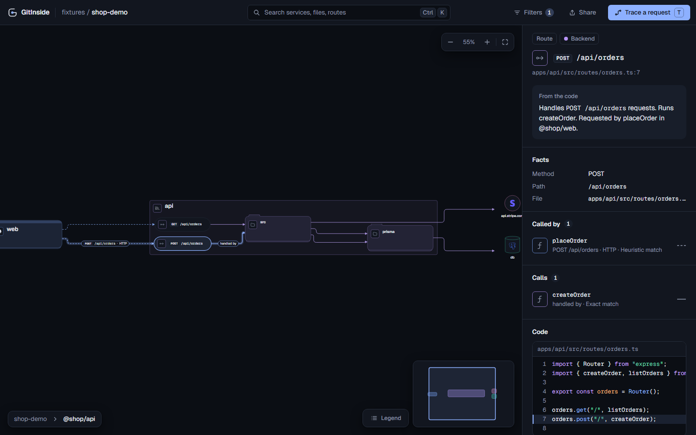
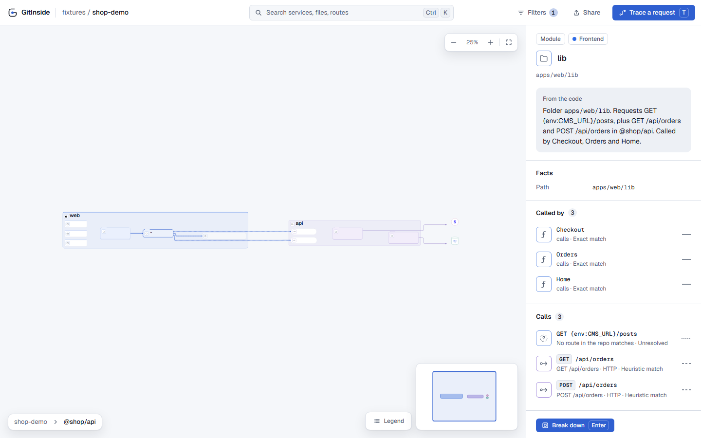
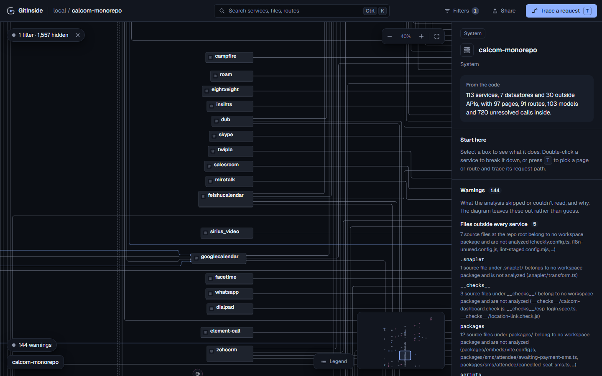
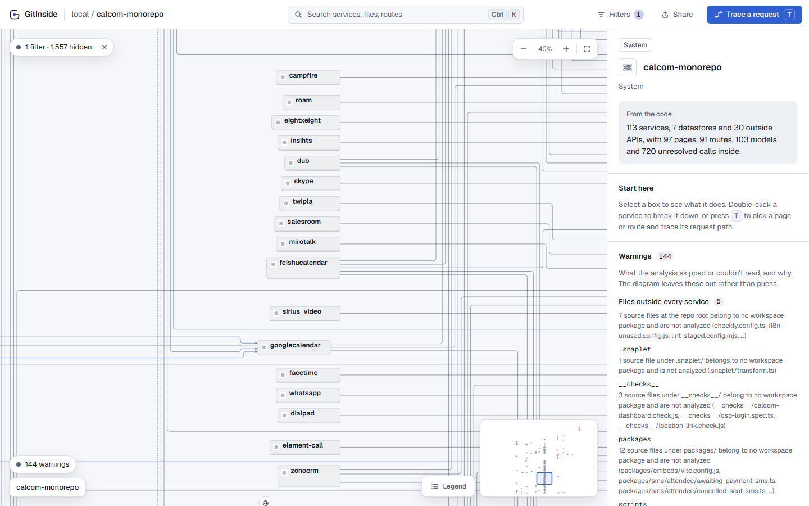

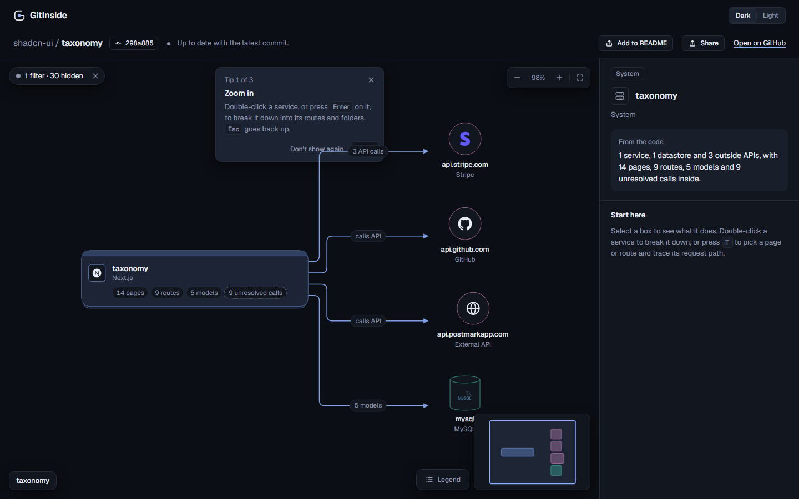
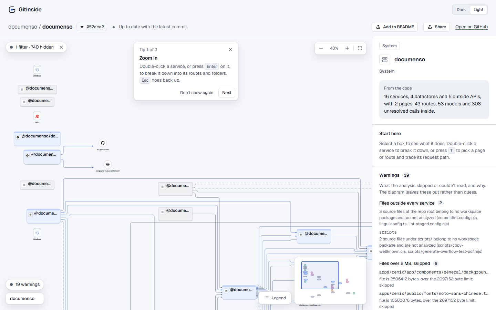
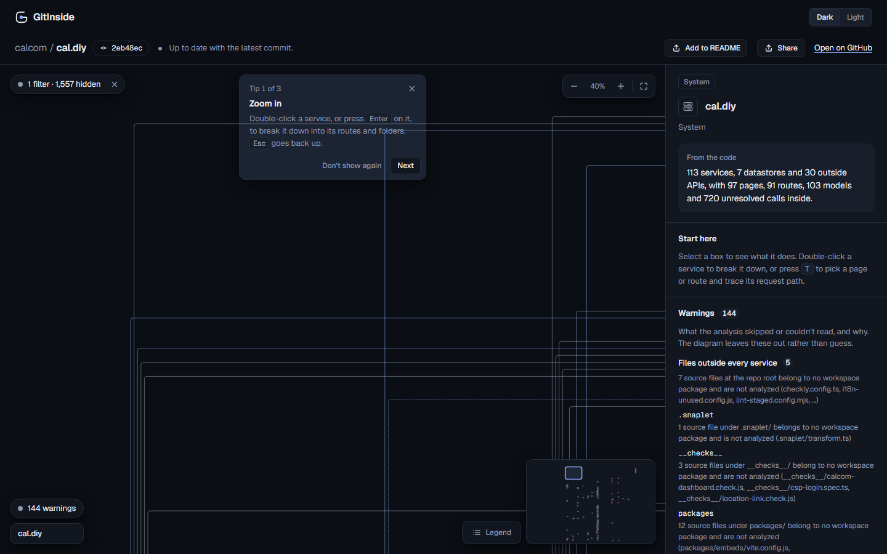

**Limits and the README badge in production (M5.14b1, 2026-11-04, 10:46–10:58 UTC).** I ran a scratch script from this laptop's single address, posting to `/api/analyze` the same way the landing form does:

| Request | Answer |
|---|---|
| `AbhinavGonthina/gitinside` at `41f500d` (never analyzed) | `202 queued`, done ≈ 32 s later |
| the same repo at its next commit `7c9ed7f`, 1 minute later | `429 REPO_RATE_LIMITED`, `Retry-After: 1735`, "each repo gets one every 30 minutes. Try again in 29 minutes." |
| `krishnaacharyaa/wanderlust` (the address's 2nd new analysis this hour) | `202 queued`, done |
| `vercel/commerce` (3rd) | `403 CHALLENGE_REQUIRED` with the Turnstile site key: "You've started several analyses this hour…" |
| the same with a made-up token | `403 CHALLENGE_FAILED` (Cloudflare's `siteverify` refused it) |
| `shadcn-ui/taxonomy` (already analyzed), meanwhile | `200 done`: re-asking for a finished diagram is never limited |

- **The 5-an-hour limit's `429` can't be reached from a script.** From the 3rd new analysis on, every request needs a Turnstile token (ADR-0157), and passing that check is exactly what a script shouldn't be able to do. The limit itself is covered by `analyze.test.ts` and the route tests. A check by hand in a browser is optional on #21.
- **Badge in a real GitHub README.** This repo's README now opens with the Markdown that "Add to README" gives (`7c9ed7f`). GitHub serves it through its image proxy (`camo.githubusercontent.com`, `200 image/svg+xml`, `via: 1.1 varnish`), and the proxy kept our `cache-control: public, max-age=600`. It reads "GitInside | 9 services · 8 datastores · 1 queue" in both of GitHub's themes. Before the analysis, the badge was the link-only one, and that answer stayed in the CDN for its full 10 minutes (as designed).
- **Check-on-view worked on its own.** The badge and repo page views after the README commit enqueued `7c9ed7f`, which the 30-minute per-repo limit had just refused on `/api/analyze`. Check-on-view doesn't take the per-repo claim. Instead it counts against the repo's own hourly re-checks (`repo:<id>`, `RECHECKS_PER_HOUR` in `lib/repoView.ts`). By 10:58 the repo page said "Up to date with the latest commit" with no console errors. One consequence: every push to a repo with a badge brings a new analysis the next time someone views the README, at most 6 an hour. That's fine for this repo (about 30 s each), and the compute pause (ADR-0156) caps the month. #21's readings will show what it costs.

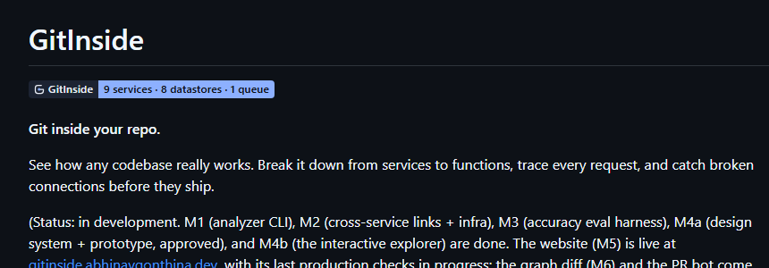
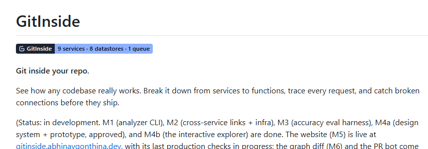
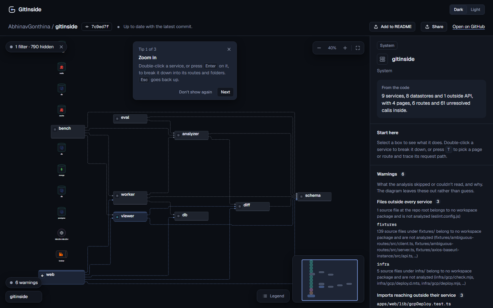

**Quota readings in production (M5.14b2, planning #21).** This machine has no production credentials, so Abhinav read these on 2026-11-05 between 06:10 and 06:20 UTC: production's database (read-only SQL), the bucket's details page in Oracle's console, and Google's billing report for November to date. By then November had 8 finished analyses, among them M5.13's and M5.14b1's.

| Meter | Used (November to date) | Free limit | Share |
|---|---:|---:|---:|
| Bucket requests (`store_requests`) | 42 (web 26, worker 16) | 50,000 a month | 0.08% |
| Bucket size (Oracle's console) | 2.75 MiB, 8 objects | 20 GB | 0.01% |
| Database (`pg_database_size`) | 8,462,336 bytes (8.1 MiB) | 1 GB (SPEC §5's figure, `QUOTA_LIMITS`) | 0.85% |
| Cloud Run vCPU (`compute_usage`, 677.1 s of instance time) | 677.1 vCPU-s | 180,000 | 0.38% |
| Cloud Run memory (677.1 s × 4.295 GB) | 2,908 GB-s | 360,000 | 0.81% |
| Cloud Run requests | 8 | 2,000,000 | 0.0004% |
| Cloud Tasks operations | 16 | 1,000,000 | 0.0016% |

- **Every meter is under 1%,** far from the 80% alarm and pause. The bucket matches the analyses: 8 objects for 8 analyses, and the worker's 16 requests average 2 per job. The website's 26 are graph reads that missed the CDN over about a day of views and image refreshes, which fits ADR-0097's cache (M5.13a1).
- **Google's report:** Cloud Run CPU 126.7 s, memory 113.45 GiB-s, 51 requests; Cloud Tasks 5 operations; 0 USD in total.
- **That report hadn't caught up, so ADR-0156's estimate isn't confirmed yet.** cal.diy's one push ran 92.1 s on a 4 GiB instance: 368 GiB-s, more than 3× the report's memory for the whole month. Billing usage can lag by a day or more, and cal.diy's job was 25 hours old at the reading. All the reading shows is that our count (677.1 s) isn't below anything Google has reported, which is the safe direction: a low count would make the pause come too late. The settled comparison (Nov 1–4, read on or after Nov 7) is M5.14b4, on planning #22. It doesn't hold the `m5` tag.
- **Found: the kill switch's compute isn't counted** (ADR-0156 amendment). Google counted 51 Cloud Run requests against the worker's 8. The kill switch is a second Cloud Run service (1 vCPU, 512 MiB) that the budget's Pub/Sub notifications reach several times a day, and its time comes out of the same free allowance. The report's 0.9 GiB-s per vCPU-second, where the worker alone would give 4, fits too. #22's per-service request counts confirm it or not; then M5.14b4 counts it or reserves its share.
- **The 5-an-hour `429`:** not checked by hand (Abhinav skipped the optional step; the unit and route tests cover it).
- **Production's split for the big jobs** (planning #20, `bench/results/2026-11-04-caldiy-stages.md` → Production's split): cal.diy's 92.7 s from queued to done was 0.6 s dispatch, 9.5 s download, 81.6 s analysis, and 1.4 s upload. Each stage ran 1.6–2.0× slower than on CI's 1-vCPU runner, and the graph came out identical, so the CPU that Cloud Run gave the job explains the gap to the 60 s budget, not dispatch or the network.

## Interview questions

**1. A stranger's repo can contain anything. Walk through what stops it from hurting you.**
It's never executed or installed: we download GitHub's tarball and parse it. Our own extractor refuses absolute or `..` paths, skips every link and device, and caps bytes (on the decompressed stream, so gzip bombs stop early), entries, and path lengths. The analyzer runs in a child process with Node's permission model (read only the code and the repo, write only the graph file), an empty environment, a heap cap, a kill time taken from the job's deadline, and a network guard. The worker that starts it runs in a non-root image with nothing writable outside `/tmp`, and nobody can call it except Cloud Tasks (Cloud Run IAM, plus an HMAC over the body). The security suite proves each layer with sentinels and canaries at the real limits. *Follow-up:* "Which layer is weakest?" On the original VM design, a container with no capabilities and a DNS-allowlisting gateway sat outside the child. Cloud Run offers neither for free, so since ADR-0152 the child's in-process guards are the network boundary. That's the trade we took for scale-to-zero at $0, and the child's network probes in the tests pin it.

**2. Why write your own SigV4 signer instead of using the AWS SDK?**
The worker process holds the bucket keys and parses hostile input, so every dependency there is attack surface and supply-chain risk. We need one signed request shape for four operations (PUT, GET, LIST, DELETE). That's about 150 lines, verified byte for byte against the three worked examples in AWS's docs, plus a fake S3 that checks signatures and body hashes in tests. The trade-off is owning the edge cases: the fake S3 caught that S3 error codes contain digits (`XAmzContentSHA256Mismatch`).

**3. A repo goes private after it was analyzed. What happens now, and what still leaks?**
The next time someone opens its repo page or README image, GitHub answers 404 for it, and `viewRepo` calls `hideRepo`, which flips the row to private. Every public route reads through `findPublishedAnalysis`, which filters on public, so permalinks, graphs, and images all stop at once. It comes back only when an analysis request sees GitHub say it's public again. What still leaks: permalinks never ask GitHub (to protect the 60-an-hour quota), so a permalink-only audience isn't checked, and a CDN copy of a graph can live up to a day. The fresh-eyes review found that the first version didn't record the change at all.

**4. How do you keep a free bucket (Oracle Object Storage, 20 GB) inside its quota without a transaction across Postgres and the bucket?**
A pure planner decides from the database rows and the bucket's own listing (what the provider counts): keep the 5 newest commits per public repo and anything a recent PR names, and drop the oldest past 16 GB. The runner deletes rows before objects. With no transaction spanning both stores, you choose the order whose failure is harmless: a crash after the row delete leaves an orphan object, which the next run deletes after an hour's grace, never a row pointing at a missing graph. A row whose object is missing is only reported, so a listing bug can't wipe the database.

**5. Why is the analysis's job ID derived from the commit instead of random?**
Dedupe and replay safety in one step. The same commit (and analyzer version) is always the same job and the same `analyses` row, so a second visitor's request gets the job already in flight, and the web app can refund a rate-limit slot when the job already existed. The Cloud Tasks task is named from the job ID plus the row's queue entry time, so creating it twice answers `ALREADY_EXISTS` (already queued), while a retry after a failure gets a fresh name. A push for a row that's already `done` answers `200` before any download (ADR-0145), so a duplicate delivery costs nothing. The cost: the ID must also carry its scope once private repos arrive (installation, M8.3), or two tenants' jobs for one commit would collide.

Quiz yourself: open Claude Code and say 'quiz me on M5'.
