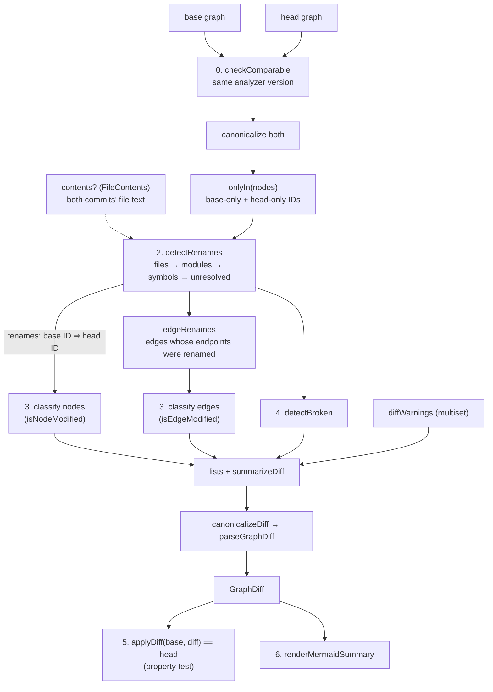
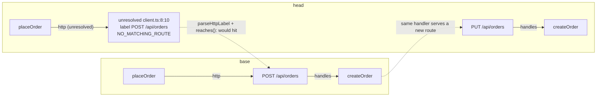

# Walkthrough: the graph diff

> D11.2. The graph diff is the part of GitInside that takes two analyzed commits (a PR's base and head) and says what changed in the architecture: which routes, files, and functions were added, removed, changed, or moved, and which connections the change **broke** (a client still POSTs to a route that is now PUT). It powers `gitinside diff`, the viewer's diff mode, and the PR bot (M8.6). This document walks through every function in the order the data flows, explains why each one exists, and goes line by line through the tricky parts. Line numbers are as of commit `fdfc239`; function names are stable, so search by name if a line has moved.

**Files, in reading order**

| Stage | File | Entry point | What it produces |
|---|---|---|---|
| 0. Guard | `packages/diff/src/compare.ts` | `checkComparable()` | Nothing, or `IncompatibleGraphsError` |
| 1. Fingerprints | `packages/diff/src/fingerprint.ts` | `changedFields()`, `isNodeModified()` | Which fields differ, and whether that's a real change |
| 2. Renames | `packages/diff/src/rename.ts` | `detectRenames()` | `Map<baseId, headId>`, one to one |
| 3. Classify | `packages/diff/src/diff.ts` | `diffGraphs()` | added / removed / modified / updated / renamed lists |
| 4. Broken | `packages/diff/src/broken.ts` | `detectBroken()` | `BrokenEdge[]` with a reason and the head call sites |
| 5. Apply | `packages/diff/src/apply.ts` | `applyDiff()` | head, rebuilt from base + diff (the completeness check) |
| 6. Render | `packages/diff/src/mermaid.ts` | `renderMermaidSummary()` | A Mermaid `flowchart` for the CLI and PR comment |

Shared pieces live in `@gitinside/schema`: the `GraphDiff` type and `summarizeDiff` (`packages/schema/src/diff.ts`), `canonicalize`/`canonicalizeDiff`/`stringifyDiff` (`canonical.ts`), and the route grammar `parseRoutePath`/`alignSegments` (`routes.ts`), which the analyzer's matcher and `detectBroken` both use.

Decisions behind each stage: ADR-0084 (a diff carries head records, so it rebuilds head alone), ADR-0085 (fingerprints), ADR-0086 (rename detection and its thresholds), ADR-0087 (broken edges by re-resolution), ADR-0088 (contract breaks: parameters and fields), ADR-0089 (the Mermaid summary), all in `docs/DECISIONS.md`. The algorithm's spec is DESIGN.md §8.

---

## The big picture



All of it is one call, `diffGraphs(base, head, options)` (`diff.ts:154`). Its body is the diagram, nearly line for line.

Four rules shape every function below:

1. **IDs do most of the work.** Node IDs are qualified names (`route:svc/GET /api/orders`, `symbol:svc/src/a.ts#Cls.method`, ADR-0019), so the same thing has the same ID in both commits. Only what's left over (base-only and head-only IDs) needs cleverness.
2. **Never guess.** A tie between two rename candidates is left unmatched; a call the diff can't prove still exists isn't flagged broken. A missed rename shows as removed + added, which is honest; a wrong rename would be a lie.
3. **The diff is complete.** It stores the head record of everything added or changed, so `applyDiff(base, diff)` rebuilds head byte for byte (ADR-0084). The website can store a diff and a base and never re-analyze head.
4. **Deterministic.** Same two graphs ⇒ byte-identical diff, whatever order the inputs list things in. Every collection is sorted with `compareStrings`, and the output goes through `canonicalizeDiff`.

### The running example

We'll follow the `diff-broken` fixture pair (`fixtures/diff-broken-base/` → `fixtures/diff-broken-head/`, README there). One Express service, one client file:

```ts
// base src/server.ts                         // head src/server.ts
app.get("/api/orders", listOrders);           app.get("/api/orders", listOrders);
app.post("/api/orders", createOrder);         app.put("/api/orders", createOrder);   // POST → PUT
app.delete("/api/orders/:id", deleteOrder);   //                                     // removed
app.get("/api/health", health);               //                                     // removed

// head src/client.ts (unchanged except that `ping`, the only /api/health caller, is gone)
import { formatCents } from "./legacy.js";    // src/legacy.ts was deleted
export async function placeOrder(total: number) {
  return fetch("/api/orders", { method: "POST", body: JSON.stringify({ total }) });   // line 8
}
export async function cancelOrder(id: number) {
  return fetch(`/api/orders/${id}`, { method: "DELETE" });                            // line 12
}
```

Plus three more changes: the `Invoice` Prisma model was removed (still read by `invoiceTotal`), `withTax` gained a required `rate` parameter (still called with one argument by `quote`), and `Order.status` was removed (still filtered on by `openOrders`).

The expected diff (`broken.test.ts:36`) has exactly six broken connections:

| From | To (base target) | Reason | Detail |
|---|---|---|---|
| `quote` | `withTax` | `PARAMETERS_ADDED` | withTax now needs 2 arguments (was 1) |
| `cancelOrder` | `DELETE /api/orders/:id` | `TARGET_REMOVED` | DELETE /api/orders/:id was removed |
| `placeOrder` | `POST /api/orders` | `ROUTE_CHANGED` | POST /api/orders is now PUT /api/orders |
| `file src/client.ts` | `file src/legacy.ts` | `TARGET_REMOVED` | src/legacy.ts was removed |
| `invoiceTotal` | `model Invoice` | `TARGET_REMOVED` | model Invoice was removed |
| `openOrders` | `model Order` | `FIELD_REMOVED` | Order.status was removed |

…and `GET /api/health` is **removed but not broken**, because its only caller left with it. By the end of this document you should be able to explain each row, and the absence of the seventh.

For renames we'll use the second pair, `diff-rename` (`fixtures/diff-rename-base/` → `-head/`): `src/routes/orders.ts` moved to `src/orders/routes.ts` (with a doc comment added), and `formatTotal` was renamed in place to `formatAmount`.

---

## 0. The guard: `compare.ts`

### `checkComparable(base, head)` (lines 22–29)

Refuses two graphs from different **analyzer versions**. If the analyzer changed between the two runs (a new detector, a renamed warning), every difference it causes would read as a change in the PR. Better to fail loudly with "analyze both with the same version" than to post a wrong comment.

Two things it deliberately does *not* check:

- **The schema version:** `parseGraph` only accepts the current one, so two parsed graphs already agree.
- **The repo:** a fork's PR head is analyzed under the fork's name, and the CLI diffs local folders named whatever the caller passed.

`describeRepo` (`owner/name@sha`) is only for messages; `applyDiff` reuses it.

---

## 1. Fingerprints: `fingerprint.ts`

**Goal:** for two records with the same ID, decide whether a reviewer would call the difference a **change** (`modified`) or bookkeeping (`updated`). A route whose handler moved down three lines has a different `source.line`; nobody wants that in a PR comment. A route whose method went from POST to PUT absolutely does.

### `NODE_FINGERPRINTS` and `NODE_INCIDENTAL` (lines 6–35)

One row per node kind listing the fields that count. Every field of every kind is in exactly one of three places: the fingerprint row, `NODE_INCIDENTAL` (`label`, `source`), or `id`. The type makes the rows name only real fields (`Exclude<keyof NodeOf<K>, "id" | "label" | "source">`), and the test "classify every field of every node kind exactly once" (`diff.test.ts:286`) compares the table with the schema, so adding a field to the schema without classifying it fails CI.

Why `label` is incidental: labels are *derived*, from the ID (a file's base name) or from fingerprint fields (a route's `GET /x`). If a label changes, something that counts changed too, or nothing did.

The subtle row is `symbol`: `symbolKind`, `exported`, `requiredParams`, and no body hash. A function whose body changed shows up through its **file's** `hash`. Hashing every symbol's body would make every edit inside a function a "modified symbol", which is noise at the architecture level; `requiredParams` is the one signature fact that breaks callers (ADR-0088, used in §4).

### `EDGE_FINGERPRINT` and `EDGE_INCIDENTAL` (lines 38–49)

Edges are simpler: everything but `id` and `sites` counts. `sites` is where the calls are, not what they do: an edge whose call moved a line is `updated`. A confidence drop (`exact` → `heuristic`) is `modified`, because it changes how the diagram draws the edge.

### `canonicalJson(value)` (lines 52–61)

`JSON.stringify` with a replacer that rebuilds every plain object with its keys sorted. Two consequences:

- Key order never matters. This is not hypothetical: Postgres `jsonb` reorders keys (shorter first), so a graph read back from the database has different key order from the one written.
- `undefined` values vanish (`JSON.stringify` drops them), so `{ a: 1 }` and `{ a: 1, b: undefined }` compare equal.

Arrays keep their order: order inside an array is usually meaningful.

### `fingerprintValue(kind, field, value)` (lines 68–76)

The one exception to "arrays keep order": a **model's fields** are compared as a set keyed by name. Reordering columns in `schema.prisma` changes nothing a caller sees, so the model is `updated`; a field whose type changed is `modified` (`diff.test.ts:211`).

### `changedFields(base, head)` (lines 83–91)

The names of top-level fields whose `canonicalJson` differs, sorted, never `id`. The union of both records' keys is used, so a field present on one side only counts. This is what fills each entry's `changes` list in the diff.

### `isNodeModified(base, head, changes, renames)` (lines 98–117)

Line by line:

- 104: a different `kind` is always a modification.
- 108–109: a changed field that isn't in the kind's fingerprint doesn't count.
- **110–112: the parent-followed-its-rename rule.** If the node's `parentId` changed *only because its parent was renamed* (`renames.get(base.parentId) === head.parentId`), it's not a change. In `diff-rename`, the routes `GET /api/orders` and `POST /api/orders` keep their IDs (route IDs carry no file), but their parent file moved. Without this rule, both routes would be "modified" in the PR comment, when the move is the file's news, not theirs. With it they're `updated` with `changes: ["parentId", "source"]` (`rename.test.ts:143`).
- 113–115: otherwise compare by `fingerprintValue`, so a model's reordered fields don't count.

### `isEdgeModified(changes)` (lines 120–123)

Any changed field other than `sites`. No rename rule is needed: a renamed edge is handled as a rename, below.

---

## 2. Renames: `rename.ts`

**Goal:** among base-only and head-only nodes of the same kind, find the ones that are the same thing under a new ID: a moved file, the folder it moved with, the functions inside it, a function renamed in place, and the unresolved calls inside moved files. Return `base ID ⇒ head ID`, one to one.

Why it matters: without it, moving one file turns into "1 file removed, 1 file added, 3 functions removed, 3 functions added, 6 edges removed, 6 edges added" in the PR comment. With it, it's "1 file moved".

### `FileContents` (lines 19–22)

`base(path)` and `head(path)` return a file's text, or `undefined`. It's **optional**, and the caller must pass exactly the analyzed commits' text: the diff also runs in browsers (viewer diff mode), so it can't hash the text to check it against the file node's `hash`. The CLI builds it from two git worktrees (`packages/analyzer/src/cli.ts:143`).

Without contents, only files with identical content (same `hash`) can match, and symbols match only by following their file.

### `RENAME_THRESHOLDS` (lines 30–54)

Every number here was measured, not picked (ADR-0086, on 5,898 files of cal.com and the eval repos):

| Threshold | Value | Why |
|---|---|---|
| `shingleSize` | 4 | 3 matched slightly more edits, 5 lost a tenth of them |
| `fileSimilarity` | 0.6 | a 20% edit still scores ≥ 0.6 in 92–96% of samples; two unrelated files do in 0.04% |
| `minFileTokens` | 50 | short files' scores swing wildly; they match only by identical content |
| `symbolSimilarity` | 0.8 | a same-name symbol in a moved file whose body was rewritten is a new symbol |
| `minBodyTokens` | 20 | `const a = 1;` is 5 tokens; equal tiny bodies are coincidences |
| `maxFilePairs` | 250,000 | past this, only same-base-name files are compared (near-linear on huge refactors) |
| `maxShingleLookups` | 100,000,000 | the same fallback by work: a pair costs the smaller file's shingle count; ~22 ns a lookup here, so about 2 s (M6.11i) |

`rename.test.ts:535` re-checks them on every fixture in the repo: no two different fixture files match (except known near-copies), and every fixture file still matches itself after a 10% edit.

### Similarity: `tokenize`, `shingles`, `jaccard`, `similarity` (lines 56–87)

- **`tokenize`**: identifiers, numbers, and single punctuation characters. Whitespace never becomes a token, so reformatting a file (Prettier) doesn't lower its score (`rename.test.ts:225`).
- **`shingles(tokens, size)`**: the set of every window of `size` consecutive tokens, joined with `\u0000` (a character no token contains, so `["ab", "c"]` and `["a", "bc"]` differ). A sequence shorter than `size` is one shingle, so short inputs still compare.
- **`jaccard(a, b)`**: |A ∩ B| / |A ∪ B|, computed as `shared / (|A| + |B| − shared)` by iterating the **smaller** set. Two empty sets are 1.

Why shingles and not a line diff: a 4-token window captures local order (`a(b, c)` vs `a(c, b)`) without caring where in the file it sits, so moving a function within the file barely changes the score, and the cost is linear in file size.

### `assign(candidates, into)` (lines 103–130): ties are never broken

Every matcher produces scored `Candidate`s (`from`, `to`, `score`, `rank`) and hands them to `assign`, which is the "never guess" rule in code:

1. Sort best first: higher `score`, then higher `rank` (a tie-breaker such as "same base name"), then IDs (only for determinism).
2. Group equal `(score, rank)` into **tiers**.
3. Per tier, drop candidates whose ends were already claimed by a higher tier. Count how many candidates each end has *in this tier*.
4. Take a pair only if both its ends appear exactly once in the tier.
5. Mark **every** end seen in the tier as claimed, matched or not.

Step 5 is the subtle one. Say two identical files `a.ts` and `b.ts` are removed and two identical files `x.ts` and `y.ts` added (all four hashes equal, different base names). One tier, four candidates, each end counted twice: nothing is taken. And because all four ends are now claimed, a lower tier (a weaker content match) can't sneak in and pair them either. Result: two removed, two added, which is the truth as far as the graph can tell (`rename.test.ts:178`).

If instead `a.ts` became `x/a.ts` and `b.ts` became `x/b.ts`, the same-base-name `rank` of 1 puts `a⇒x/a` and `b⇒x/b` in a higher tier of their own, each end once: both match.

### `matchFiles(removed, added, contents, into)` (lines 184–271)

- **By hash** (194–200): every removed/added pair with the same `hash` is a candidate with score **1**. This works without contents.
- **By content** (202–267), only with contents: shingle each file once (`fileShingles` returns `undefined` for unread or under-50-token files, which then never score). For each pair: skip same-hash pairs (already candidates at 1), and keep scores ≥ 0.6.
  - **The budget** (210–241): a `Group` is a set of removed files to compare with a set of added ones, with its `pairs` and its `lookups`. `jaccard` walks the smaller set, so a pair costs min(|A|, |B|); `lookups` (146–163) sums that over every pair without visiting them, by sorting one side's sizes, keeping prefix sums, and binary-searching each size of the other side (`O((n + m) log m)`).
  - If the whole `removed × added` exceeds `maxFilePairs` or `maxShingleLookups`, files are grouped by base name and the groups are taken cheapest first (lookups, then name), skipping any that no longer fits, so one costly group of 400 large `index.ts` files can't stop a small `util.ts` group (`rename.test.ts:423`). Identical content is still found by hash, so a mass move of unchanged files isn't affected.
  - Why work and not pairs alone (M6 review C6, M6.11i): 500 removed and 500 added files are under the pair cap, but at 15,000 shingles each (a large generated file) every pair compared is ~3.75 billion lookups, over a minute at 22 ns.
  - **Saying so** (242–252, M6 review R4, M6.11n2): past the budget, `matchFiles` returns a `RenameLimit` counting the removed and added files that had shingles, sat in no compared group, and had no identical-content file on the other side. `detectRenames` passes it on as `limit`, `diffGraphs` writes it as the diff's `renameLimit`, and the Mermaid summary adds a `limit["Moves not checked for 401 removed and 401 added files"]` note. Within budget the field is absent, so ordinary diffs don't change.
- `rank` is 1 for a shared base name.

In `diff-rename`, `src/routes/orders.ts` → `src/orders/routes.ts` has a different hash (a doc comment was added and a call renamed) and different base names, so it's found by content. Without contents it's removed + added (`rename.test.ts:159`).

### `matchModules(removed, added, base, head, into)` (lines 278–320)

A folder moves when its files did. At this point `into` holds only file renames. For each one whose head file sits in an **added** module, the base file's module gets a vote for the head file's module. A removed module `m` matches added module `to` when the votes `n` are a strict majority **both ways**: more than half of `m`'s files went to `to` (`2n > baseFiles(m)`), and more than half of `to`'s files came from `m` (`2n > headFiles(to)`). Both conditions stop a folder that was split, or a new folder assembled from many places, from being called a move. Only direct file children vote.

`diff-rename`: `src/routes` had one file, which moved to `src/orders`, which has one file: 1 vote, `2 > 1` both ways, so `module:…/src/routes ⇒ module:…/src/orders`.

### `matchSymbols(...)` (lines 359–440)

Two rules, in order, with rule 1 run again at the end.

**Rule 1, `followParents`** (375–404): a symbol whose parent (a file, or a class for methods) was renamed is looked for under the new parent with the same name.

- `childPrefix(parent)` (343–347) is how child IDs start: `symbol:<file path>#` for a file, `<class ID>.` for a class. Swapping the old prefix for the new one gives the candidate's ID; `symbol:svc/src/routes/orders.ts#listOrders` becomes `symbol:svc/src/orders/routes.ts#listOrders`.
- The candidate must be head-only and untaken, have the same `symbolKind`, and really be under the new parent.
- If both bodies can be read, their shingle Jaccard must be ≥ 0.8; a same-name function whose body was rewritten is a new function (`rename.test.ts:241`). **If either body can't be read** (no contents), it matches anyway: following the file is the evidence.
- `ordered` sorts removed symbols by nesting depth (dots after `#`), so a class is matched before its methods, and the methods can then follow the class in the same pass.

**Rule 2, equal bodies** (407–437), only with contents: a function renamed in place, or moved to another file that wasn't itself renamed.

- `bodyText` takes the symbol's lines `source.line..source.endLine` from the file.
- `bodyTokens` masks the symbol's **own name** as `\u0001`, so `function formatTotal(…)` and `function formatAmount(…)` with the same body tokenize equal. (Recursive calls to itself are masked too, which is what you want.)
- The key is `symbolKind` + the token list; bodies under 20 tokens get no key.
- A pair matches only if its key occurs **exactly once** on each side among the leftovers. Two equal helper bodies? No match.

Then `followParents` runs again, so the methods of a class renamed by rule 2 follow it.

`diff-rename`: the three symbols in the moved file follow it by rule 1 (`createOrder`, `listOrders`, `orders`); `formatTotal ⇒ formatAmount` is rule 2.

### `matchUnresolved(removed, added, movedPaths, into)` (lines 448–483)

Unresolved nodes are named by position, `unresolved:<service>/<file>:<line>:<col>`, so adding a line above a `fetch` changes its ID. They're matched by **what they say**: the key is (file, mapped through `movedPaths` for base nodes; `reason`; `expression`; `detail`). Within a key, the nodes pair in source order, but only if both sides have **as many** of them. If you had two identical `fetch(url)` calls and removed one, we can't tell which, so neither pairs (rule 2 again).

`diff-rename`: `orders.ts:15:9 ⇒ routes.ts:16:9`. The file moved (mapped by `movedPaths`) and the doc comment pushed the call down one line.

### `detectRenames(base, head, removed, added, contents)` (lines 509–559)

Runs the four matchers in dependency order, all writing into one `renames` map: **files**, then build `movedPaths` (base path ⇒ head path) from the file pairs, then **modules** (they vote with file renames), **symbols** (they follow file renames), and **unresolved nodes** (they use `movedPaths`). The `only(...)` helper picks base-only/head-only nodes of one kind, so every pair is the same kind and one to one. It returns `{ renames, limit }` (`RenameDetection`, 486–492): `limit` is `matchFiles`' `RenameLimit`, only past the budget.

What it doesn't do (header comment): renamed services (every ID in them changes), and moved routes, pages, models, and queues, which don't need it: their IDs carry no file, so a moved declaration keeps its ID and shows as `updated`. A file split in two matches at most one half.

---

## 3. Classify: `diff.ts`

### `classify(base, head, isModified, renames)` (lines 42–77)

The one generic function used for both nodes and edges.

- 48: index head by ID.
- 51–64: for each base record: no head record with that ID ⇒ set aside as base-only. Otherwise remove it from `heads` (it's accounted for), compute `changedFields`; no changes ⇒ unchanged, skip; else `isModified` decides `modified` or `updated`. The **head** record is stored: the diff must carry the new value.
- 65–74: for each base-only record: if `renames` maps it to a head ID still in `heads`, it's `renamed` (with its `changes`, e.g. `["hash", "label", "parentId", "path"]` for the moved file); else `removed`.
- 75: whatever is left in `heads` was never claimed: `added`.

Note that `renamed` isn't split into modified/updated; a renamed entry just lists what changed.

### `onlyIn(base, head)` (lines 80–87)

Set differences of IDs. Used for nodes (input to `detectRenames`) and edges (input to `edgeRenames`).

### `edgeRenames(base, added, nodes)` (lines 93–107)

Edge IDs are built from their endpoints (`edgeId(kind, from, to)`), so renaming a node changes every edge ID touching it. For each base edge, map both endpoints through the node renames; if either changed and the resulting ID is a head-only edge, that's an edge rename. In `diff-rename` all six base edges are renamed, none removed or added (`rename.test.ts:136`).

### `diffWarnings(base, head)` (lines 113–139)

Warnings have no ID, and the same warning can legitimately appear twice. So they're a **multiset**, keyed by `warningKey` (code, file, message; defined in `apply.ts:57` so both sides use the same key):

1. Count head's occurrences per key.
2. Each base occurrence cancels one; a base occurrence with nothing left to cancel is `removed`.
3. Walk head again; each occurrence while its key still has a count left is `added` (decrementing), so exactly the surplus is added, in head's order.

### `diffGraphs(base, head, options)` (lines 155–214)

Now the whole thing reads top to bottom:

1. `checkComparable`, then `canonicalize` both graphs. Canonical order matters here, not just in the output: `detectRenames` and `detectBroken` iterate these arrays, so canonicalizing first is what makes the result independent of input order (property "the diff doesn't depend on input order", `properties.test.ts:680`).
2. Node `onlyIn` ⇒ `detectRenames`.
3. `classify` nodes with `isNodeModified` (closing over `renames` for the parent rule).
4. `classify` edges with `isEdgeModified`, and the edge renames.
5. Shape the lists into the schema's form (removed records become just their **base IDs**: head doesn't have them and `applyDiff` only needs to delete them).
6. `detectBroken(before, after, renames)`.
7. `summarizeDiff` counts every list (builders never count by hand), `renameLimit` is added when `detectRenames` returned a `limit`, `canonicalizeDiff` sorts everything, and `parseGraphDiff` validates the result, including integrity checks such as "an ID appears in only one list" (`packages/schema/src/diff.ts:173`). A builder bug fails here, not in a PR comment.

**Running example after stage 3.** In `diff-broken`, `POST /api/orders`, `DELETE /api/orders/:id`, `GET /api/health`, `src/legacy.ts`, `model Invoice`, and `ping` are among the removed nodes; `PUT /api/orders` and the four head unresolved nodes (one per still-made call) are among the added ones; `model Order` and `withTax` are `modified` (`fields` and `requiredParams` changed). Nothing is renamed: the new route has a different ID and no file moved.

---

## 4. Broken connections: `broken.ts`

**Goal:** the PR bot's headline. A connection is **broken** when the code still makes a call, but what it called is gone or no longer accepts the call. Removed-and-unused is not broken (that's just a deletion).

The hard question is "does the code still make the call?". The diff has no TypeScript program, only two graphs. The trick (ADR-0087): when head's analyzer couldn't resolve a call, it didn't drop it; it made an **unresolved node** that says what the call was (fail visibly, CLAUDE.md §0). So the diff **re-resolves** those unresolved calls against the base target.



### Reading calls back: `parseHttpLabel(label)` (lines 74–105)

An unresolved HTTP node's label is `<METHOD|?> <url>` in the analyzer's pattern text (see the resolver walkthrough, `formatUrlPattern`): `POST /api/orders`, `DELETE /api/orders/{}`, `{env:API_URL}/orders`, `./users`. This function is its inverse:

- 75: a label ending in `…` was clipped by the analyzer; its URL is incomplete, so it's refused (`undefined`), never guessed at.
- 80–81: `?` is an unknown method (`null`); anything not in `HttpMethod` is refused.
- 83–90: strip the base. An `{env:…}` prefix or a page-relative `./` is dropped; an absolute URL is kept only if its host is **loopback** (`LOOPBACK`, the same hosts the analyzer's matcher accepts); a remote host is no route in this repo, so `undefined`.
- 92–103: split into segments; inside each, `{}` becomes a hole, so `user-{}` is `[text "user-", hole]`.

### `reaches(call, route)` (lines 112–121)

The analyzer's own matching rules, so the diff never disagrees with the analyzer about what a call reaches: methods equal, or either side `ALL`, or `HEAD` to a `GET` route, or an unknown method; and `alignSegments(call, parseRoutePath(route.path)) !== ALIGN.FAIL` (at **any** confidence level; the shared DP from `@gitinside/schema`, explained in the resolver walkthrough §4).

### `relativeImportTargets(fromPath, specifier)` (lines 37–57)

The files a relative specifier can name, the way TypeScript resolves it without `paths` or packages:

- Only `./` and `../`; a bare (`react`) or aliased (`@/x`) specifier is `undefined` (not handled: no head evidence of what it maps to).
- Walk the pieces; `..` past the repo root is `undefined`.
- Candidates: the path itself, the path plus each extension (`.ts`, `.tsx`, `.d.ts`, `.js`, …), a `.js`-style specifier read as its TypeScript source (`JS_TO_TS`: `./legacy.js` ⇒ `legacy.ts`, the ESM convention the fixture uses), and `<path>/index.*`.

### `stillCalls(edge, target, source, node)` (lines 133–164)

Given a base edge whose target is gone (or moved while this edge didn't follow), and one unresolved node a head edge of the same kind reaches from the same source: is this the same call?

- **`http` ⇒ route:** only `NO_MATCHING_ROUTE` nodes (a `DYNAMIC_URL` call never resolved to the route in the first place). Then two ways to say yes:
  - 143–145: the node's label equals the `request` of one of the **base edge's** sites (an unclipped label). The analyzer writes each matched request's label onto its site (`buildHttpEdges`), and that label is the same text an unresolved node gets, built before matching. So it works whatever path the matcher really aligned: an example env file's `/api` in front, a dev proxy's rewrite, a Next `basePath`, a rewrite to another server (M6.11c, review finding C2). Before this, `GET /api/users` sent by a Vite proxy as `/users` could never be read back to the `GET /users` route.
  - 146–147: otherwise `parseHttpLabel` + `reaches`, for base graphs written before `request` existed and for a call whose text changed but still names the route's own path.
- **`imports` ⇒ file:** only `UNKNOWN_SYMBOL` nodes from a file, and the specifier (the node's `expression`) must name the target's path.
- **`reads`/`writes` ⇒ model:** only `UNKNOWN_SYMBOL`, and the expression's second-to-last part must be the model's accessor: `prisma.invoice.findMany` ⇒ `invoice` = `lowerFirst("Invoice")`. This is Prisma's own naming rule for client accessors.
- Anything else: `false` (not handled, documented).

### `explain(target, replacedBy, movedTo)` (lines 204–221)

The user-facing words, with targets named by `nameOf` (files by path, models as "model X", symbols by their name in the file such as `Interpreter.parse`, others by label): a target head renamed or moved (`movedTo`, its head self) ⇒ `TARGET_MOVED`, "src/routes/orders.ts is now at src/orders/routes.ts" ("X moved" if both read the same); a removed route with replacements ⇒ `ROUTE_CHANGED`, "POST /api/orders is now PUT /api/orders" (several joined with "or"); otherwise `TARGET_REMOVED`, "src/legacy.ts was removed".

### `contractBreak(target, now, edge)` (lines 253–289)

For targets that **survive** but changed what they accept (ADR-0088). The analyzer records the facts this needs: each TypeScript symbol's `requiredParams`, each call site's argument count (`args`), and each Prisma site's `missingFields` (names the call uses that head's model lacks).

- **`calls` ⇒ symbol, `PARAMETERS_ADDED`:** `requiredParams` rose from `was` to `needs`, and a head site passes `args >= was && args < needs`. The lower bound matters: a call that already passed too few in base was already broken; this PR didn't break it. A site with no `args` (a spread, `f(...xs)`) is never flagged: its count is unknown.
- **`reads`/`writes` ⇒ model, `FIELD_REMOVED`:** fields in base's model but not head's are `removed`; a site is flagged if its `missingFields` includes one. The detail names exactly the fields some site still uses ("Order.status was removed"). `listOrders` and `createOrder` touch `Order` without naming `status`, so they're not flagged.

Only the offending sites are listed, never every site of the edge.

### `detectBroken(base, head, renames)` (lines 336–447)

**Setup** (341–378):

- `gone(id)`: not in head **and** not renamed. A moved file isn't gone, but pass 1 still checks it (step 3 below).
- `headEdges`: head edges by ID, for "did this edge follow the move?" and for pass 2.
- `headOut`: head edges by source.
- `handlersOf`: base route ⇒ its handler symbols (from `handles` edges).
- `newRoutesOf`: head handler ⇒ routes it serves that are **new** in head (not in base, not a rename target). This is how `ROUTE_CHANGED` is told apart from `TARGET_REMOVED`: the same handler now serves a different route.
- `stillImported(target, from)` (369–378, M7.2e): a call to a removed symbol leaves no unresolved node, so for `calls` the evidence is the import instead. It finds the target's top-level symbol (`exportedAncestor`: itself, or a method's class) and both files (`fileOf`: the target's in base, the caller's in head), then returns the sites of head's `imports` edge between those files (the target file through its rename) whose `missingExports` list that symbol's name.

**Pass 1, targets gone or left behind** (380–425). For each base edge:

1. 383: targets that are themselves `unresolved` are skipped (an unresolved call that vanished isn't a broken connection).
2. 384–386: the source as it is in head (its rename, if any). **No head source ⇒ skip.** This line is why `GET /api/health` isn't broken: `ping` was removed too.
3. 387–391: the target must be gone, or renamed (`movedTo`) with **no head edge of this kind from the source to its new ID**. If that edge exists, the caller followed the move and the edge is a plain rename. If it doesn't, the base edge is removed, and the question is whether the caller still asks for the old place (M6.11b, review finding C1).
4. 393–402: the head edges from that source of the **same kind** that end at an unresolved node for which `stillCalls` holds, against the target **as base had it** (its old path), plus for a `calls` edge the import sites `stillImported` finds. Neither ⇒ the call is really gone, skip.
5. 404–409: replacements: for each of the target's base handlers (through its rename), the new head routes it serves.
6. 410–424: the broken edge, with the head call sites of the matching edges and import sites, deduplicated by location and sorted; `explain` picks `TARGET_MOVED` when `movedTo` is set.

**Pass 2, targets that survive** (427–445). For each base edge, map both endpoints through renames; if the target still exists in head and head still has the edge between the same (renamed) endpoints, ask `contractBreak`. The two passes can't both fire for one edge: pass 1 needs the target gone or the edge removed, pass 2 needs the target present and the edge kept.

The result is sorted by edge ID.

**Running example, row by row:**

| Row | Pass | How |
|---|---|---|
| `placeOrder ⇒ POST /api/orders` | 1 | head `placeOrder` has an `http` edge to `unresolved:…/client.ts:8:10`, `NO_MATCHING_ROUTE`, label `POST /api/orders`, which is the base site's `request` (it also `reaches` the base route). Base handler `createOrder` serves head-new `PUT /api/orders` ⇒ `ROUTE_CHANGED` |
| `cancelOrder ⇒ DELETE /api/orders/:id` | 1 | label `DELETE /api/orders/{}`, the base site's `request` (and the hole aligns with `:id`). `deleteOrder` was removed, so no replacement ⇒ `TARGET_REMOVED` |
| `client.ts ⇒ legacy.ts` | 1 | `UNKNOWN_SYMBOL` node, expression `./legacy.js`; `relativeImportTargets("src/client.ts", "./legacy.js")` includes `src/legacy.ts` |
| `invoiceTotal ⇒ Invoice` | 1 | `UNKNOWN_SYMBOL` `prisma.invoice.findMany`; accessor `invoice` |
| `quote ⇒ withTax` | 2 | `requiredParams` 1 ⇒ 2; the site at `pricing.ts:6:10` passes 1 |
| `openOrders ⇒ Order` | 2 | `status` removed; the site at `handlers.ts:18:23` has `missingFields: ["status"]` |
| `ping ⇒ GET /api/health` | 1, skipped | `ping` isn't in head |

### What it deliberately doesn't detect

From the header comment (lines 321–335), with the reason in each case being "no head evidence in the graph":

- Calls to **removed functions** that no head import still asks for by name: the analyzer makes no unresolved node for a call it can't resolve to a symbol. Since M7.2e the import is the evidence instead: `stillImported` flags a base `calls` edge to a removed symbol when head's import of the symbol's file lists its top-level name in `missingExports` (ADR-0087's M7.2e amendment). A global, a namespace import (`ns.f()`), a re-export from another file, and a symbol kept but no longer exported still leave nothing.
- **Aliased or package imports** (`@/x`, `@acme/shared`): `relativeImportTargets` can't map them.
- **Clipped URL labels**, a call whose text changed in the same commit and reached the route only through an example env path, a dev proxy, `basePath`, or rewrites (its label is no base `request` and doesn't align by itself), and `renders`, `publishes`, `consumes`, `external_call`, `stores` edges.
- A source that follows a moved target with one call and keeps the old path with another: its edge is renamed (it followed), so it's no candidate.
- Symbols with **no `requiredParams`** (JavaScript, overloads, inherited constructors), **parameter type** changes, and model fields whose **type changed or became required**.

`broken.test.ts:554` pins the first one down as documented behaviour.

---

## 5. Apply: `apply.ts`

### Why it exists

`applyDiff(base, diff)` rebuilds head. It's not used to *show* anything; it's the proof that a diff is complete (ADR-0084), checked by the property "apply(base, diff(base, head)) equals head" and on both fixture pairs. A stored diff plus its base is then enough to reconstruct the PR head's graph.

### `applyLists(what, base, lists)` (lines 22–54)

A map of base items by ID, then, in order: delete `removed` IDs; delete renamed `from` IDs; replace `changed` (modified + updated) records; insert `added`; insert renamed records. Each step **checks the diff against the map**: removing or changing an ID that isn't there, or adding one that already is, throws `DiffApplyError`. A diff applied to the wrong base fails loudly instead of producing a plausible but wrong graph.

### `applyWarnings(base, diff)` (lines 61–72)

The multiset inverse of `diffWarnings`: remove one occurrence per `removed` entry (throwing if there's none), append `added`.

### `applyDiff(base, diff)` (lines 86–117)

Refuses a diff whose base repo (owner, name, **and SHA**) or analyzer version differ from `base`; applies the lists; then `canonicalize` + `parseGraph`, so the result is in canonical order and valid (a ZodError otherwise).

---

## 6. Render: `mermaid.ts`

### `escapeMermaidLabel(text)` (lines 105–109)

Labels come from the repo, which is **untrusted** (SECURITY.md T10): a route path could contain `"]` and close the node, or `%%{init:…}%%` and start a directive, or HTML. The fix is an allowlist, not a denylist: whitespace collapsed, cut to 60 code points (`[...text]` splits by code point, so a character outside the BMP isn't cut between its two UTF-16 halves), and every character outside `[A-Za-z0-9 ._,()/:@-]` written as a numeric entity `#<code>;`. Nothing the repo writes can be Mermaid syntax.

### `mermaidShape(kind)` (lines 115–130)

One bracket pair per kind (routes as stadiums, models and datastores as cylinders, queues as subroutines, externals as hexagons). Exported because the viewer's Mermaid export uses it too, so both draw a kind the same way.

### `renderMermaidSummary(diff, base, head, options)` (lines 181–353)

A PR comment shows the **architecture level**, not every file. So:

- **What's drawn:** nodes of `SHOWN_KINDS` (service, route, page, model, datastore, queue, external) that were added, removed, changed, or renamed; edges of `SHOWN_EDGES` (http, reads, writes, stores, publishes, consumes, external_call); and **every broken connection**, whatever its endpoints' kinds (`quote ⇒ withTax` is two symbols, but it's drawn).
- **A broken entry's `to` is its base ID** (210–216). When head also renamed that target (a `PARAMETERS_ADDED` route whose path changed, or any `TARGET_MOVED`), it's mapped through `renamedTo` to its head ID, so the target is drawn once, as "… - Renamed from …", rather than once under each ID (M6 review C7, M6.11i).
- **`anchor(id, nodes)`** (202–208): lift an endpoint to the nearest drawn kind by walking `parentId` up. A function calling a route is drawn from its service. Edges that lift to the same `(from, to, status)` merge into one connection labeled with all their kinds ("Added http, reads"); an edge that lifts onto itself (both ends in one service) isn't drawn. Removed edges are lifted in **base** (their nodes may be gone from head); the others in head.
- **Priority order** (254–265): broken endpoints, then changed nodes, then other connections' endpoints. Only the first `maxNodes` (40) are drawn and named `n1…`; the rest, and connections touching them, are counted in a closing note ("...and 3 more nodes not drawn"). Fail visibly applies here too.
- **Names** (281–336): `title` is the kind word plus the `qualified` label (`model Invoice`; a method after its class, `method DocumentInterpreter.parse`, by walking up `parentId` while the parent is a symbol, M7 review S1). If two drawn nodes would read the same ("datastore postgres" in two services), each gets its service, else its declaring file. Renames say "Renamed from …" (only the old method's name when its class stayed the same, so the 60-character cut doesn't eat it) or "Moved" (same qualified name, new place); the rest say "Added"/"Removed"/"Changed".
- **Styles** (317–350): solid arrows for added and changed, dotted for removed and broken; `classDef`/`linkStyle` with the light theme's diff colors, removals and broken edges dashed, so the change is in the border as well as the word (color is never the only signal).
- **The rename-limit note** (`renameLimitNote`, 137–150): a diff with `renameLimit` gets `limit["Moves not checked for 401 removed and 401 added files"]` after the `more` note, or after `none[…]` when nothing is drawn, so a reviewer knows some moves may show as removed and added. It stays under the 60-code-point cut even at 5-digit counts (the 20,000-file limit).
- `updated` records and warnings are never drawn: nothing a reader would call a change.

---

## Where each output comes from

| Output | Produced by |
|---|---|
| `nodes.added` / `edges.added` | head IDs left unclaimed in `classify` |
| `nodes.removed` / `edges.removed` | base IDs with no head ID and no rename, as IDs only |
| `modified` | same ID, a fingerprint field really differs (`isNodeModified` / `isEdgeModified`) |
| `updated` | same ID, only incidental fields (`label`, `source`, `sites`) or a parent that followed its rename |
| `renamed` | `detectRenames` (nodes) and `edgeRenames` (edges) |
| `broken` | `detectBroken`, pass 1 (`TARGET_REMOVED`, `ROUTE_CHANGED`) and pass 2 (`PARAMETERS_ADDED`, `FIELD_REMOVED`) |
| `warnings` | `diffWarnings` (multiset) |
| `summary` | `summarizeDiff`, never counted by hand |

## Tests to read alongside this

- `diff.test.ts`: classification, ordering independence, the fingerprint tables against the schema.
- `rename.test.ts`: the `diff-rename` pair, the tie rule, thresholds, folders, classes, unresolved pairing, and the thresholds re-checked on every fixture.
- `broken.test.ts`: the `diff-broken` pair's six rows, each re-resolution rule, contract breaks, `parseHttpLabel`, `relativeImportTargets`.
- `apply.test.ts`: rebuilding head, and every refusal.
- `properties.test.ts`: the five DESIGN.md §8 properties with fast-check, over pairs generated from one choice vector (head = base with 5–30% of the choices replaced), plus a guard that the generator actually reaches renames and all four broken reasons, so the properties can't pass vacuously.
- `mermaid.test.ts`: the summary's drawing rules and label escaping.

---

## Explain it back

You understand the graph diff when you can answer each of these without looking:

- [ ] Why does `diffGraphs` refuse two analyzer versions but not two repo names or schema versions?
- [ ] What's the difference between `modified` and `updated`? Give one field change that's each for a route, a file, and an edge.
- [ ] Why has a symbol no body hash in its fingerprint? Where does a changed function body show up instead?
- [ ] Why does `canonicalJson` sort keys, and what real system reorders them? Why are a model's fields compared as a set?
- [ ] A route's file moved. Its `parentId` changed. Why is the route `updated`, not `modified`, and which line decides?
- [ ] Why is `FileContents` optional, and what can and can't be found without it? Why can't the diff check the text against the file's `hash`?
- [ ] What's a shingle? Why 4 tokens, and why does whitespace never become a token?
- [ ] Walk `assign` through two identical files removed and two added. Why are the ambiguous ends claimed even though nothing matched, and what would go wrong if they weren't?
- [ ] When does a folder count as moved? Why must the majority hold in both directions?
- [ ] Rule 1 vs rule 2 in `matchSymbols`: when does each fire? Why mask the symbol's own name? Why run rule 1 twice?
- [ ] Unresolved node IDs are positions. How are they matched across commits, and why only when both sides have as many?
- [ ] Why does renaming a node rename edges, and how does `edgeRenames` find them?
- [ ] Why are warnings a multiset, and how does `diffWarnings` add exactly the surplus?
- [ ] Why canonicalize the inputs *before* detecting renames and broken edges, not only the output?
- [ ] The diff has no TypeScript program. How does it know `placeOrder` still POSTs to `/api/orders`? What did the analyzer have to do for this to work?
- [ ] Why does `stillCalls` accept only `NO_MATCHING_ROUTE` for HTTP, and why does `parseHttpLabel` refuse clipped labels and remote hosts?
- [ ] Why does a matched `http` site record its `request` text instead of the path the matcher aligned, and which call through a dev proxy would still go unflagged?
- [ ] How is `ROUTE_CHANGED` told apart from `TARGET_REMOVED`?
- [ ] `util.ts` moved to `lib/util.ts`; one importer followed and one kept `./util`. Which base edge is renamed, which is broken, and what tells `detectBroken` the two apart? Why is the moved file matched at its base path?
- [ ] Why isn't `GET /api/health` broken? Name the line.
- [ ] In `PARAMETERS_ADDED`, why `args >= was` and not just `args < needs`? Why are spread calls never flagged?
- [ ] Why can't one base edge be broken by both passes?
- [ ] What does `applyDiff` prove, and why does a diff store head records instead of only IDs? Why does it throw instead of skipping a missing ID?
- [ ] How does `escapeMermaidLabel` stop a malicious route path from injecting Mermaid syntax, and why an allowlist?
- [ ] Why is a broken `quote ⇒ withTax` drawn in the PR summary when symbols otherwise aren't?
- [ ] Name the five properties `properties.test.ts` checks, and explain why the "generator reaches every case" test is needed.
- [ ] Name three breaking changes the diff can't detect, and why each is out of reach.
