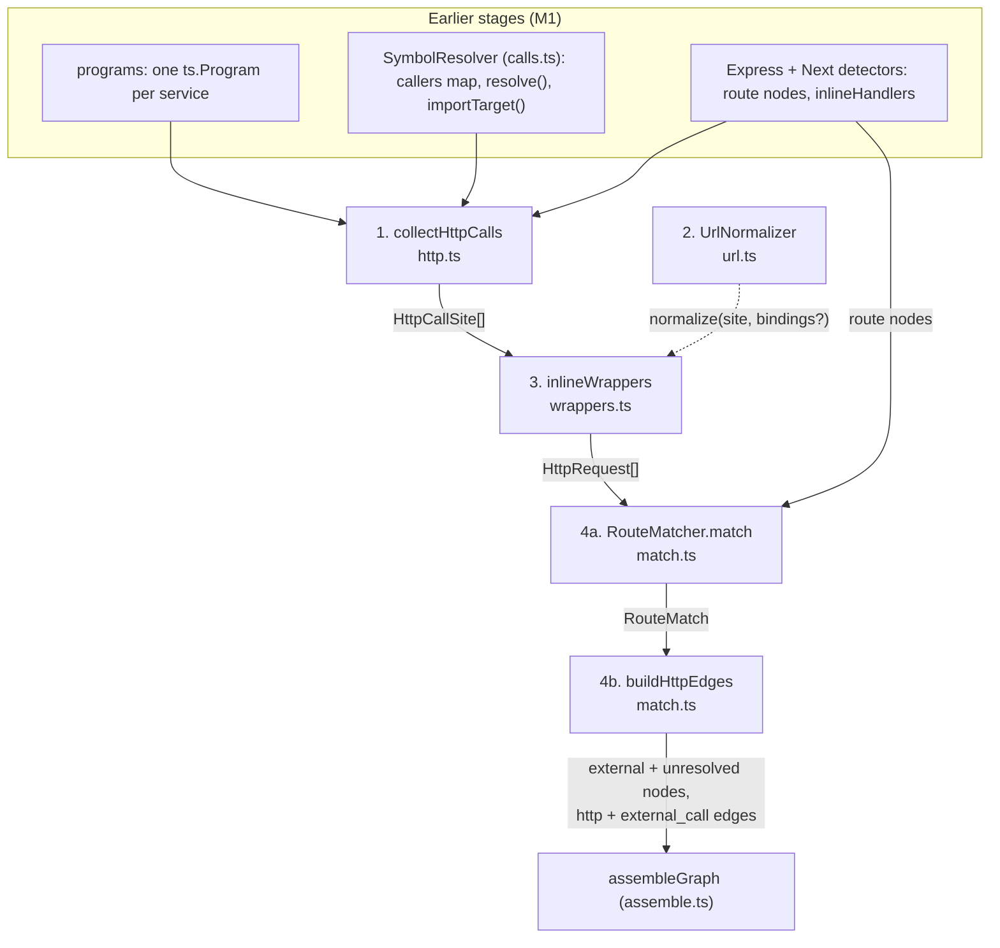
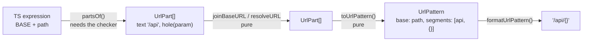
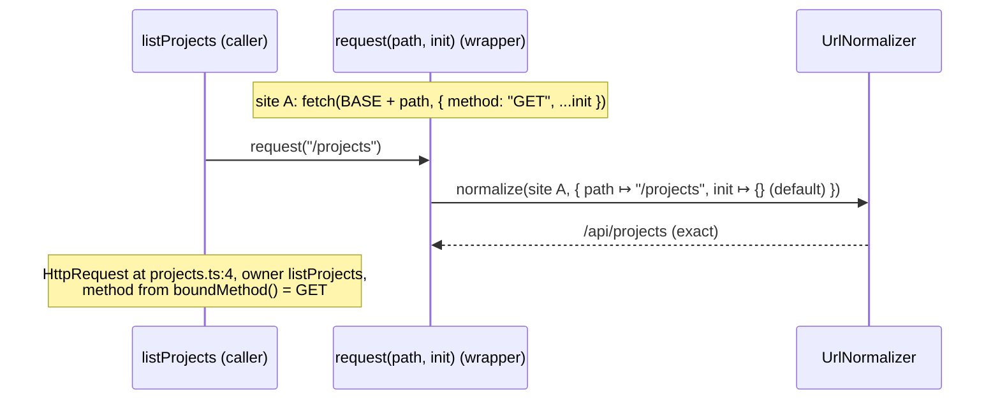
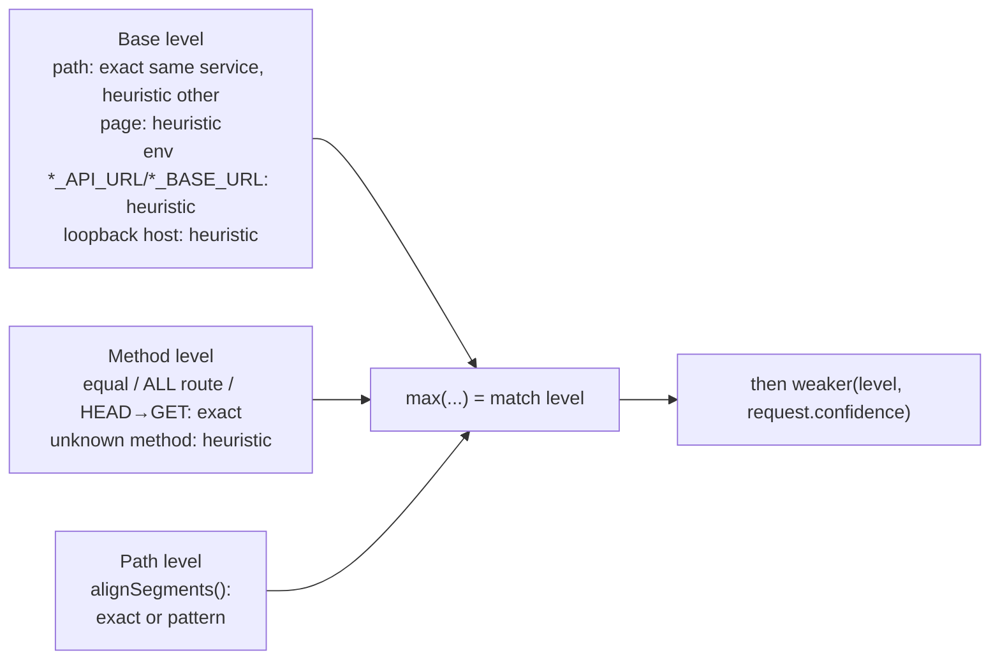

# Walkthrough: the cross-service resolver

> D11.1. The resolver is the part of the analyzer that turns `fetch("/api/users/" + id)` in one package into an arrow to `GET /api/users/:id` in another, with a confidence level, or into an `unresolved` node that says why it couldn't. This document walks through every function in the order the data flows, explains why each one exists, and goes line by line through the tricky parts. Line numbers are as of commit `92a08d7`; function names are stable, so search by name if a line has moved.

**Files, in reading order**

| Stage | File | Entry point | What it produces |
|---|---|---|---|
| 0. Shared helpers | `packages/analyzer/src/values.ts` | `createValueReader()` | Readers for consts, object properties, enum members; `weaker()`; `redactedText()` |
| 1. Collect | `packages/analyzer/src/http.ts` | `collectHttpCalls()` | `HttpCallSite[]`, one per `fetch`/axios call |
| 2. Normalize | `packages/analyzer/src/url.ts` | `createUrlNormalizer()` | `NormalizedUrl`: a `UrlPattern` or `DYNAMIC_URL`/`WRAPPER_DEPTH` |
| 3. Inline | `packages/analyzer/src/wrappers.ts` | `inlineWrappers()` | `HttpRequest[]`, wrapper calls expanded one level |
| 4. Match + emit | `packages/analyzer/src/match.ts` | `createRouteMatcher()`, `buildHttpEdges()` | `RouteMatch` per request, then graph nodes and edges |

Decisions behind each stage: ADR-0030 (collect), ADR-0031 (normalize), ADR-0032 (inline), ADR-0033 (match), ADR-0034 (unresolved/external), ADR-0038 (redaction), all in `docs/DECISIONS.md`.

---

## The big picture



All of it runs inside one stage of `analyze()` (`packages/analyzer/src/analyze.ts:125`):

```ts
const http = await stage("http", () => {
  const sites = collectHttpCalls(programs, resolver, express.inlineHandlers);
  const requests = inlineWrappers(sites, programs, resolver, createUrlNormalizer(resolver), express.inlineHandlers);
  const matcher = createRouteMatcher([...express.nodes, ...next.nodes], workspace);
  return buildHttpEdges(requests, matcher, workspace);
});
```

Three rules shape every function below:

1. **Never run the repo's code.** Values are read from syntax and from TypeScript's checker. Anything that would need execution becomes "unknown".
2. **Unknown is not absent.** `undefined` means "not set, use the real default". `null` means "set, but unreadable". Only `undefined` ever gets a default (ADR-0030).
3. **Nothing is dropped.** Every call site becomes at least one request, and every request becomes an edge, resolved or not. `fixtures.test.ts` asserts this on every fixture.

### The running example

We'll follow the `wrapper-fetch` fixture (`fixtures/wrapper-fetch/`) through every stage:

```ts
// src/http.ts
const BASE = "/api";
export async function request(path: string, init: RequestInit = {}) {
  const res = await fetch(BASE + path, { method: "GET", ...init });   // site A
  return res.json();
}
export function requestRaw(url: string) {
  return fetch(url);                                                  // site B
}
export function requestVia(url: string) {
  return requestRaw(url);
}

// src/projects.ts
import { request, requestVia } from "./http";
export function listProjects()          { return request("/projects"); }
export function createProject(name: string) {
  return request("/projects", { method: "POST", body: JSON.stringify({ name }) });
}
export function legacyProjects()        { return requestVia("/api/projects"); }

// src/server.ts: app.get("/api/projects", …); app.post("/api/projects", …)
```

The golden output (`fixtures/wrapper-fetch/expected.json`) has three HTTP edges:

- `listProjects → GET /api/projects`, `exact`
- `createProject → POST /api/projects`, `exact` (the spread's `POST` beats the default `GET`)
- `requestVia → unresolved:wrapper-fetch/src/http.ts:15:10`, reason `WRAPPER_DEPTH`, label `GET requestRaw(url)`

By the end of this document you should be able to explain each one.

---

## 0. Shared helpers: `values.ts`

Every stage needs to answer "what string does this expression always hold?" without running code. `values.ts` is that toolbox.

### `CONFIDENCE_RANK` and `weaker()` (lines 40–49)

```ts
export const CONFIDENCE_RANK = { exact: 0, pattern: 1, heuristic: 2, unresolved: 3 };
export const weaker = (a, b) => CONFIDENCE_RANK[a] >= CONFIDENCE_RANK[b] ? a : b;
```

Confidence is a number where **lower is stronger**. `weaker()` is `max`. Every time a value passes through an assumption (a workspace import resolved by a `src/index` fallback, say), the running confidence is combined with `weaker()`, so the final label names the biggest assumption made. The matcher uses the same numbers directly (`EXACT`, `PATTERN`, `HEURISTIC` in `match.ts`).

### `objectProperty()` and `ownProperty()` (lines 133–168)

These read `name` out of an object literal and return the three-valued `ConfigValue`:

- the property's value expression, when it's written down;
- `undefined` when the object certainly doesn't set it;
- `null` when something *could* set it: a spread (`...init`), a computed key that isn't a string literal (`[k]: v`), or a method/getter named `name`.

`objectProperty` walks properties **from the last to the first**, because in JavaScript the last write wins. In `{ method: "GET", ...init }`, it sees `...init` first and returns `null`: the spread might override `method`. That's correct, and it's why `http.ts` later has `spreadMethod()` to say *which* spreads could.

`ownProperty` handles one member. The tricky branch is computed keys (line 159): `["method"]: "PUT"` is read as `method`; `["other"]` is a different property (`undefined`); `[someVar]` could be anything (`null`).

### `createValueReader()` (lines 201–296)

Bound to one `SymbolResolver`, so it can ask the right program's checker.

- **`symbolAt(sp, node)`**: the checker symbol at a node. Special case: for the name in a shorthand property `{ method }`, `getSymbolAtLocation` would return the *property*, so it asks for the *value* symbol instead (`getShorthandAssignmentValueSymbol`).
- **`resolveDeclaration(sp, symbol, hops)`**: follows an import to the declaration it names.
  - If TypeScript resolved the alias, use its first declaration (`exact`).
  - If not (a workspace package import, since there's no `node_modules`), ask `resolver.importTarget()` (M1.8) for the symbol in the target package's program and recurse. The result carries that import's confidence (`heuristic` for `src/index` fallbacks), combined with `weaker()`.
  - Note the returned `sp` can be a **different program**: every expression from here on is paired with the program whose checker understands it (`ProgramExpression`). Asking the wrong checker about a node returns garbage, so this pairing is everywhere.
- **`constObject(sp, e, hops)`**: the object literal a `const` holds. Handles nesting: for `ROUTES.admin.users`, it recurses on `ROUTES.admin`, which recurses on `ROUTES`. Only `const` declarations count (`isConst`), because a `let` could be reassigned.
- **`enumString(sp, e)`**: the value of a string enum member, via `checker.getConstantValue`.
- **`constString(sp, e, hops)`**: the string an expression always holds: a literal, a `const` holding one, an enum member, or a property of a const object. Used for method names, not URLs (URLs need holes; see `url.ts`).

All recursive readers take `hops` and stop at `MAX_HOPS = 16`. That bounds the work on adversarial input like `const a = b; const b = a;`.

### `redactedText(node, url)` (lines 82–119)

The text shown on an unresolved node. It was added in M2.9 after the secret-leak test caught `fetch(target, { headers: { Authorization: "Bearer …" } })` copying the token into the graph (ADR-0038).

Line by line:

- `DELIMITERS` (66–72) maps each string-like token kind to the lengths of its quotes. A template head `` `abc${ `` has one char before (`` ` ``) and two after (`${`).
- `visit` walks every node under `node`, carrying `owner`: the URL node this subtree belongs to, if any (`url.includes(n)`).
- `shown` (92–95): two kinds of strings are kept as written: property *names* (`"x-api-key":`) and the value of a `method:` property. Neither can be a secret, and both help the reader.
- For every other string token, it computes the content range `[from, to)` and how much to `keep`:
  - Inside a URL node, keep text up to and including the first `?`. After that, `inQuery` marks the URL as "in its query", so later template pieces of the same URL are masked too (`` `/x?key=${k}&token=abc` ``).
  - Outside a URL, keep nothing.
- The cut list is applied left to right, replacing masked contents with `…`, and the result is clipped to 120 chars.

The design choice: mask by **structure** (everything except the URL path), not by **pattern** (strings that look like keys). Pattern matching is a guess, and guesses miss new token formats.

---

## 1. Collect: `http.ts`

**Goal:** one `HttpCallSite` per outbound request, with its method, URL expression, and axios `baseURL` expression, each either readable, `undefined` (absent), or `null` (unreadable). No graph output yet.

### `HttpCallSite` (lines 105–137)

| Field | Meaning |
|---|---|
| `client` | `"fetch"` or `"axios"` |
| `sp`, `file`, `call` | where it is; `call` is the AST node |
| `site` | location of the callee *name* (`fetch`, `get`), used as the edge's site |
| `owners` | symbol or route node IDs the call belongs to; empty for top-level code |
| `method` | `HttpMethod` or `null` (unreadable) |
| `methodSource` | when `method` is `null`, where it came from, so inlining can retry with arguments |
| `url` | `ProgramExpression` or `null` |
| `baseURL` | `ProgramExpression`, `undefined` (no base, always for fetch), or `null` (may be set, unreadable) |
| `confidence` | `exact`, or weaker if the axios instance came through a heuristic workspace import |

### Small module-level helpers (lines 160–253)

- **`requiredModule(e)`**: `"x"` for `require("x")` or `require("x").default`. JS files without ESM imports still need to be recognized.
- **`importBinding(declaration)`**: for an import declaration, which module and which exported name it binds: `default` (`import a from`), `*` (`import * as a`, `import a = require()`), or the specifier name (`import { fetch as f }` ⇒ `fetch`, via `propertyName ?? name`). This is how the collector knows `axios` came from `"axios"` even though TypeScript can't open that module.
- **`isRepoCode(sp, declaration)`**: true for declarations in the repo's own source, false for `lib.dom.d.ts` and other `.d.ts` files. It's what tells the global `fetch` apart from a local `function fetch()`.
- **`functionOf(checker, symbol)`**: the function body a callee names, through aliases, variables (`const make = () => …`), shorthand properties, and `{ make: () => … }`. Used to follow factories (`getClient()` returning an axios instance).
- **`locationOf(node, file)`**: 1-based line and column of the node's first token. `getStart(sourceFile)` skips leading trivia (comments, whitespace), so the column points at the name, not the space before it.
- **`toMethod(text)`**: `"post"` ⇒ `"POST"`; anything outside `HttpMethod`, and `ALL` itself, ⇒ `null`. `ALL` is a route-side concept (Express `app.all`), never a request method.

### `collectHttpCalls(programs, resolver, inlineHandlers)` (line 260)

Everything else in the file is a closure inside this function, so all helpers share one `createValueReader` and one memo table. It's organized in four sections.

#### Config objects (lines 267–381)

- **`configObject(sp, e, hops)`**: the object literal a config is, directly or through a `const`/`let` variable's initializer. Returns `undefined` if it can't find one.
- **`configProperty(sp, config, name)`**: three-valued read of a config property. No config ⇒ `undefined` (absent). Config found ⇒ `objectProperty`. Config not found ⇒ `null`: we know a config was passed but can't see inside it.
- **`isStringValued(sp, e)`** (301–317): decides whether `axios(x)` is the URL form or the config form. String syntax (literal, template, `+`) is a string. Otherwise it asks the checker: every member of the type must be string-like or `null`/`undefined`, and at least one must be string-like. An `any` value fails both tests, so `axios(x)` with untyped `x` is read as a config, and its URL comes out unknown rather than misread.
- **`methodOf(value, fallback)`**: the three-valued rule in one line each: absent ⇒ `fallback` (`GET`); unreadable ⇒ `null`; readable ⇒ `constString` then `toMethod`.
- **`spreadMethod(sp, object)`** (332–353): for an object literal whose `method` is hidden by spreads, record *which* spreads could supply it, last first, plus the explicit `method:` before them as the `fallback`.
  - Walk from the end. A spread is pushed and the walk continues.
  - `ownProperty(..., "method")` returning `null` means a computed key or a method named `method` hides it: give up (`undefined`).
  - The first real `method:` is the fallback, and the walk stops, because nothing before it can matter.
  - For site A, `{ method: "GET", ...init }` gives `{ kind: "spreads", spreads: [init], fallback: "GET" }`.
- **`configMethod(sp, config, fallback)`** (359–381) combines these into `{ method, methodSource? }`:
  - `config === null` (a spread in the call's arguments hid it) ⇒ `null`, no source.
  - Readable method or no config ⇒ done.
  - Property `null` and the config can't be located (`fetch(url, init)` where `init` is a parameter) ⇒ source `config`. Inlining will look at the caller's argument.
  - Property `null` but the config is a literal ⇒ spreads hide it ⇒ source `spreads`.
  - Property readable but not a const string (`{ method: verb }`) ⇒ source `value`.

  `methodSource` exists only so that M2.3 can re-read the method once a caller's arguments are known. Without it, most inlined requests on cal.com had an unknown method.

#### fetch (lines 385–426)

- **`isFetch(sp, callee)`**:
  - `window.fetch`, `globalThis.fetch`, `self.fetch`: the object must be one of those names and not declared in repo code (a local `const window = …` doesn't count).
  - A bare identifier with no symbol at all (no lib loaded) ⇒ true only if it's spelled `fetch`.
  - Otherwise defer to `fetchSymbol`.
- **`fetchSymbol(sp, symbol, global)`**:
  - An import binding ⇒ true only if from a `FETCH_MODULES` package (`node-fetch`, `undici`, …) and bound as `default`, `fetch`, or `*`.
  - A `require` of one of those modules (or `require("x").fetch`) ⇒ true.
  - Otherwise true only if spelled `fetch` **and** no declaration is in repo code. This is the line that makes `function fetch(path) { … }` a wrapper (inlined later) instead of a request.

#### axios (lines 428–609)

axios is harder than fetch because instances carry state (`baseURL`) and travel through the code.

- **`AxiosValue`** = `{ baseURL, confidence }`. `AXIOS_ROOT` is the default export: no base, `exact`.
- **`axiosOfType(typeNode)`**: a declaration annotated `AxiosStatic` is axios; `AxiosInstance` is an instance whose `baseURL` is unknown (`null`), because the annotation doesn't say which instance.
- **`axiosOfDeclaration(sp, d, hops)`** (441–483): what a single declaration holds:
  - An import from `"axios"` as `default` or `*` ⇒ `AXIOS_ROOT`.
  - Variables, class properties, property signatures, parameters ⇒ the type annotation first, else the initializer (via `axiosOf`).
  - `{ api: x }`, `{ api }`, `export default x`, and CommonJS `module.exports = x` / `exports.api = x` (which TypeScript declares on the assignment itself, hence the `isBinaryExpression` and parent checks at 472–481).
- **`axiosBySymbol` + `axiosOfSymbol`** (489–503): a memo with a cycle guard. Before tracing a symbol, its entry is set to `null` ("in progress"). If the trace loops back to it, the lookup returns `null ?? undefined`, i.e. "not axios", instead of recursing forever. Once done, the real result (or `null` for "not axios") is stored. The visiting order is fixed (files sorted, AST order), so the memo can't make results depend on timing.
- **`traceAxiosSymbol(sp, start, hops)`** (505–532): the subtle part is lines 511–526.
  - Without `node_modules`, `import axios from "axios"` aliases to *nothing*: the aliased symbol has no declarations. So it checks **the import declaration itself first** (`axiosOfDeclaration(own)`); that's how `importBinding` sees `"axios"`.
  - If the alias resolves to nothing and isn't axios, it might be a workspace package import TypeScript couldn't follow: `resolver.importTarget` finds the exported symbol in the other package's program, and the confidence is weakened by that import's.
- **`axiosOf(sp, e, hops)`** (535–609): what an expression evaluates to:
  - `await x`, `require("axios")`.
  - `a ?? b`, `a || b`, `a && b`, ternaries ⇒ the first side that is axios. (Either branch being axios is enough to call it a request; the `baseURL` comes from that side.)
  - `x = y` and `x ??= y` ⇒ `y`.
  - **`<parent>.create(config)`** (564–569): the parent must be axios or an instance. The new instance's `baseURL` is the config's own if present (`undefined` check), else the parent's. `own === null` (config unreadable) stays `null`: it may override the base, we can't tell.
  - Any other call ⇒ a factory: find the function with `functionOf` and check every `return` expression.
  - An identifier or `a.b` ⇒ its symbol, via the memo. The two fallbacks handle `axios.default` and `pkg.api` where `pkg` is a namespace import of a workspace package.

#### Call sites (lines 611–747)

- **`fromConfig(sp, instance, config, url, method?)`** (622–643) builds the request shape for axios:
  - `shorthand` is true when the method is fixed by the call name (`api.get`). For shorthand calls, an unreadable config is assumed **not** to override `baseURL` or `url` (`read` turns `null` into `undefined`, line 632). This is a deliberate precision/recall tradeoff (ADR-0030) and is listed under "not handled".
  - The per-call `baseURL` wins over the instance's; the URL argument wins over the config's `url`.
- **`requestOf(sp, call)`** (646–710):
  - `arg(i)` returns `null` if any argument at or before `i` is a spread: `fetch(...args)` has no readable URL.
  - **fetch:** URL is argument 0, init is argument 1. `fetch(new Request(url, init))` reads the `Request`'s arguments instead, with an init passed to `fetch` itself winning (line 673).
  - **axios called directly** (`axios(...)`, `api(...)`): `isStringValued` picks `(url, config)` or `(config)`.
  - **`x.request(config)`** and **shorthands**: `get/delete/head/options(url, config)` and `post/put/patch(url, data, config)` (the `*Form` variants strip `Form` to get the method). The config is argument 1 or 2 accordingly.
- **The walk** (712–742): for each root file of each program, a recursive `visit` carries `owners`:
  - `resolver.callers` maps declaration nodes to symbol IDs (built in M1.9). Entering a node that declares a symbol makes that symbol the owner; entering an inline Express handler makes its routes the owners (`inlineHandlers`, keyed by the function's node key and read with `inlineRoutesOf`, so `app.get("/x", async () => fetch(…))` belongs to the route).
  - Because the owner is replaced on the way down, the innermost symbol wins.
  - Each recognized call becomes a site; `site` is the location of the callee name (`fetch` or the `get` in `api.get`).
- The result is sorted by file, line, column with `compareStrings`, never `localeCompare` (determinism).

**Running example after stage 1.** Two sites:

| | Site A (`http.ts:5`) | Site B (`http.ts:11`) |
|---|---|---|
| owners | `symbol:…#request` | `symbol:…#requestRaw` |
| method | `null` | `GET` (no init) |
| methodSource | `spreads: [init], fallback: "GET"` | none |
| url | `BASE + path` | `url` |

---

## 2. Normalize: `url.ts`

**Goal:** turn a URL expression (plus axios `baseURL`) into a `UrlPattern`, a base plus path segments made of text and holes, or a reason it can't (`DYNAMIC_URL`, `WRAPPER_DEPTH`) with a sentence for the user.

It's built in two layers (ADR-0031):



The checker-heavy layer is small and tested on real programs; the pure layer is tested with tables and fast-check properties.

### Types (lines 73–141)

- **`UrlPart`**: `text`, `hole` (runtime value; `param: true` if it's an unbound function parameter), `env` (an env var by name), or `origin` (`location.origin`).
- **`UrlSegment`**: one path segment, a list of text and hole pieces. `user-{}` is `[text "user-", hole]`.
- **`UrlBase`**: `path` (root-relative `/x`), `page` (relative `x`), `host` (literal origin), or `env`.
- **`NormalizedUrl`**: resolved with pattern, display text, and confidence; or unresolved with a reason and a detail from `DYNAMIC_URL_DETAIL`/`WRAPPER_DEPTH_DETAIL`. The details are fixed strings so they can't leak anything.

### The pure layer (lines 160–377)

- **`mergeParts(parts)`**: joins adjacent text and drops empty text, so `"/api" + "/users"` becomes one text part. Past `MAX_PARTS = 256` parts it collapses to a single hole: a guard against `a + a + a + …` blowups.
- **`isAbsolute(parts)`**: the first part starts with `scheme://` or `//`. The regex `ABSOLUTE` copies axios's `isAbsoluteURL`.
- **`stripQuery(parts)`**: everything before the first literal `?` or `#`. Holes before it are kept; nothing after it survives.
- **`toSegments(parts)`**: split on `/` inside text parts. A hole is pushed into the current segment. Empty pieces vanish, so `//` and trailing slashes don't create empty segments.
- **`toUrlPattern(input)`** (227–291), line by line:
  - 231–235: an `env` or `origin` part anywhere but first becomes a hole (an env var in the middle of a path is just a runtime value), then the query is stripped.
  - 237: nothing left ⇒ page-relative, no segments (an empty URL fetches the current page).
  - 238: **a leading hole ⇒ `DYNAMIC_URL`**. There's nothing to anchor a match on.
  - 242–247: a leading `env` ⇒ `env` base; a leading `origin` ⇒ `path` base (same origin as the page).
  - 249–275: a literal absolute URL. `after` is the text following `scheme://`, followed by the remaining parts. The loop accumulates `host` until the first `/`:
    - A hole before any `:` means the host itself is dynamic ⇒ `DYNAMIC_URL` ("the host is only known at runtime"). A hole after `:` is a dynamic port and is kept as `{}`.
    - Line 274: `host.slice(host.lastIndexOf("@") + 1)` drops `user:pass@`. With no `@`, `lastIndexOf` is −1 and the slice starts at 0, so it's a no-op. This is where credentials die, before any label or ID is built.
    - Scheme and host are lowercased; the path's case is kept (routes are case-sensitive by default).
  - 277: otherwise `/x` ⇒ `path`, `x` ⇒ `page`.
  - 283–289: on a non-host base, a path made only of holes (`/${a}/${b}`) is `DYNAMIC_URL`. It would match any route with the same number of params, which is a guess. A host base is fine: it goes to an external node, not a route.
- **`patternParts(pattern)`**: the inverse. The fast-check property in `url.test.ts` checks `toUrlPattern(patternParts(p))` equals `p`, i.e. normalizing is idempotent.
- **`formatUrlPattern(pattern)`**: `/api/users/{}`, `./users`, `https://api.x.com/v1`, `{env:API_URL}/orders`. This text is the label of an unresolved node and appears in details.
- **`joinBaseURL(base, url)`** (334–345): axios's `combineURLs`, exactly. An absolute URL or empty base ⇒ the URL alone; empty URL ⇒ the base; otherwise strip one trailing `/` (or `//`) from the base and all leading `/` from the URL, and join with one `/`. So `baseURL: "/api"` + `"/users"` is `/api/users`, not `/users`.
- **`resolveURL(url, base)`** (352–377): `new URL(url, base)`, which follows *different* rules:
  - The URL has a scheme ⇒ it stands alone.
  - Both are single literals ⇒ let Node's WHATWG parser do it (`new URL(...)` on two strings is parsing, not running repo code). A parse error ⇒ hole.
  - A root-relative URL (`/x`, not `//x`) keeps only the base's **origin**: an `env` or `origin` part directly, or the `scheme://host` prefix of a literal. Line 372 guards against a host that runs on into a hole (`"https://api." + region`): the host must end inside the literal.
  - Anything else ⇒ hole: a relative URL against a base whose path is unknown can't be resolved.

### The checker layer: `createUrlNormalizer(resolver)` (lines 397–688)

Three pieces of per-call state live in the closure:

- `confidence`: the weakest import confidence crossed while reading this URL, updated by `note()`.
- `bindings`: while inlining a wrapper call, the map from the wrapper's parameters to the caller's arguments.
- `used`: parameters read **without** a binding, which is how `parameters()` discovers which parameters a URL depends on.

`normalize()` resets all three in a `try/finally`, so one call can't leak state into the next.

Recognizers:

- **`isGlobal(sp, id, name)`**: spelled `name` and declared only in `.d.ts` files (or not at all). A repo variable called `process` isn't the global.
- **`isEnvObject` / `envName`**: `process.env.X`, `process.env["X"]`, `import.meta.env.X`.
- **`isLocationOrigin`**: `location.origin` on the global `location`, `window.location`, `self.location`, `globalThis.location`, or `document.location`.
- **`literalType(sp, e)`**: if the checker says the type is one string or number literal (`declare const X: "/api"`), use it. A last resort that catches values whose declarations we can't read but whose types pin them.
- **`destructuredEnv(sp, d)`**: `const { API_URL } = process.env` (and `{ API_URL: x }`).

Evaluators:

- **`parameterParts(sp, e, d, hops)`** (472–492), the heart of inlining:
  - If inlining and `d` is bound: read the bound argument. Line 482–488 **switch bindings off** while reading it, because the argument lives in the caller's scope. If the caller's argument is itself a parameter of the caller, it must not be looked up in the wrapper's table. It becomes an unbound param hole instead, which is exactly what `WRAPPER_DEPTH` detects. This also stops a recursive wrapper from looping.
  - A bound value of `undefined` (no argument, no default; a rest parameter; after a spread) ⇒ plain hole.
  - Not bound: record it in `used`, then use its literal type if it has one (`path: "/a" | …` won't, `path: "/a"` will), else a **param hole**.
- **`identifierParts`**: a parameter ⇒ `parameterParts`; a `const` ⇒ its initializer (noting the import confidence); a destructured env var ⇒ `env`; otherwise the literal type or a hole. `let` and `var` are holes: they could be reassigned.
- **`constProperty`**: `API.users`, through `reader.constObject`. A const object without that property ⇒ hole.
- **`partsOf(sp, e, hops)`** (528–604), the dispatcher:
  - Literals ⇒ text. Templates ⇒ head, then each span's expression and literal text. `+` ⇒ both sides.
  - `a ?? b` and `a || b` (544–548): keep the left side only if it is exactly one env var. `process.env.API_URL ?? "http://localhost:3000"` reads as the env var, because the env value is what runs in production; the literal fallback is for local dev. Anything else ⇒ hole.
  - Ternary: both branches must normalize to identical parts, else hole. Picking one branch would be a guess.
  - `new URL(u, base)` ⇒ `resolveURL`, only for the real `URL` class (`isURLConstructor`: global, or imported from `url`/`node:url`).
  - `x.toString()` and `String(x)` ⇒ `x`. `x.href` ⇒ `x` (for `new URL(...).href`).
  - Env reads, `location.origin`, identifiers, property accesses (enum member, const property, literal type, `.href`), and `obj["key"]`.
  - Everything else ⇒ hole.
- **`normalize(site, scope?)`** / **`normalizeSite(site)`** (634–668):
  1. URL `null` ⇒ `DYNAMIC_URL` ("can't be read statically").
  2. Read the URL's parts. **If inlining and it starts with an unbound param hole ⇒ `WRAPPER_DEPTH`.** Checked before the generic leading-hole rule, so the more specific reason wins.
  3. Any other leading hole ⇒ `DYNAMIC_URL`.
  4. If there's a `baseURL` and the URL isn't absolute: same three checks on the base, then `joinBaseURL`.
  5. `toUrlPattern`; a detail ⇒ `DYNAMIC_URL` with that detail; else resolved with the accumulated `confidence`.
- **`parameters(site)`** (676–685): evaluate the URL and base with no bindings and return `used`. `inlineWrappers` uses this to ask "does this site's URL read a parameter of its function?"

**Running example after stage 2** (without bindings):

- Site A: `BASE + path` ⇒ `[text "/api", hole(param)]` ⇒ pattern `/api/{}`. `parameters()` = `{path}`.
- Site B: `url` ⇒ `[hole(param)]` ⇒ leading hole ⇒ `DYNAMIC_URL`. `parameters()` = `{url}`.

Both read a parameter of the function they're in, so both are wrapper bodies.

---

## 3. Inline: `wrappers.ts`

**Goal:** apps rarely call `fetch` directly; they call `api.get("/users")` or `request("/projects")`. A site inside such a helper can't be resolved alone, but each *call* to the helper can. `inlineWrappers` turns each call into its own `HttpRequest`, re-normalizing the helper's URL with the parameters bound to that call's arguments. Exactly one level (ADR-0032).



### `HttpRequest`

Like a call site, but positioned at the **caller**: `file`, `site`, and `owners` are the wrapper call's when inlined, and `via` is the wrapper's symbol ID. `confidence` is the weakest of the site's, the URL's, and the wrapper call's resolution. Since M6.7c it is plain data (no TypeScript nodes), so the text an unresolved node would show is computed up front: `expression` (`requestRaw(url)` for an inlined call) and `label`.

### Per-service facts and the binding step (M6.7c, ADR-0092)

`collectHttpFacts` returns one `HttpFacts` per service: its direct requests, its wrappers (each with the requests it makes if nobody calls it), and its calls to wrappers anywhere, already inlined. `bindWrappers` is the only step that looks across services: it drops a wrapper's own requests when some service calls it, then sorts. `inlineWrappers` is the two together. Inlining happens in the caller's service because binding a URL template later can't reproduce `normalize` exactly (ternaries compare whole branches, `new URL` depends on the argument's text, step budgets span the argument); the caller records the wrapper's program as reached, so its cached facts stay valid exactly as long as its inputs do.

### Module helpers (lines 110–147)

- **`enclosingFunction(node)`**: the innermost function with a body containing the node.
- **`valueFunction(node)`**: the function a symbol declaration holds: the declaration itself (`function f`), a variable/property initializer (`const f = () => …`), `export default`, or `exports.f = …`.
- **`symbolName(id)`**: the last name in a symbol ID: `symbol:pkg/src/a.ts#Api.get` ⇒ `get`. Used for the cheap name filter below.

### `collectHttpFacts(sites, programs, resolver, normalizer, inlineHandlers)`

#### Find wrappers (lines 183–217)

- **`wrapperOf(site)`**: walk up from the site's enclosing function to the first node that declares a symbol. Only if that symbol's `valueFunction` **is** the enclosing function is it a wrapper. For a closure nested inside `function outer() { const f = (p) => fetch(p) }`, the first symbol going up is `outer`, whose value function is `outer`, not `f`, so it's not a wrapper: the resolver can't name `f`, so calls to it couldn't be found anyway.
- A site is a wrapper body when its function exists and either:
  - `normalizer.parameters(site)` contains one of **that function's** parameters (`d.parent === fn`), or
  - its `methodSource` reads one of them (`parameterOf` on each source expression).
- Non-wrapper sites go to `direct`. Wrapper sites are grouped by wrapper symbol ID.

#### Find callers (lines 219–264)

One walk over each service's files (`callersIn`), with the same owner tracking as `collectHttpCalls`. The expensive call is `resolver.resolve()` (the type checker), so it's gated by a cheap filter (lines 236–242): the callee's name must equal some wrapper's `symbolName`, **or** be an alias (a renamed import like `import { request as r }`, whose name can't match). Only candidates are resolved; a resolved target that is a wrapper records a `Caller` with its location, owners, and the resolution's confidence.

#### Build requests (lines 266–378)

- **`own(site)`**: a request from the site itself, normalized without bindings. Computed for direct sites and for every wrapper site; `bindWrappers` keeps a wrapper's own requests only when it has **no visible callers**, so an uncalled wrapper still appears (as `DYNAMIC_URL` if its URL starts with the parameter). Nothing is dropped.
- **`inline(id, wrapper, caller)`**, for each caller a service has:
  - **Bindings** (lines 299–317), parameter by parameter, positionally:
    - a rest parameter, or a position at or after a spread argument ⇒ unknown (`undefined`);
    - an argument ⇒ the argument, in the **caller's** program;
    - no argument but a default ⇒ the default, in the **wrapper's** program;
    - neither ⇒ unknown, and also recorded in `missing` (at runtime it's `undefined`, which matters for methods).
  - **`bound(value)`**: if a value is a wrapper parameter, substitute its binding: `"missing"` for an absent argument, `null` for unknown.
  - **`methodValue(value)`**: an absent or missing method is `GET` (fetch's and axios's default); unknown ⇒ `null`; else `constString` ⇒ `toMethod`.
  - **`configMethod(config)`**: for `fetch(url, init)` where `init` is a parameter: look at the caller's `init` (an object literal or const object) and read its `method`.
  - **`boundMethod(site)`** (343–356): reads the method the way JavaScript builds the object. For spreads, walk them last first: a missing spread adds nothing (continue); an unknown one ⇒ `null`; one whose object sets `method` ⇒ that method; one whose object certainly doesn't set it ⇒ continue. If no spread decides, use the `fallback` (`"GET"` in site A).
  - For each wrapper site: `normalizer.normalize(site, bindings)`, combine confidences, and find which **arguments** the URL read (`urlArgs`). The `expression` is `redactedText(call, urlArgs)`, which keeps those arguments' path text readable and masks every other argument (a token passed as `request("/x", token)`).
- A service calling a wrapper in another program records it with `resolver.programOf`, so the wrapper's inputs count as the caller's.
- `bindWrappers` sorts by request location, then by the inner call's location.

**Running example after stage 3.** Site A has two callers, site B has one:

| Request | at | owner | bindings | URL | method |
|---|---|---|---|---|---|
| A via `listProjects` | `projects.ts:4` | `listProjects` | `path ↦ "/projects"`, `init ↦ {}` (default) | `/api/projects` | `{}` has no `method` ⇒ fallback `GET` |
| A via `createProject` | `projects.ts:8` | `createProject` | `path ↦ "/projects"`, `init ↦ { method: "POST", … }` | `/api/projects` | spread sets `POST` |
| B via `requestVia` | `http.ts:15` | `requestVia` | `url ↦ url` (requestVia's own param) | `WRAPPER_DEPTH` | `GET` |

The third row is the subtle one. Binding `requestRaw`'s `url` to the argument `url` and reading that argument with bindings switched off finds `requestVia`'s own parameter: an unbound param hole at the start, so `WRAPPER_DEPTH`. `legacyProjects → requestVia("/api/projects")` would need a second level, which is deliberately not followed.

---

## 4. Match and emit: `match.ts`

**Goal:** for each request, find the route nodes it reaches and how sure we are, then write graph nodes and edges for every outcome.

### Scoring model

A match makes three independent assumptions. Each gets a level, and the match takes the **weakest** (`Math.max` on the numeric ranks):



### Route parsing (lines 71–150)

- **`RouteSegment`**: `literal`, `param` (`optional` for `:id?`), `wildcard` (`min` 0 for `*`, `*rest`, `:p*`; 1 for `:p+`), or `complex` (any other Express syntax, matched loosely).
- **`parseRoutePath(path)`**: split, drop empties, classify each segment with the regexes at 132–135. Order matters: a plain param is tried before a repeating one, and `PATTERN_SYNTAX` catches the rest as `complex` rather than misreading `/ab?cd` as a literal.
- **`isLoopbackHost(host)`**: `localhost`, `127.0.0.1`, `0.0.0.0`, `[::1]`, `*.localhost`, any port. Bracketed IPv6 is handled before splitting on `:`.

### Segment matching (lines 164–219)

- **`spells(segment, literal)`**: can a segment with holes spell a literal? Greedy, leftmost, linear:
  - `at` is how much of the literal is consumed; `floating` means a hole came before the current text piece.
  - Text not after a hole must match exactly at `at` (`startsWith`).
  - The last text piece after a hole must be a suffix (`endsWith`, and not overlapping what's consumed).
  - A middle text piece after a hole takes the leftmost occurrence (`indexOf`). Leftmost is always safe: it leaves the most room for what follows.
  - At the end, a trailing hole absorbs the rest, otherwise everything must be consumed.
  - Example: `user-{}` spells `user-42` (prefix `user-`, then a trailing hole). `{}-admin` spells `x-admin` (suffix).
- **`segmentLevel(segment, route)`**:
  - literal route: same text ⇒ `EXACT`; a pure hole ⇒ `FAIL` (nothing says the runtime value is that literal); a partly literal segment that spells it ⇒ `PATTERN`.
  - param: a hole ⇒ `EXACT` (a runtime value in a param slot is exactly what a param is for); text ⇒ `PATTERN` (the literal `/users/me` *can* hit `/users/:id`, but another route might be the real target).
  - wildcard and complex ⇒ `PATTERN`.

### `alignSegments(call, route)` (lines 226–252): dynamic programming

`go(i, j)` is the best level at which `call[i..]` aligns with `route[j..]`.

- Base case: route exhausted ⇒ `EXACT` if the call is exhausted too, else `FAIL`.
- **Wildcard** at `j`: try consuming `k = min, min+1, …` call segments; each option's level is `max(PATTERN, go(i+k, j+1))`; take the minimum.
- **Optional param**: one option skips it (`go(i, j+1)`).
- **Any segment**: one option matches `call[i]` against `route[j]`: `max(segmentLevel, go(i+1, j+1))`.
- `best` is the `min` over options. Results are memoized by `i * width + j`.

**`max` along a path, `min` across choices** is the whole idea: an alignment is only as strong as its weakest step, and we want the strongest alignment. Without the memo, a route like `/*/*/*` against a long path would try exponentially many splits; with it, there are at most `(call + 1) × (route + 1)` states.

Example: call `/files/a/b`, route `/files/*rest`:

| `go(i, j)` | value | why |
|---|---|---|
| `go(3, 2)` | EXACT | both exhausted |
| `go(2, 2)`, `go(1, 2)` | FAIL | route exhausted, call isn't |
| `go(1, 1)` | PATTERN | wildcard: k=0 ⇒ FAIL, k=1 ⇒ FAIL, k=2 ⇒ max(PATTERN, EXACT) |
| `go(0, 0)` | PATTERN | `files` = `files` (EXACT), max with `go(1, 1)` |

### `createRouteMatcher(nodes, workspace)` (lines 276–408)

- **Index** (280–297): `method ⇒ first literal segment ⇒ routes`. Routes starting with a param or wildcard go in the `ANY` bucket (`"\0"`, a key no real segment can be); a route with no segments (`/`) goes in `""`. The first node with an ID wins, as in assembly. `routeService(id, keys)` finds a route's service by the **longest** workspace key its ID starts with.
- **`candidates(method, first)`** (300–324):
  - Methods to look in: unknown ⇒ all; `HEAD` ⇒ `HEAD`, `GET`, `ALL`; otherwise the method plus `ALL`.
  - Buckets: no first segment ⇒ `""` and `ANY`; literal ⇒ that bucket and `ANY`; pure hole ⇒ only `ANY` (a hole never matches a literal); partly literal ⇒ every bucket (it could spell any literal).
- **`baseLevel` / `methodLevel`**: the tables in the diagram above. Two subtleties:
  - `path` is `exact` only when the **caller's** service (the file making the request, i.e. the wrapper's *caller* when inlined) is the route's service. Across services, a root-relative URL needs a proxy or rewrite we can't see, so it's `heuristic`.
  - An env var not named like an API base (`ANALYTICS_HOST`) gives `FAIL`: it might point anywhere.
- **`match(request)`** (348–406), line by line:
  - 350: an unresolved URL passes its reason and detail straight through.
  - 352–354: a non-loopback literal host ⇒ `external`.
  - 355–361: an env base with a non-API name ⇒ `NO_MATCHING_ROUTE`, with a detail saying what name pattern was expected.
  - 362: the caller's service, for `baseLevel`.
  - 366–384: score each candidate. **Lexicographic ranking**: a lower overall `level` wins; on a tie, a lower `path` level wins; on a full tie, the route joins `matched`. The second key matters under an env base: `{env:API_URL}/users/me` is `heuristic` against both `/users/me` and `/users/:id`, but the path levels are `exact` vs `pattern`, so the literal route wins.
  - 385–391: nothing matched ⇒ `NO_MATCHING_ROUTE`, detail `no route matches GET to /api/teams`.
  - 393–396: a route with the request's own method beats an `ALL` route at the same level (the Next pages router's fall-through `ALL` is the same handler).
  - 397–398: still several ⇒ ambiguous, **one level weaker**, but never past `heuristic` (`Math.min(…, HEURISTIC)`): an `unresolved` edge must point at an `unresolved` node, and these are real routes.
  - 399–404: cap by the request's own confidence; route IDs deduplicated and sorted.

**Running example.** Request A via `listProjects`: base `path`, caller service `wrapper-fetch` = route service ⇒ `EXACT`. Method `GET` against `GET /api/projects` ⇒ `EXACT`. Path `[api, projects]` vs `[api, projects]` ⇒ `EXACT`. One route ⇒ `exact`. The `POST` request only finds `POST /api/projects` in its candidate list (`POST` + `ALL` buckets), also `exact`.

### External hosts (lines 413–445)

- **`externalHost(scheme, host)`**: drops the scheme's default port (`:443` for https), so `https://api.stripe.com:443` and `https://api.stripe.com` are one host. A protocol-relative URL (`//cdn…`, scheme `null`) keeps its port, since we don't know which default applies.
- **`externalNode(host)`**: the single constructor for `external:ext/<host>` nodes. `sdk.ts` (M2.6) calls it too, so a `fetch` and a Stripe SDK call produce byte-identical nodes and assembly merges them without a `DUPLICATE_NODE` warning.

### What an unresolved node shows

Computed in `wrappers.ts` with the request (M6.7c), and only copied here:

- **`expression`**: the wrapper call when inlined (`requestRaw(url)`, keeping only the URL-reading arguments' path text), else the `fetch`/axios call with its URL and base expressions kept. Always through `redactedText`.
- **`label`**: `METHOD url-text` when resolved, else `METHOD <expression>` (for a direct call, the redacted URL expression when there is one); the method is `?` when unknown.

### `buildHttpEdges(requests, matcher, workspace)` (lines 497–602)

- Match every request once and keep the list (`matches`), so tests and later stages can inspect every outcome.
- **Sources** (539–544): the request's owners, or for top-level code the file node, so a module-level `fetch` still has an arrow. Files outside every service have no program, so they never produce requests.
- **`addEdge`** (506–535) merges edges with the same `(kind, from, to)`: confidence becomes the **strongest** of the merged sites, sites are unioned, and `reason` survives only if every site gave the same one. So an edge marked `AMBIGUOUS` really was ambiguous at every site.
- **routes** ⇒ an `http` edge to each route, labeled with the route's label.
- **external** ⇒ the external node plus an `external_call` edge, `exact` unless the request itself is weaker (floored at `heuristic`, since the target is real).
- **unresolved** ⇒ a node `unresolved:<service>/<file>:<line>:<col>` at the request's site, under the service, with `reason`, `expression`, `detail`, and `source`; and an `unresolved` `http` edge from each source. Two requests at one site (a wrapper with two `fetch` calls) share the node; the first request's reason wins. The node is created even if there are no sources, so it's never lost.
- Nodes and edges are sorted by ID, and each edge's sites by location, for determinism.

**Running example, final output:**

- `http:…#listProjects->route:wrapper-fetch/GET /api/projects` (exact)
- `http:…#createProject->route:wrapper-fetch/POST /api/projects` (exact)
- node `unresolved:wrapper-fetch/src/http.ts:15:10`: label `GET requestRaw(url)`, reason `WRAPPER_DEPTH`, detail "the URL starts with a parameter of the calling function, a wrapper more than one call deep"; edge `http:…#requestVia->unresolved:…` (unresolved)

Column 10 is the `r` of `requestRaw` in `  return requestRaw(url);`: the site is the callee name of the wrapper call, not the `fetch` inside it.

---

## Where each confidence level comes from

| Level | Produced by |
|---|---|
| `exact` | Everything literal and in the caller's own service: `/api/x` ⇒ `/api/x`; a hole ⇒ `:param`; a literal external host |
| `pattern` | Path assumptions: a literal against a `:param`, a partly literal segment, a wildcard or complex route segment; or an ambiguous `exact` match |
| `heuristic` | Base or method assumptions: root-relative across services, page-relative, API-named env base, loopback host, unknown method, a heuristic workspace import on the way; or an ambiguous `pattern`/`heuristic` match |
| `unresolved` | `DYNAMIC_URL`, `WRAPPER_DEPTH`, `NO_MATCHING_ROUTE` (from here), plus reasons from other detectors |

## What it deliberately doesn't do

Each file's header comment lists its "not handled" patterns; these are the ones most likely to come up in an interview:

- Two or more wrapper levels (`WRAPPER_DEPTH` instead).
- Reading env **values**, `next.config` rewrites, or dev proxies (names only; values may be secrets).
- Express registration order for overlapping routes (`/v1/acme/items` vs `/v1/:org/items` stays ambiguous).
- Other clients (`ky`, `got`, `XMLHttpRequest`), and axios instances mutated after creation.
- A hole that spans several segments (`/api/${path}` with `path = "a/b"`).

## Tests to read alongside this

- `url.test.ts`: the table-driven normalizer cases and the "toUrlPattern properties" fast-check block.
- `wrappers.test.ts`: binding, defaults, spreads, `WRAPPER_DEPTH`.
- `match.test.ts`: `parseRoutePath`, `alignSegments`, ranking and ambiguity tables.
- `fixtures.test.ts`: the M2 pattern fixtures, "no call site dropped", and the secret-leak test.

---

## Explain it back

You understand the resolver when you can answer each of these without looking:

- [ ] What are the four stages, what record passes between each pair, and why are they separate instead of one pass?
- [ ] What's the difference between `undefined` and `null` in `HttpCallSite`, and what would go wrong if a `null` method defaulted to `GET`?
- [ ] How does the collector know `api.get()` is axios when `node_modules` isn't there? Why does `traceAxiosSymbol` check the import declaration before following the alias?
- [ ] What does the `null` entry in `axiosBySymbol` do, and what input would loop forever without it?
- [ ] Why does `{ method: "GET", ...init }` read as unknown at collection time, and how does `boundMethod` resolve it for `createProject`?
- [ ] What is a hole? Why is `/api/users/{}` matchable but `${base}/users` `DYNAMIC_URL`?
- [ ] Why is the normalizer split into `partsOf()` and `toUrlPattern()`? What property does fast-check test, and why is idempotence the right property?
- [ ] axios `baseURL: "/api"` + `"/users"` and `new URL("/users", "https://h/api")` give different paths. What does each give, and which functions encode that?
- [ ] Where exactly are URL credentials removed, and why there rather than when building the label?
- [ ] Why does `parameterParts` switch bindings off while reading the caller's argument? Walk through how that produces `WRAPPER_DEPTH` for `requestVia`.
- [ ] Why isn't a closure nested inside a function treated as a wrapper? (Hint: `wrapperOf` and what the resolver can name.)
- [ ] What makes the caller search cheap, and why must aliased names pass the filter too?
- [ ] Name the three levels a match combines. Why `max` to combine them, and why rank by path level second?
- [ ] In `alignSegments`, why `max` along a path and `min` across choices? What's the complexity, and what would naive backtracking cost on `/*/*/*`?
- [ ] Why does a pure hole never match a literal route segment, while a literal does match a `:param`?
- [ ] When is a root-relative URL `exact` vs `heuristic`, and whose service counts as "the caller" for an inlined wrapper?
- [ ] What happens when two routes tie? Why does ambiguity floor at `heuristic` instead of going to `unresolved`?
- [ ] How does `addEdge` merge sites, and when does an edge keep its `reason`?
- [ ] What does `redactedText` keep, what does it mask, and why mask by structure rather than by pattern?
- [ ] Prove "no call site dropped": trace a site through every stage and name the line that guarantees it reaches the graph in each case (direct, wrapper with callers, wrapper without callers, unresolved, top-level code).
